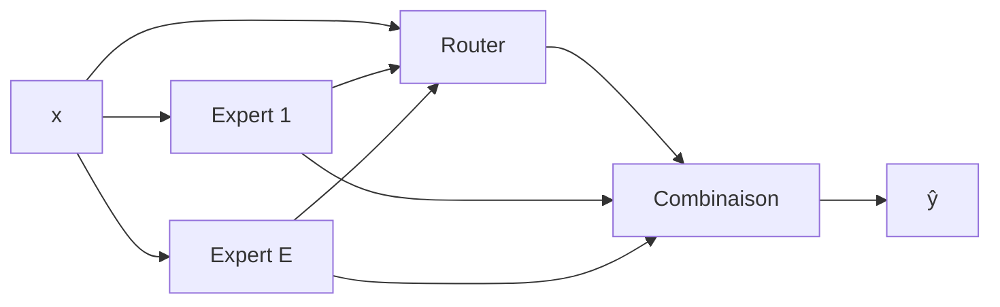

#ml-3

# Définition

Le **mélange d'experts** (Mixture of Experts, MoE) fait coopérer $E$ **experts**, de petits réseaux de neurones, au sein d'une même couche : un **routeur** attribue à chaque entrée un poids par expert, et une **combinaison** agrège les sorties des experts retenus en une prédiction $\hat{y}$.

C'est la forme routée de la [[Combinaison de modèles|combinaison de modèles]] : la décision y est un vecteur de poids sur les experts plutôt qu'un choix global.

# Modèle

L'entrée $\mathbf{x}$ alimente simultanément les $E$ experts et le routeur ; les sorties des experts et la décision du routeur convergent vers la combinaison qui produit $\hat{y}$.

Le routeur calcule une distribution de poids sur les experts :

$$\mathbf{g}(\mathbf{x}) = \operatorname{softmax}(W_r \mathbf{x}) \in \mathbb{R}^{E}$$

La combinaison ne retient que les $k$ experts de plus fort poids et somme leurs sorties pondérées :

$$\mathbf{y} = \sum_{e \in \operatorname{TopK}(\mathbf{g}(\mathbf{x}))} g_e(\mathbf{x}) \operatorname{FFN}_e(\mathbf{x})$$

où $\operatorname{FFN}_e$ désigne le [[Réseau feed-forward du Transformer|réseau feed-forward]] de l'expert $e$.

# Interprétation

Le principe est celui d'une porte de décision entre modèles spécialisés : un modèle traite une tâche précise, un autre la conversation générale, et la porte choisit lequel répond pour obtenir un échange naturel. Le mélange d'experts généralise ce principe à $E$ experts et à un routage effectué pour chaque token.

# Propriétés

Seuls $k$ experts sont calculés par token : le modèle dispose de nombreux paramètres pour un coût de calcul proche de celui d'un petit modèle.

Une perte additionnelle équilibre la charge entre les experts.

# Exemple

Dans les grands modèles de langage actuels, les couches feed-forward de l'[[Architecture du Transformer|architecture du Transformer]] deviennent des couches MoE :

- Switch Transformer (2021) : $k = 1$, un seul expert par token.
- Mixtral 8×7B : 8 experts et $k = 2$, soit 47 B de paramètres dont 13 B utilisés par token.
- DeepSeek-V3 (2024) : 671 B de paramètres dont 37 B utilisés par token.
