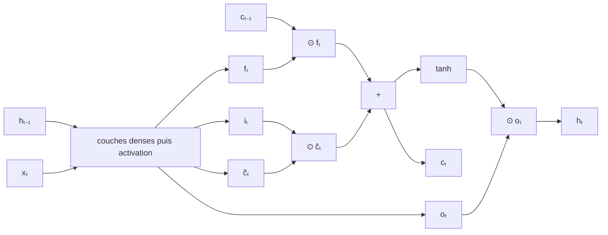

#ml-1

# Définition

La mémoire à long et court terme (LSTM) est une cellule récurrente à deux états, là où la [[Cellule d'Elman]] n'en a qu'un :

- $c_t$, la **cellule**, qui porte une mémoire à long terme ;
- $h_t$, l'état à court terme, celui que lit la couche de sortie.

L'état de cellule n'est pas réécrit à travers une tangente hyperbolique : il est mis à jour par une **addition**.

$$c_t = f_t \odot c_{t-1} + i_t \odot \tilde{c}_t$$

$\tilde{c}_t$ est le contenu nouveau, calculé comme dans une cellule d'Elman ; $f_t$ et $i_t$ sont des **portes** comprises entre 0 et 1, appliquées composante par composante (produit terme à terme $\odot$).

Quand $f_t$ est proche de 1 et $i_t$ proche de 0, $c$ est conservé tel quel, et son gradient aussi : la mémoire peut couvrir des centaines de pas.

# Propriétés

Le schéma de la cellule enchaîne le calcul des portes, l'écriture dans la mémoire, puis la lecture de la sortie.

Chaque porte et le contenu sont calculés par une couche dense appliquée à la concaténation de l'entrée et de l'état précédent, suivie d'une activation :

$$f_t = \sigma(W_f [x_t ; h_{t-1}] + b_f)$$

$$i_t = \sigma(W_i [x_t ; h_{t-1}] + b_i)$$

$$o_t = \sigma(W_o [x_t ; h_{t-1}] + b_o)$$

$$\tilde{c}_t = \tanh(W_c [x_t ; h_{t-1}] + b_c)$$

$$c_t = f_t \odot c_{t-1} + i_t \odot \tilde{c}_t$$

$$h_t = o_t \odot \tanh(c_t)$$

- $f_t$, $i_t$ et $o_t$ passent par une sigmoïde $\sigma$ ;
- $\tilde{c}_t$ passe par une tangente hyperbolique ;
- $c_t$ combine l'ancienne mémoire $c_{t-1}$ et le contenu nouveau $\tilde{c}_t$ par une addition pondérée ;
- $h_t$ est l'état de cellule filtré par la porte de sortie.

Trois portes, oubli, entrée et sortie : chacune est une régression logistique par composante, c'est-à-dire un [[Neurone artificiel|neurone]]. Quatre couches denses sur $[x_t ; h_{t-1}]$ : quatre fois les poids d'une cellule d'Elman.

# Interprétation

- La sigmoïde, à valeurs dans $(0, 1)$, est un **cadran** pour les portes $f_t$, $i_t$ et $o_t$.
- La tangente hyperbolique, à valeurs dans $(-1, 1)$, donne une valeur **signée** et bornée, pour le contenu $\tilde{c}_t$.
- $\tilde{c}_t$ indique *ce qui* pourrait être écrit ; $i_t$ *quelle quantité* en écrire ; $f_t$ *quelle part* de l'ancienne mémoire garder ; $o_t$ *quelle part* de la mémoire montrer dans $h_t$.

Une dimension de $c$ peut par exemple porter le nombre du sujet : $+1$ pour un singulier, $-1$ pour un pluriel.

- Un nouveau sujet : $f \approx 0$, $i \approx 1$, $\tilde{c} = \pm 1$ : effacer, puis écrire.
- Les mots entre les deux : $f \approx 1$, $i \approx 0$ : garder, et le gradient passe.
- Le verbe : $o \approx 1$ : montrer l'information, pour accorder le verbe.

# Remarque

L'addition qui met à jour $c$ est le même mécanisme que celui des [[Connexions résiduelles]] : elle réserve au gradient un chemin direct, au lieu de le faire traverser une tangente hyperbolique à chaque pas.

La cellule LSTM généralise la [[Cellule d'Elman]] : le contenu nouveau s'y calcule de la même façon, mais des portes dosent ce qui est écrit, conservé et montré, au prix de quatre couches denses au lieu d'une.

C'est cette mémoire additive qui fait tenir l'information sur des centaines de pas, là où le gradient d'une cellule d'Elman tend à [[Disparition et explosion du gradient|disparaître]].

Sa mise en œuvre dans PyTorch est décrite dans [[Couches récurrentes avec PyTorch]] ; l'[[Unité récurrente à portes]] en est une variante allégée, réduite à deux portes.
