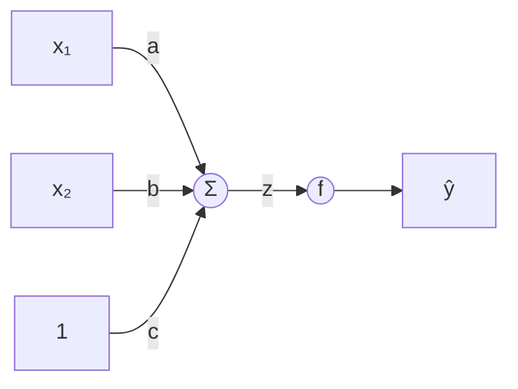

#ml-1

# Définition

Un neurone artificiel calcule une somme pondérée de ses entrées, y ajoute un biais, puis applique une fonction d'activation non linéaire au résultat.

Pour deux entrées $x_1$ et $x_2$, de poids respectifs $a$ et $b$, et un biais $c$,

$$z = a x_1 + b x_2 + c$$

$$\hat{y} = f(z)$$

où $f$ est une [[Fonctions d'activation|fonction d'activation]] non linéaire.

Le biais s'ajoute comme une entrée constante de valeur $1$, de poids $c$.

# Interprétation

Le neurone est l'unité de calcul élémentaire : les empiler en couches conduit au [[Perceptron multicouche]].

La [[Régression logistique]] est exactement un neurone à activation sigmoïde : la somme pondérée fournit le score $z$, que la sigmoïde transforme en probabilité.

Le même calcul sert de brique dans d'autres modèles : les portes d'oubli, d'entrée et de sortie d'une cellule [[Mémoire à long et court terme|LSTM]] sont chacune une régression logistique par composante, donc un neurone à activation sigmoïde.
