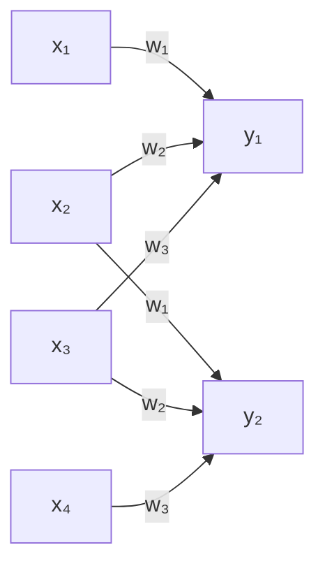

#ml-2

# Définition

Un noyau est le tableau des poids d'une convolution sur un seul canal d'entrée : $k$ nombres en une dimension, une grille $k_1 \times k_2$ en deux dimensions. Il est appliqué à chaque position de ce canal avec les mêmes valeurs, ce qui partage les poids entre toutes les positions.

$$y_i = \sum_{t=1}^{k} w_t \, x_{i+t-1}$$

# Propriétés

- Le noyau ne dépend pas de la position : la même suite de poids glisse sur tout le canal.
- La dilation espace ses poids : un noyau de $k$ éléments espacés de $d$ positions couvre $d(k-1)+1$ cellules d'entrée.
- Sur une entrée à plusieurs canaux, un noyau seul ne produit pas de sortie : il faut un noyau par canal d'entrée, réunis dans un [[Filtre de convolution]].
- Le noyau contient les poids, pas le biais, qui est porté par le filtre.

# Exemple

Noyau $w = (1, 2, 1)$ et entrée $x = (1, 4, 2, 1)$ :

- $y_1 = 1 \times 1 + 2 \times 4 + 1 \times 2 = 11$ ;
- $y_2 = 1 \times 4 + 2 \times 2 + 1 \times 1 = 9$.

Les deux positions emploient les mêmes trois poids, sur des fenêtres décalées d'un cran.

# Remarque

Quand l'entrée n'a qu'un seul canal, « noyau » et « filtre » désignent le même objet et sont employés l'un pour l'autre ; les deux notions ne se séparent qu'à partir de deux canaux d'entrée, où le filtre contient plusieurs noyaux. Le mot anglais est *kernel*, à ne pas confondre avec le noyau d'une application linéaire, qui est un sous-espace vectoriel : le contexte de la [[Couche de convolution]] lève l'ambiguïté.
