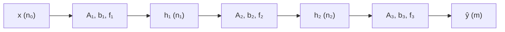

#ml-1

# Définition

Un réseau **feed-forward** est un [[Réseau de neurones|réseau de neurones]] dont le graphe de calcul est une chaîne de transformations :

$$x \longrightarrow f_1 \longrightarrow h_1 \longrightarrow f_2 \longrightarrow h_2 \longrightarrow \cdots \longrightarrow f_n \longrightarrow \hat{y}$$

L'information y circule dans un seul sens, sans boucle ; les graphes qui en comportent une relèvent du [[Réseau récurrent]]. Chaque $f_i$ est une **couche**, qui va de $\mathbb{R}^n$ dans $\mathbb{R}^m$. La sortie d'une couche est l'entrée de la suivante : les formes doivent s'enchaîner d'une couche à l'autre.

Un **perceptron multicouche** (MLP, de l'anglais *multi-layer perceptron*) est un empilement de telles couches, chacune avec ses propres paramètres et sa propre activation :

$$h_1 = f_1(xA_1^\top + b_1)$$

$$h_2 = f_2(h_1A_2^\top + b_2)$$

et ainsi de suite jusqu'à la sortie.

# Propriétés

Une couche compte $m$ neurones qui lisent la même entrée $x \in \mathbb{R}^n$. Le neurone $j$ calcule :

$$h_j = f(xa_j^\top + b_j)$$

En rangeant les $a_j$ comme les lignes d'une matrice $A$, les $m$ neurones se calculent d'un seul coup :

$$h = f(xA^\top + b)$$

où $A$ est de taille $m \times n$ et $b$ a $m$ valeurs. Une couche porte donc $(n+1) \times m$ paramètres : $m n$ poids et $m$ biais.

Avec $x$ vu comme une ligne de $n$ valeurs, $xA^\top$ est de taille $m$, et le biais s'ajoute composante par composante. Une couche n'est rien d'autre qu'un produit matriciel suivi de $f$.

Pour un MLP à deux couches cachées de tailles $n_1$ et $n_2$, et une couche de sortie de taille $m$, le nombre total de paramètres est :

$$(n_0+1)\,n_1 + (n_1+1)\,n_2 + (n_2+1)\,m$$

où $n_0$ est la taille de l'entrée. Chaque terme compte les poids et les biais d'une couche.

# Interprétation

Une couche agit sur ses entrées de trois façons possibles :

- **combiner** les entrées : opération linéaire, convolution, avec des paramètres appris ;
- **transformer** chaque entrée séparément : [[Fonctions d'activation|activation]], normalisation, le plus souvent sans paramètres ;
- **sélectionner ou écarter** des entrées : pooling, dropout, sans paramètres.

Le produit matriciel de la couche est la [[Forme matricielle de la régression|forme matricielle de la régression linéaire]] : les poids d'une régression deviennent les lignes de $A$, une ligne par composante de sortie, et l'activation remplace l'identité. C'est ce qui fait d'une couche une brique de réseau plutôt qu'un modèle isolé.

# Exemple

Un MLP à deux couches cachées et une couche de sortie enchaîne trois transformations affines, chacune suivie de son activation :

Le réseau du [[Problème du ou exclusif]] est plus petit : deux entrées, deux neurones cachés, une sortie. La formule des paramètres donne $(2+1) \times 2 + (2+1) \times 1 = 9$ paramètres, dont six poids et trois biais.

# Remarque

Deux conventions de disposition circulent pour la matrice des poids, et elles ne diffèrent que par une transposition.

- Celle retenue ici range les poids d'un neurone en ligne : $A$ est de taille $m \times n$ et la couche s'écrit $h = f(xA^\top + b)$.
- L'écriture alternative range ces poids en colonne : la matrice est de taille $n \times m$ et la couche s'écrit $h = f(xA + b)$.

Les deux décrivent exactement la même application ; seule la forme des tenseurs change, et elle doit être vérifiée avant le produit.

Les tailles $n_1, n_2$ des couches cachées et l'activation de chaque couche ne sont pas apprises : ce sont des [[Hyper-paramètres]], au même titre que le nombre de couches. Empiler des couches linéairement n'apporte d'ailleurs aucune puissance tant qu'aucune activation ne s'intercale, voir [[Composition de couches linéaires]].

Un perceptron multicouche apprend des transformations non linéaires des données. Il constitue de ce fait une alternative non linéaire aux méthodes de projection linéaire, l'[[Analyse en composantes principales|ACP]] et l'[[Analyse discriminante linéaire|LDA]], pour la réduction de dimension comme pour la classification.
