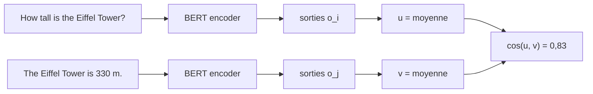

#ml-3

# Définition

SBERT associe à une phrase **un seul vecteur**, au lieu d'un vecteur par token. Ce vecteur est la **moyenne** des sorties $o_i$ de l'encodeur BERT sur les tokens de la phrase :

$$u = \frac{1}{n}\sum_{i=1}^{n} o_i$$

où $n$ est le nombre de tokens de la phrase et $o_i$ la sortie de l'encodeur pour le token $i$.

# Modèle

Les deux phrases à comparer passent par le **même encodeur BERT**, avec les mêmes poids, et chacune est réduite à un vecteur par moyenne de ses sorties. La proximité des phrases se lit alors dans la similarité cosinus des deux vecteurs :

$$\cos(u,v) = \frac{u^\top v}{\|u\|\,\|v\|}$$

L'encodeur est entraîné sur des **paires de phrases** : deux phrases de sens proche doivent produire des vecteurs proches.

# Interprétation

Le vecteur de phrase résume la phrase entière : deux formulations différentes d'un même contenu se retrouvent au même endroit de l'espace des vecteurs, et la similarité cosinus y est élevée.

La comparaison ne porte donc plus sur les tokens, mais sur les phrases prises comme des unités.

# Exemple

La question « How tall is the Eiffel Tower? » et la réponse « The Eiffel Tower is 330 m. » donnent $\cos(u,v) = 0{,}83$ : les deux phrases sont sémantiquement proches alors que leurs formulations diffèrent.

# Remarque

- Le modèle s'utilise **sans fine-tuning** : les vecteurs produits servent directement.
- Usages : recherche sémantique, RAG, clustering.
- SBERT est l'application d'un [[Réseaux siamois|réseau siamois]] à un encodeur [[BERT et le modèle de langage masqué|BERT]] : les deux branches partagent les poids.
