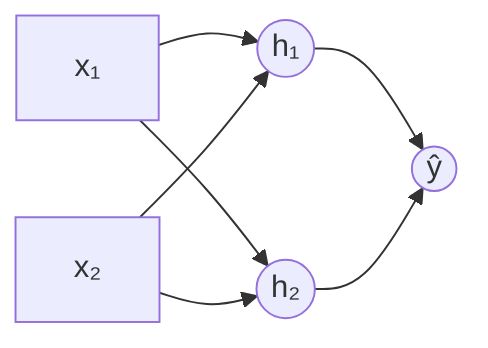

#ml-1

# Définition

Le problème du ou exclusif, noté XOR, est un problème de classification à deux entrées binaires : la classe vaut $1$ quand **exactement une** des deux entrées est active.

| $x_1$ | $x_2$ | classe |
| :---: | :---: | :---: |
| 0 | 0 | 0 |
| 0 | 1 | 1 |
| 1 | 0 | 1 |
| 1 | 1 | 0 |

Les quatre entrées possibles sont les quatre coins du carré unité : les deux points de la classe $1$, $(0,1)$ et $(1,0)$, occupent une diagonale, et les deux points de la classe $0$, $(0,0)$ et $(1,1)$, occupent l'autre.

# Exemple

Une [[Régression logistique]] de la forme

$$\hat{y} = \sigma(a x_1 + b x_2 + c)$$

est exactement un [[Neurone artificiel]]. Sa frontière de décision,

$$a x_1 + b x_2 + c = 0,$$

est une droite.

Aucune droite ne sépare les deux classes du ou exclusif : une seule droite ne peut pas laisser les deux points d'une diagonale d'un côté et les deux points de l'autre diagonale de l'autre côté.

Un neurone seul ne suffit donc pas. La solution consiste à empiler les neurones.

# Modèle

Deux neurones cachés tracent deux droites, chacune séparant le carré en deux.

- $h_1 = [x_1 + x_2 \geq 0.5]$ vaut $1$ dès qu'au moins une entrée est active : c'est un OU.
- $h_2 = [x_1 + x_2 \geq 1.5]$ vaut $1$ seulement quand les deux entrées sont actives : c'est un ET.

Un troisième neurone lit $h_1$ et $h_2$ et combine leurs réponses :

$$\hat{y} = [h_1 - h_2 \geq 0.5],$$

soit un OU dont on retire le cas où les deux entrées sont actives.

La notation $[\cdot]$ désigne l'échelon, c'est-à-dire une [[Fonctions d'activation|sigmoïde]] très raide.

| $x_1$ | $x_2$ | $h_1$ | $h_2$ | $\hat{y}$ |
| :---: | :---: | :---: | :---: | :---: |
| 0 | 0 | 0 | 0 | 0 |
| 0 | 1 | 1 | 0 | **1** |
| 1 | 0 | 1 | 0 | **1** |
| 1 | 1 | 1 | 1 | 0 |

Ce réseau est un [[Perceptron multicouche]] à une couche cachée de deux neurones, suivie d'un neurone de sortie.

# Interprétation

Les deux neurones cachés envoient chaque entrée $(x_1, x_2)$ sur un nouveau point $(h_1, h_2)$, dans l'espace caché :

- $(0,0)$ reste en $(0,0)$ ;
- $(1,1)$ reste en $(1,1)$ ;
- $(0,1)$ et $(1,0)$ arrivent tous les deux au même point $(1,0)$.

Les deux points de la classe $1$ se superposent, et une seule droite sépare alors les classes dans l'espace caché. Cette droite est le neurone de sortie.

Une couche cachée construit donc une représentation dans laquelle le problème devient simple. Ici les poids ont été posés à la main ; l'apprentissage trouve seul de tels poids.

# Remarque

Une démonstration sur $200$ points bruités autour des quatre coins du carré confirme ce comportement.

- La régression logistique bloque avec une perte de $0.693 = \ln 2$ : elle répond $0.5$ partout, l'entropie croisée d'un tirage à pile ou face.
- Deux couches linéaires sans activation donnent exactement le même résultat, voir [[Composition de couches linéaires]].
- Une couche cachée de deux neurones $\tanh$ résout le problème, et dans l'espace caché une droite sépare bien les classes.

Relancer avec d'autres graines, ou avec huit neurones cachés, change la facilité de l'apprentissage mais pas le principe.

Le ou exclusif est l'exemple minimal qui rend la non-linéarité obligatoire : sans elle, la couche cachée ne composerait que des applications linéaires, voir [[Fonctions d'activation]]. Il est aussi la raison d'être de l'empilement des neurones décrit dans le [[Perceptron multicouche]].
