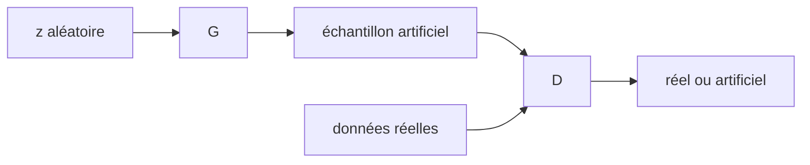

#ml-2

# Définition

Un **réseau antagoniste génératif** (GAN, pour *generative adversarial network*) est un [[Modèle génératif|modèle génératif]] formé de deux réseaux aux objectifs adverses, entraînés ensemble pour produire des données artificielles aussi fidèles que possible à des données réelles, des photographies par exemple.

- **Générateur** $G$ : produit un échantillon artificiel à partir d'un vecteur d'entrée aléatoire $\mathbf{z}$.
- **Discriminateur** $D$ : doit distinguer les données artificielles des données réelles, c'est un [[Classification binaire|classifieur binaire]] qui répond « réel » ou « artificiel ».

L'entraînement consiste en deux optimisations menées en parallèle :

- le discriminateur cherche à minimiser son erreur de classification ;
- le générateur cherche à maximiser l'erreur de classification du discriminateur.

# Modèle

Le discriminateur est une fonction $D(\mathbf{x}) \in [0,1]$ : la probabilité que $\mathbf{x}$ soit réel.

Le générateur est une fonction $G(\mathbf{z})$ : un échantillon généré à partir de $\mathbf{z} \sim \mathcal{N}(0,I)$.

Les deux réseaux jouent un jeu à deux joueurs de type minimax, formalisé par l'objectif :

$$\min_G \max_D \; \mathbb{E}_{\mathbf{x}\sim\mathrm{data}}\left[\log D(\mathbf{x})\right] + \mathbb{E}_{\mathbf{z}}\left[\log\left(1 - D(G(\mathbf{z}))\right)\right]$$

# Propriétés

Le même objectif se lit séparément pour chaque joueur.

- $D$ maximise : les données réelles doivent recevoir la probabilité $1$, les données générées la probabilité $0$. C'est une [[Entropie croisée binaire|entropie croisée binaire]].
- $G$ minimise : il veut $D(G(\mathbf{z})) \to 1$, c'est-à-dire que ses échantillons soient classés comme réels.

En pratique, $G$ maximise plutôt $\log D(G(\mathbf{z}))$ : les gradients sont plus forts au début, lorsque $D$ gagne facilement.

À l'équilibre, $D(\mathbf{x}) = \frac{1}{2}$ partout : le discriminateur ne distingue plus les deux sources, et les données générées suivent la distribution des données réelles.

# Interprétation

Le générateur est l'alternative adversariale au [[Décodeur génératif|décodeur génératif]] : au lieu d'apprendre une densité par une perte de reconstruction, il apprend en trompant un classifieur entraîné en même temps que lui.

Les deux objectifs portent sur la même quantité, l'un la maximise et l'autre la minimise : c'est un jeu à somme nulle, où le gain d'un joueur est exactement la perte de l'autre. L'équilibre visé est celui où le générateur a rendu le discriminateur incapable de trancher, et non celui où l'un des deux écrase l'autre.

# Exemple

Sur un jeu de portraits, le générateur produit une grille de visages synthétiques : les images ont la texture, l'éclairage et la variété de photographies réelles, alors qu'aucun des visages représentés n'existe. Le discriminateur a précisément servi à pousser le générateur jusque-là.

Sur des photographies variées, la planche produite par un générateur couvre des scènes et des objets divers, tous entièrement synthétiques, sans modèle ni disposition répétitive visible d'une image à l'autre.

# Remarque

L'objectif minimax n'est qu'une écriture théorique : la version réellement optimisée remplace la minimisation de $\log(1 - D(G(\mathbf{z})))$ par la maximisation de $\log D(G(\mathbf{z}))$, plus stable en début d'entraînement. L'[[Entraînement d'un réseau antagoniste génératif|entraînement]] détaille l'alternance des deux optimisations, et les [[Variantes de réseaux antagonistes génératifs|variantes]] en déclinent l'architecture.

Le [[Modèle de diffusion]] est l'alternative non adversariale à ce jeu : il engendre un échantillon par une longue suite d'étapes de débruitage, sans générateur ni discriminateur.
