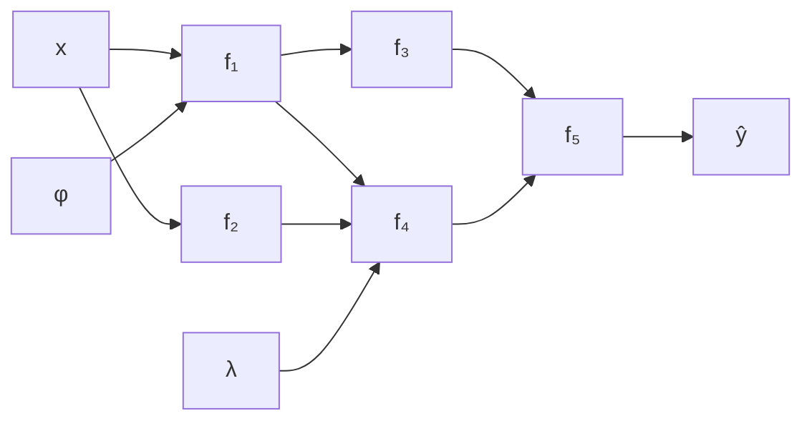

#ml-1

# Définition

Un réseau de neurones est un ensemble de transformations successives qui approxime au mieux la relation entre des variables issues d'observations.

# Interprétation

Les trois termes de la définition se lisent ainsi :

- les transformations successives donnent la **forme** de la fonction ;
- les **paramètres** de ces transformations sont optimisés pour que la fonction approche au mieux la relation ;
- les variables issues d'observations fournissent les **données d'entraînement**.

# Modèle

De façon générale, un réseau de neurones est un [[Graphe de calcul|graphe de calcul]] mêlant variables et paramètres.

- $x$ est la variable d'entrée et $\hat{y}$ la variable de sortie ;
- $f_1, \dots, f_5$ sont les transformations successives appliquées aux variables ;
- $\varphi$ et $\lambda$ sont des paramètres du graphe, au même titre que les variables dans les transformations qui les reçoivent.

# Remarque

Le [[Perceptron multicouche]] en est un cas particulier, où les transformations se succèdent sans cycle ; le [[Réseau récurrent]] en est la variante où le graphe comporte une boucle.
