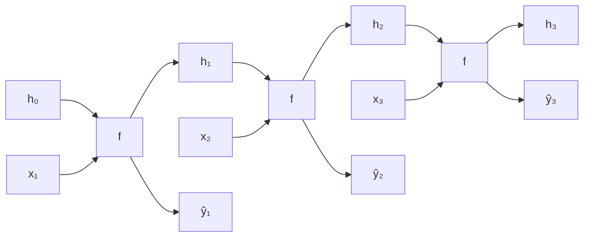

#ml-1

# Modèle

Un **réseau récurrent** (RNN) lit une [[Données séquentielles|séquence]] pas à pas en transportant une mémoire d'un pas au suivant. À chaque pas $t$ :

$$(\hat{y}_t, h_t) = f(x_t, h_{t-1})$$

- $x_t$ : l'entrée au pas $t$ ;
- $h_t$ : l'**état caché**, un résumé de $x_1, \dots, x_t$, qui part de $h_0 = 0$ ;
- $\hat{y}_t$ : la sortie prédite au pas $t$.

C'est la même fonction $f$, avec les mêmes poids, qui sert à chaque pas : les poids sont **partagés dans le temps**. Deux conséquences en découlent :

- une longueur quelconque : il suffit de boucler $T$ fois ;
- ce qui est appris à une position vaut à toutes les positions.

L'état caché $h_t$ représente le préfixe $x_1, \dots, x_t$ : c'est un [[Plongement]].

# Interprétation

Chaque $h_t$ mêle l'élément nouveau, par exemple un mot, à tout ce qui le précède, et les éléments les plus anciens s'estompent. La sortie $\hat{y}_t$ peut donc s'appuyer sur tout ce qui a été lu jusque-là, ce qui autorise deux usages :

- l'**étiquetage** : on conserve chaque $\hat{y}_t$, une étiquette par mot ;
- la **classification d'une question** : on ne conserve que $\hat{y}_5$.

Sur la question « What time is it ? », chaque $h_t$ intègre le mot lu au pas $t$ aux mots précédents, et seule la sortie du dernier pas sert à classer la question.

# Propriétés

Déplié sur $T$ pas, un réseau récurrent est un réseau à propagation avant de $T$ couches, dont toutes les couches partagent les mêmes poids $\theta = (\theta_u, \theta_o)$.

- L'entraînement se fait par rétropropagation sur le réseau déplié, appelée **rétropropagation dans le temps** (BPTT), voir [[Rétropropagation dans le temps]].
- Un poids utilisé à chaque pas reçoit la **somme** de ses gradients sur tous les pas.
- Le coût vient du séquencement : les $T$ pas s'exécutent l'un après l'autre, en avant puis en arrière, et chaque $h_t$ doit être conservé pour la passe arrière.

# Remarque

La [[Cellule d'Elman]] en est le cas le plus simple : une seule couche cachée récurrente. Déplié, le réseau n'est autre qu'un [[Perceptron multicouche]] de $T$ couches qui partagent leurs poids.

La [[Réseau de neurones récurrent|forme probabiliste]] du modèle en est la variante conditionnelle : elle résume tout l'historique dans un état caché $h_{i-1}$ pour conditionner la loi de l'état $X_i$ au pas suivant.
