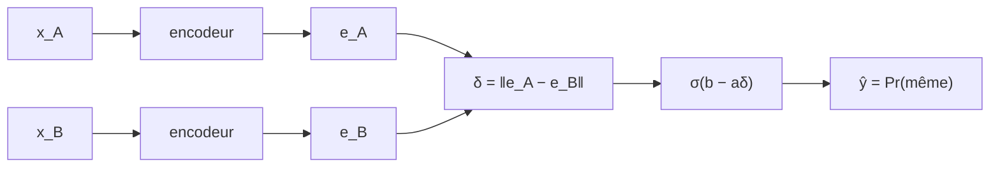

#ml-1

# Définition

Un **réseau siamois** répond à la question : deux entrées désignent-elles la même chose ? Même personne, même signature, même sens.

Il applique le **même encodeur, avec les mêmes poids**, aux deux entrées :

$$e_A = f(x_A)$$
$$e_B = f(x_B)$$

Les sorties $e_A$ et $e_B$ sont des [[Plongement|plongements]] des deux entrées. Leur distance mesure l'écart entre ces représentations :

$$\delta = \|e_A - e_B\|$$

Cette distance est passée à une sigmoïde, ce qui donne la probabilité que les deux entrées soient la même :

$$\hat{y} = \sigma(b - a\delta) = \Pr(\text{même})$$

# Interprétation

La sortie est une régression logistique appliquée à la distance : une paire proche reçoit une probabilité $\hat{y}$ proche de 1.

Le réseau ne classe donc pas chaque entrée séparément : il juge le **couple** formé par les deux entrées, et produit la probabilité qu'elles soient identiques.

Il s'entraîne sur des paires étiquetées, mêmes ($y = 1$) ou différentes ($y = 0$), avec l'[[Entropie croisée binaire|entropie croisée binaire]].

# Remarque

- Aucune liste de classes : le réseau fonctionne pour des personnes jamais vues à l'entraînement.
- Un classifieur, lui, aurait besoin d'une sortie par personne, et d'un réentraînement à chaque nouvel arrivant.
- Applications : vérification de visage ou de signature, détection de paraphrase.

La [[Vérification d'identité de locuteur ou de visage]] est l'application directe du principe : la décision porte sur l'identité d'une personne, pas sur une classe apprise parmi un ensemble fixé.
