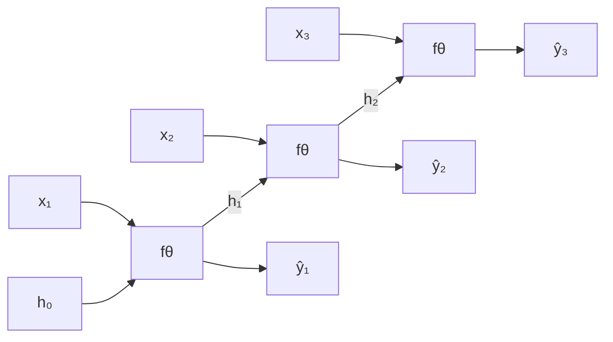
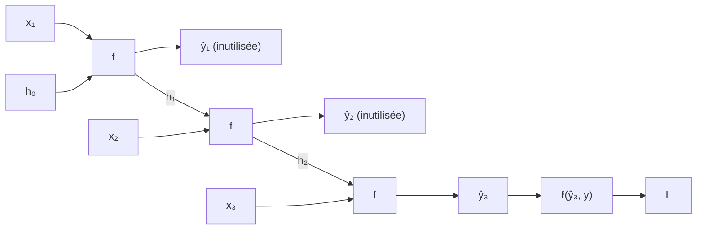
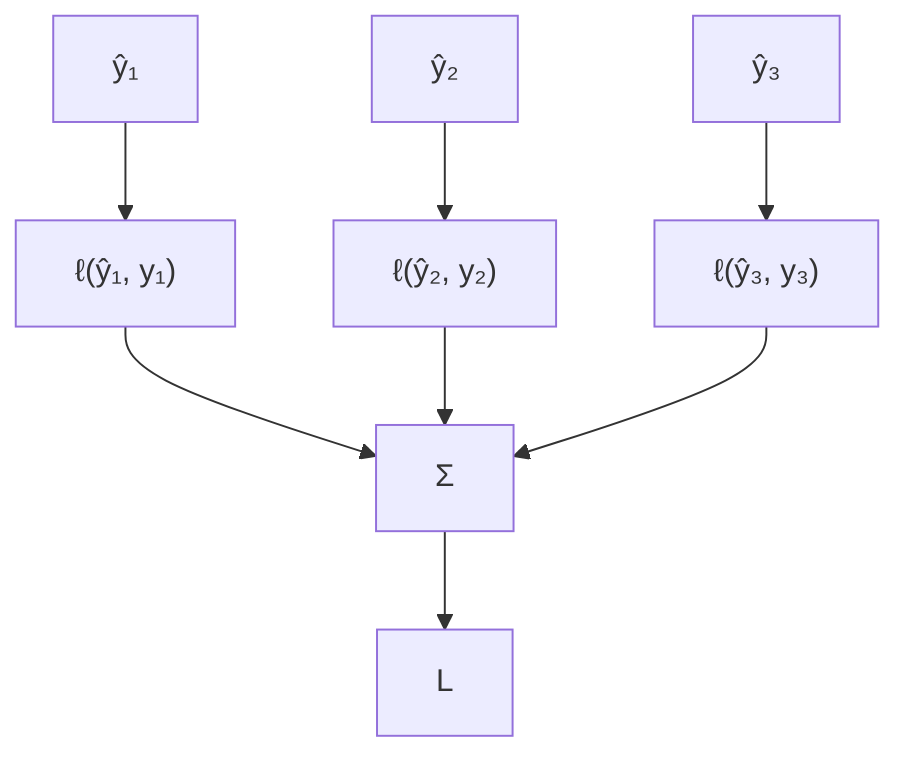

#ml-1

# Définition

Déplié sur $T$ pas, un [[Réseau récurrent]] est un réseau à propagation avant de $T$ couches, dont toutes les couches partagent les mêmes poids $\theta = (\theta_u, \theta_o)$. L'entraînement se fait par [[Rétropropagation]] sur ce réseau déplié : c'est la **rétropropagation dans le temps** (*backpropagation through time*, BPTT).

Le dépliage transforme la récurrence en une chaîne de couches identiques : la passe avant enchaîne les $T$ pas, la passe arrière remonte la chaîne.

# Propriétés

- Un poids utilisé à chaque pas reçoit la **somme** de ses gradients sur tous les pas :

$$\frac{\partial L}{\partial \theta} = \sum_{t=1}^{T} \left.\frac{\partial L}{\partial \theta}\right|_{t}$$

- Le coût vient du séquencement : les $T$ pas s'exécutent l'un après l'autre, en avant puis en arrière.
- Chaque $h_t$ doit être conservé pour la passe arrière.

# Algorithme

La forme de la perte dépend de la tâche, donc du nombre de sorties utilisées.

**Many-to-one.** Une seule perte, sur la dernière sortie :

$$L = \ell(\hat{y}_T, y)$$

- Le gradient remonte depuis $L$ à travers $h_{T-1}, h_{T-2}, \dots$, jusqu'au premier pas.
- Usage : prédire le mois suivant à partir des $W$ mois précédents.

**Many-to-many.** Une perte par pas, sommée ou moyennée :

$$L = \sum_t \ell(\hat{y}_t, y_t)$$

- Usage : étiquetage, ou prédiction de la lettre suivante à chaque position d'un nom.
- Une séquence très longue, un livre entier par exemple, impose la **BPTT tronquée** : ne rétropropager que sur les $K$ derniers pas, et transporter $h$ vers l'avant sans son gradient (`h.detach()`).

# Remarque

Le gradient d'un poids traverse tous les pas qui l'ont utilisé : plus la séquence est longue, plus la chaîne de multiplications est profonde, ce qui est le mécanisme de la [[Disparition et explosion du gradient]]. La BPTT tronquée coupe cette chaîne en abandonnant le gradient porté par $h$, au prix d'un gradient biaisé.

Chaque pas est une [[Cellule d'Elman]] : un pas isolé est un [[Perceptron multicouche]] à une couche cachée, dont la couche cachée est aussi transmise au pas suivant. Déplié, le modèle complet est donc un perceptron multicouche de $T$ couches qui partagent leurs poids.
