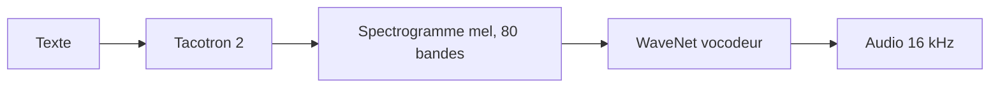

#ml-2

# Définition

Le **spectrogramme mel** est une représentation temps-fréquence d'un signal audio. Le signal est découpé en fenêtres courtes, le spectre de chaque fenêtre est calculé, les fréquences sont regroupées en **80 bandes mel**, et le logarithme de l'énergie de chaque bande est conservé.

Le découpage et le calcul des spectres constituent la **transformée de Fourier à court terme** (*STFT*) :

- fenêtres de $50$ ms, une nouvelle fenêtre tous les $12{,}5$ ms ;
- spectre calculé sur chaque fenêtre ;
- fréquences regroupées en $80$ bandes mel, plus fines aux basses fréquences, comme l'oreille ;
- logarithme de l'énergie, qui donne une « image » : le temps en abscisse, les $80$ bandes en ordonnée.

# Modèle

Le signal est une suite d'échantillons $x_1, \dots, x_T$ à la fréquence d'échantillonnage $f_s$, d'après sa description dans [[Audio numérique]]. Pour une fenêtre de $N$ échantillons commençant à l'instant $\tau$, le spectre vaut

$$X(k, \tau) = \sum_{n=0}^{N-1} x_{\tau+n}\, w_n\, e^{-2i\pi \frac{k n}{N}}$$

où $w_0, \dots, w_{N-1}$ est la fenêtre de pondération appliquée avant la transformée.

L'énergie d'une bande mel $b$ est ensuite sommée sur les fréquences de la bande, puis passée au logarithme :

$$S(\tau, b) = \log\left(\sum_{k \in B_b} |X(k,\tau)|^2\right)$$

où $B_b$ désigne l'ensemble des indices de fréquence appartenant à la bande $b$.

Le spectrogramme est la matrice des $S(\tau, b)$ : une colonne par trame, $80$ lignes, une ligne par bande.

L'échelle mel convertit une fréquence $f$ en une fréquence perçue $m$ par

$$m = 2595 \log_{10}\left(1 + \frac{f}{700}\right)$$

Les bandes sont régulières sur l'axe $m$, donc plus étroites en hertz aux basses fréquences : la résolution suit la perception auditive, fine dans les graves, grossière dans les aigus.

# Interprétation

Le logarithme de l'énergie et la répartition non uniforme des bandes font de la matrice une « image » : le temps en abscisse, la fréquence perçue en ordonnée, une intensité par case. Une trame suffit à résumer le contenu spectral des $50$ ms correspondantes.

Le spectrogramme mel sert de variable de conditionnement locale à un modèle audio. Une trame est produite tous les $12{,}5$ ms, soit tous les $200$ échantillons à $16$ kHz : le conditionnement $\mathbf{h}$ est donc **suréchantillonné d'un facteur $200$** pour être aligné sur le rythme des échantillons, comme détaillé dans [[Conditionnement de WaveNet]].

# Exemple

Sur un enregistrement de parole à $16$ kHz, la figure d'origine superpose deux vues :

- en haut, la forme d'onde : $16$ kHz, $82\,999$ échantillons ;
- en bas, le spectrogramme mel correspondant : $411$ trames $\times$ $80$ bandes, une trame tous les $200$ échantillons, axe des bandes gradué de $0$ à $80$, axe des temps de $0$ à $5$ s.

Le nombre de trames se retrouve par le calcul : avec une fenêtre de $50$ ms ($800$ échantillons à $16$ kHz) et un pas de $200$ échantillons, les $82\,999$ échantillons laissent place à $1 + \left\lfloor \frac{82\,999 - 800}{200} \right\rfloor = 411$ fenêtres.

# Remarque

La synthèse vocale enchaîne deux modèles distincts : le texte est converti en spectrogramme mel par [[Tacotron 2]], puis un modèle audio, WaveNet employé comme **vocodeur**, reconstitue la forme d'onde à partir de ce spectrogramme (voir [[Architecture WaveNet]]).

Le spectrogramme joue ainsi le rôle d'une représentation intermédiaire compacte : plusieurs centaines d'échantillons audio par trame sont remplacés par $80$ coefficients, ce qui allège la séquence à modéliser pour le modèle texte vers mel.
