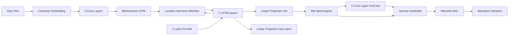

#ml-2

# Modèle

Tacotron 2 est une architecture de synthèse vocale de bout en bout qui décompose la production d'un signal audio en deux étages :

- un prédicteur de spectrogramme, réseau séquence à séquence qui transforme un texte en [[Spectrogramme mel]] ;
- un vocodeur, réseau génératif de type [[Architecture WaveNet|WaveNet]], qui transforme ce spectrogramme en échantillons de forme d'onde.

Le vocodeur est conditionné sur la mél-spectrogramme prédite : il ne reçoit jamais le texte, seulement la représentation temps-fréquence produite par le premier étage. La génération s'écrit donc comme une loi de la forme d'onde $\mathbf{y}$ conditionnée par le texte $\mathbf{x}$, transitant par une mél-spectrogramme intermédiaire $\mathbf{m}$ :

$$p(\mathbf{y} \mid \mathbf{x}) \approx p(\mathbf{y} \mid \hat{\mathbf{m}}), \qquad \hat{\mathbf{m}} = f(\mathbf{x})$$

où $f$ est le prédicteur séquence à séquence et $\hat{\mathbf{m}}$ l'estimation qu'il fournit au vocodeur.

# Algorithme

Le pipeline de synthèse enchaîne dix composants :

| Étape | Composant | Rôle |
|---|---|---|
| 1 | Input Text | Texte à synthétiser |
| 2 | Character Embedding | Conversion des caractères en vecteurs |
| 3 | 3 Conv Layers | Extraction de contexte local |
| 4 | Bidirectional LSTM | Encodage séquentiel bidirectionnel |
| 5 | 2 LSTM Layers | Décodage autorégressif |
| 6 | Location Sensitive Attention | Alignement texte et audio |
| 7 | Linear Projection | Prédiction de la mél-spectrogramme |
| 8 | Stop Token | Détection de fin de séquence |
| 9 | 5 Conv Layer Post-Net | Affinage de la mél-spectrogramme |
| 10 | WaveNet MoL | Génération de l'onde audio |

Le déroulé complet, du texte aux échantillons audio :

Le texte passe par un Character Embedding, puis 3 Conv Layers et un Bidirectional LSTM. Le décodeur est constitué de 2 LSTM Layers reliées à une Location Sensitive Attention. Une Linear Projection produit la mél-spectrogramme et le Stop Token. La mél-spectrogramme prédite est affinée par un 5 Conv Layer Post-Net, ajouté en résiduel. Le modèle WaveNet MoL convertit enfin la mél-spectrogramme en échantillons de forme d'onde.

# Interprétation

Les deux étages séparent deux problèmes de natures différentes. Le prédicteur travaille sur des séquences de symboles et produit une cible compacte : une trame de mél-spectrogramme résume plusieurs centaines d'échantillons audio, si bien que le modèle de texte n'a jamais à manipuler la forme d'onde brute. Le vocodeur travaille à l'échelle de l'échantillon et reconstruit le signal à partir de cette cible.

L'attention sensible à la localisation aligne le texte et l'audio : elle indique, à chaque pas de décodage, quelle portion du texte encoder est en cours de prononciation. Elle améliore ainsi l'alignement et la stabilité de la synthèse. Le Stop Token, prédit en parallèle de la mél-spectrogramme, signale la fin de la séquence et arrête le décodage autorégressif.

Le Post-Net ne remplace pas la sortie du décodeur : il la corrige, en ajoutant en résiduel un raffinement destiné aux artefacts spectraux, avant que la mél-spectrogramme ne soit transmise au vocodeur.

# Remarque

Tacotron 2 est une architecture complète de synthèse vocale, et non une simple variante conditionnée de WaveNet : WaveNet n'en occupe que le dernier étage. Le conditionnement décrit pour WaveNet, injection d'une variable de conditionnement dans chaque unité résiduelle, est le mécanisme par lequel le vocodeur consomme la mél-spectrogramme prédite, conformément au [[Conditionnement de WaveNet|conditionnement local]].

Le vocodeur WaveNet MoL génère directement les échantillons de forme d'onde à partir de la mél-spectrogramme prédite. Le signal audio y est quantifié en 256 classes, selon la [[Compression mu-law]].
