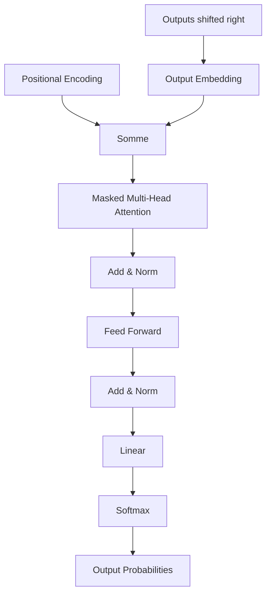

#ml-3

# Définition

Le Transformer décodeur seul est la variante du Transformer réduite à sa seule pile de décodage : ni encodeur, ni attention croisée. L'unique séquence traitée est la séquence cible elle-même, et son attention est masquée. C'est l'architecture présentée comme celle de tous les grands modèles de langage.

Deux traits suffisent à la résumer :

- l'entrée est la séquence cible, sans source extérieure à encoder
- l'attention est masquée, chaque position ne voyant que les positions qui la précèdent

# Modèle

## Pile de blocs

De bas en haut :

- `Outputs (shifted right)`, voir [[Teacher forcing]] et [[Génération d'une séquence]]
- `Output Embedding` : chaque jeton devient un vecteur, voir [[Couche de plongement]], auquel s'ajoute le `Positional Encoding`, voir [[Encodage positionnel]]
- `Masked Multi-Head Attention` : l'attention de la séquence sur elle-même, masquée pour interdire l'accès aux positions futures, voir [[Masque causal]]
- `Add & Norm` : connexion résiduelle puis normalisation
- `Feed Forward`, puis `Add & Norm`
- `Linear`, puis `Softmax`, puis `Output Probabilities` : une distribution de probabilité sur le vocabulaire

La pile est constituée de blocs identiques empilés, chacun contenant les deux sous-couches d'attention et feed-forward. Comparée au décodeur d'un [[Architecture du Transformer|encodeur-décodeur]], elle a perdu la sous-couche d'attention croisée, faute d'encodeur en amont, et ne reçoit plus en entrée que la séquence cible décalée.

## Circulation des tenseurs

Chaque sous-couche est contournée par une connexion résiduelle avant son `Add & Norm`. Le bloc compris entre les deux `Add & Norm` se répète à l'identique dans toute la profondeur du modèle.

# Interprétation

Retirer l'encodeur ne laisse qu'un seul flux : le modèle reçoit le début de la séquence et doit en produire la suite. Le masque rend cette opération causale, la prédiction à une position ne dépendant que des jetons déjà présents, ce qui autorise l'entraînement à prédire chaque position en une seule passe plutôt qu'en boucle explicite.

Le décalage de l'entrée d'un pas vers la droite aligne la prédiction sur le jeton suivant : à chaque position, la sortie visée est le jeton qui vient juste après celui lu. La tête `Linear` puis `Softmax` transforme alors la représentation courante en une distribution de probabilité sur le vocabulaire, dont on tire le jeton produit.

Cette variante porte le nom de GPT, aux côtés de l'encodeur seul et de l'encodeur-décodeur, voir [[Variantes du Transformer]].
