#ml-1

# Définition

Une tâche sur des séquences se caractérise par la forme de son entrée et celle de sa sortie : chacune est soit un élément isolé, soit une séquence d'éléments.

| Configuration | Entrée | Sortie |
| --- | --- | --- |
| one to one | un élément | un élément |
| one to many | un élément | une séquence |
| many to one | une séquence | un élément |
| many to many | une séquence | une séquence, de longueur différente de celle de l'entrée et sans alignement position par position |
| many to many | une séquence | une séquence, un élément de sortie par élément d'entrée |

# Exemple

- one to one : une image et sa classe ;
- one to many : une image et sa légende ;
- many to one : un avis et son opinion, ou $W$ mois et le mois suivant ;
- many to many : une phrase et sa traduction ;
- many to many : l'étiquetage, une étiquette par mot.

# Interprétation

Sur les schémas de ces tâches, les entrées sont en rouge, les sorties en bleu, et en vert la mémoire du réseau, transmise d'un pas à l'autre.

```mermaid
flowchart LR
    subgraph cinq["many to many : synchronisée"]
        e1["x₁"] --> e2["f₁"]
        e2 --> e3["ŷ₁"]
        e4["x₂"] --> e5["f₂"]
        e5 --> e6["ŷ₂"]
        e7["x₃"] --> e8["f₃"]
        e8 --> e9["ŷ₃"]
        e2 --> e5
        e5 --> e8
    end
    subgraph quatre["many to many : séquence à séquence"]
        d1["x₁"] --> d2["f₁"]
        d3["x₂"] --> d4["f₂"]
        d5["x₃"] --> d6["f₃"]
        d2 --> d4
        d4 --> d6
        d6 --> d7["g₁"]
        d7 --> d8["ŷ₁"]
        d7 --> d9["g₂"]
        d9 --> d10["ŷ₂"]
    end
    subgraph trois["many to one"]
        c1["x₁"] --> c2["f₁"]
        c3["x₂"] --> c4["f₂"]
        c5["x₃"] --> c6["f₃"]
        c2 --> c4
        c4 --> c6
        c6 --> c7["ŷ"]
    end
    subgraph deux["one to many"]
        b1["x"] --> b2["f₁"]
        b2 --> b3["ŷ₁"]
        b2 --> b4["f₂"]
        b4 --> b5["ŷ₂"]
        b4 --> b6["f₃"]
        b6 --> b7["ŷ₃"]
    end
    subgraph un["one to one"]
        a1["x"] --> a2["f"] --> a3["ŷ"]
    end
    classDef entree fill:#f8d7da,stroke:#b02a37,color:#000
    classDef sortie fill:#dbe5ff,stroke:#2b4c9b,color:#000
    classDef memoire fill:#d8f5d8,stroke:#1e7b34,color:#000
    class a1,b1,c1,c3,c5,d1,d3,d5,e1,e4,e7 entree
    class a3,b3,b5,b7,c7,d8,d10,e3,e6,e9 sortie
    class a2,b2,b4,b6,c2,c4,c6,d2,d4,d6,d7,d9,e2,e5,e8 memoire
```

Le module de calcul se répète à chaque pas de temps, et c'est la mémoire verte qui transporte l'information d'un pas au suivant : c'est le principe du [[Réseau récurrent]].

La source donne le même nom, many to many, aux deux dernières colonnes : elles ne se distinguent que par leur exemple et par leur schéma. Pour la traduction, la sortie n'a pas la longueur de l'entrée et aucun élément de sortie ne correspond à une position donnée de l'entrée (sur le schéma, trois entrées pour deux sorties) ; pour l'étiquetage, chaque élément de l'entrée reçoit son élément de sortie, ce qui fait qualifier cette variante de synchronisée.

# Remarque

- Un réseau feed-forward ne réalise que la première configuration, one to one.
