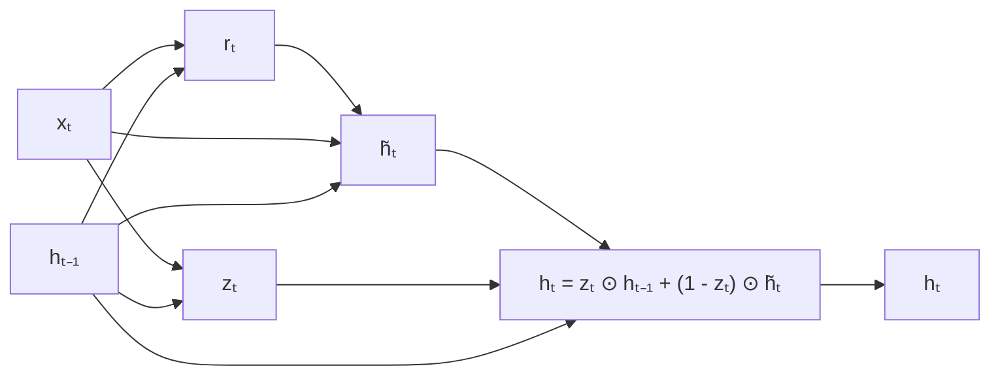

#ml-1

# Modèle

L'unité récurrente à portes (GRU, *gated recurrent unit*) est une cellule récurrente légère : un seul état $h_t$, deux portes sigmoïdes et trois couches denses. À chaque pas de temps, l'entrée $x_t$ et l'état précédent $h_{t-1}$ produisent d'abord les deux portes

$$r_t = \sigma(W_r [x_t ; h_{t-1}] + b_r)$$

$$z_t = \sigma(W_z [x_t ; h_{t-1}] + b_z)$$

puis le candidat et le nouvel état

$$\tilde{h}_t = \tanh(W_h [x_t ; r_t \odot h_{t-1}] + b_h)$$

$$h_t = z_t \odot h_{t-1} + (1 - z_t) \odot \tilde{h}_t$$

où $\sigma$ est la sigmoïde et $\tanh$ la tangente hyperbolique (voir [[Fonctions d'activation]]), $[x_t ; h_{t-1}]$ la concaténation des deux vecteurs d'entrée, $\odot$ le produit terme à terme, et $W_r, W_z, W_h$ les matrices de poids avec $b_r, b_z, b_h$ les biais associés.

Les deux portes $r_t$ et $z_t$ ont la même taille que l'état $h_{t-1}$ : chacune de leurs composantes est dans $(0, 1)$.

# Interprétation

La porte $z_t$ est un interrupteur doux, dimension par dimension : elle conserve l'état précédent $h_{t-1}$ quand $z_t \approx 1$ (et son gradient passe alors), ou prend le candidat $\tilde{h}_t$ quand $z_t \approx 0$.

La porte $r_t$ indique quelle part de $h_{t-1}$ le candidat $\tilde{h}_t$ regarde pour se construire.

Le candidat $\tilde{h}_t$ est le contenu que la cellule pourrait écrire au pas $t$, et $1 - z_t$ dose la quantité qu'elle en écrit.

# Exemple

Le schéma de la cellule fait passer l'état par le candidat, filtré par les deux portes.

L'état $h_{t-1}$ suit deux chemins : la ligne directe vers la sortie $h_t$, pondérée par $z_t$, et le passage par le candidat $\tilde{h}_t$, pondéré par $1 - z_t$.

# Remarque

L'unité récurrente à portes est une variante allégée de la [[Mémoire à long et court terme]] : un seul état au lieu de deux, deux portes au lieu de trois, trois couches denses au lieu de quatre, pour une qualité souvent comparable.

En pratique, on part d'une cellule à portes, GRU ou LSTM, plutôt que de la [[Cellule d'Elman]], plus simple mais sans contrôle de ce qui est conservé ou écrit.

L'implémentation de cette cellule est décrite dans [[Couches récurrentes avec PyTorch]].
