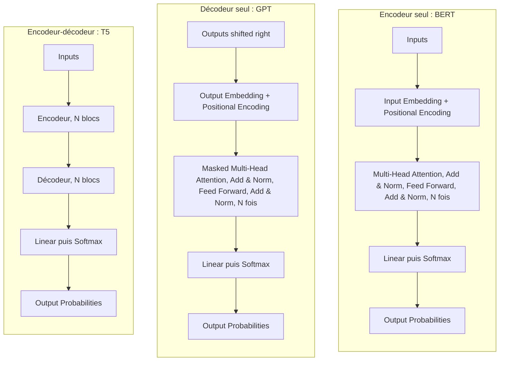

#ml-3

# Définition

Le Transformer ne désigne pas une architecture unique : l'[[Architecture du Transformer|architecture encodeur-décodeur]] n'est que l'une des trois familles de modèles rangées sous ce nom, qui se distinguent par la pile de blocs qu'elles conservent.

- **encodeur seul** : la seule pile d'encodage, sans décodeur, que l'on regroupe sous le nom de BERT
- **décodeur seul** : la seule pile de décodage, sans encodeur, que l'on regroupe sous le nom de GPT
- **encodeur-décodeur** : les deux piles enchaînées, dont T5 et BART sont les exemples usuels

Les trois partagent la même tête de sortie : une couche linéaire, un softmax, puis une distribution de probabilités sur le vocabulaire. Ce qui change est la façon dont l'attention circule dans la séquence, et donc ce que le modèle peut voir du futur.

# Modèle

## Encodeur-décodeur

- l'encodeur occupe la partie gauche, le décodeur la partie droite
- `Inputs`, puis `Input Embedding` additionné au `Positional Encoding`
- $N$ blocs d'encodeur : `Multi-Head Attention`, `Add & Norm`, `Feed Forward`, `Add & Norm`
- `Outputs (shifted right)`, puis `Output Embedding` additionné au `Positional Encoding`
- $N$ blocs de décodeur : `Masked Multi-Head Attention`, `Add & Norm`, `Multi-Head Attention` croisée, `Add & Norm`, `Feed Forward`, `Add & Norm`
- `Linear`, `Softmax`, `Output Probabilities`

Chaque sous-couche est entourée d'une connexion résiduelle suivie d'une normalisation, voir [[Connexions résiduelles]]. L'attention croisée du décodeur reçoit la sortie de l'encodeur comme clés et valeurs, détail repris dans [[Architecture du Transformer]]. Le masquage de la première attention du décodeur empêche d'accéder aux positions futures, voir [[Masque causal]].

## Encodeur seul

La pile d'encodage est conservée telle quelle, sans décodeur ni attention croisée.

- `Inputs`, puis `Input Embedding` additionné au `Positional Encoding`
- $N$ blocs de `Multi-Head Attention`, `Add & Norm`, `Feed Forward`, `Add & Norm`
- `Linear`, `Softmax`, `Output Probabilities`

## Décodeur seul

La pile de décodage est conservée seule : son attention croisée disparaît, faute d'encodeur en amont.

- `Outputs (shifted right)`, puis `Output Embedding` additionné au `Positional Encoding`
- $N$ blocs de `Masked Multi-Head Attention`, `Add & Norm`, `Feed Forward`, `Add & Norm`
- même tête `Linear`, `Softmax`, `Output Probabilities`

## Les trois piles

# Propriétés

## Causalité et caractère autorégressif

Un modèle est causal lorsque sa sortie à une position ne dépend que des positions antérieures, et autorégressif lorsqu'il produit la séquence un jeton après l'autre en se nourrissant de ses propres sorties. Ces deux qualités ne valent pas pour toutes les variantes.

| Variante | Causal | Autorégressif | Vue sur la séquence |
|---|---|---|---|
| encodeur seul (BERT) | non | non | chaque jeton voit toute la séquence, à gauche comme à droite |
| décodeur seul (GPT) | oui | oui | chaque jeton ne voit que les précédents |
| encodeur-décodeur (T5, BART) | décodeur seulement | décodeur seulement | l'encodeur lit toute l'entrée, le décodeur progresse vers la droite |

## Le masque d'attention

La différence entre encodeur seul et décodeur seul tient à un seul objet : le masque appliqué aux scores d'attention.

| | Encodeur seul | Décodeur seul |
|---|---|---|
| Masque | absent | présent, triangulaire |
| Visibilité | chaque jeton voit toute la séquence, gauche et droite | chaque jeton ne voit que les précédents |
| Effet | représentation bidirectionnelle | représentation causale |

L'attention masquée s'écrit avec les mêmes projections que l'attention ordinaire, auxquelles s'ajoute la matrice de masque :

$$V' = \operatorname{softmax}\left(\frac{QK^\top}{\sqrt{d_k}} + M\right) V$$

avec $Q = T W_Q$, $K = T W_K$ et $V = T W_V$.

- $T$ : la même séquence sert à construire les trois matrices
- $d_k$ : dimension d'une tête d'attention
- $M$ : masque valant $0$ aux positions autorisées et $-\infty$ aux positions futures

# Interprétation

Parler d'encodeur-décodeur suppose donc l'existence des deux autres variantes : retirer une pile et conserver la tête de sortie suffit à passer de l'une à l'autre. Le choix se lit sur la tâche visée.

- encoder une séquence complète pour la représenter, c'est le rôle de l'encodeur seul, voir [[BERT et le modèle de langage masqué]]
- produire une séquence jeton après jeton, c'est le rôle du décodeur seul, voir [[Transformer décodeur seul]]
- transformer une séquence en une autre, c'est le rôle de l'encodeur-décodeur, voir [[T5 et l'apprentissage multi-tâche]]

Les grands modèles de langage actuels relèvent tous du décodeur seul. Le masque y joue un rôle central : il rend le modèle causal tout en lui permettant de prédire une séquence entière en une seule passe, au lieu d'une boucle explicite sur les positions.

# Remarque

Le schéma de l'encodeur-décodeur ajoute un encodage positionnel absolu aux plongements d'entrée et de sortie ; T5, cité comme exemple de cette architecture, recourt pour sa part à des encodages positionnels relatifs.
