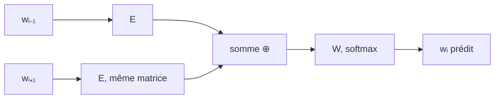
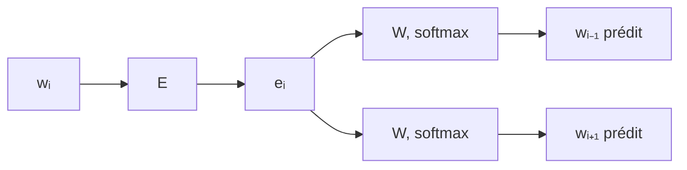

#ml-1

# Définition

**word2vec** regroupe deux tâches d'apprentissage de plongements de mots, qui exploitent toutes deux le contexte d'un mot :

- **CBOW** : prédire un mot $w_i$ à partir de ses voisins ;
- **skip-gram** : prédire les voisins à partir du mot $w_i$.

Chaque tâche est traitée comme une classification : une classe par mot du vocabulaire.

# Modèle

Le mot d'entrée est encodé par un vecteur [[Encodage des valeurs symboliques|one-hot]], puis multiplié par une matrice $E$, sans biais ni activation :

$$e_i = x_i^\top E$$

où $x_i$ est le vecteur one-hot de $w_i$. Le produit sélectionne une ligne de $E$, et les lignes de $E$ sont les plongements des mots du vocabulaire.

La sortie est une couche $W$ qui contient un vecteur par mot du vocabulaire, suivie d'un [[Fonction softmax|softmax]] et d'une [[Entropie croisée multi-classe|entropie croisée]] : le mot prédit est celui dont le score est le plus élevé.

Dans CBOW, la même matrice $E$ sert pour tous les voisins, et leurs plongements sont additionnés en un vecteur unique avant la couche de sortie :

$$e = e_{i-1} + e_{i+1}$$

Dans skip-gram, le plongement du mot central alimente une sortie par position de voisin :

La fenêtre de contexte vaut ici un mot de chaque côté ; en pratique, elle couvre quelques mots.

# Interprétation

Le plongement $e_i$ d'un mot compte quelques centaines de dimensions. Pour l'observer, on le projette en deux dimensions : les mots d'un même thème se rassemblent alors en régions voisines, les termes de mathématiques d'un côté, ceux des affaires de l'autre.

Ce regroupement par thème est le comportement attendu sous l'[[Hypothèse distributionnelle]] : des mots employés dans des contextes semblables reçoivent des plongements proches.

# Exemple

Sur une projection en deux dimensions d'un vocabulaire mélangeant plusieurs domaines :

- un groupe de termes mathématiques : *entropy*, *factorization*, *eigenvalues*, *markov* ;
- un groupe de termes d'affaires : *customers*, *investors*, *marketing*, *advertising*.

Les deux groupes occupent des régions distinctes du plan.

# Remarque

La couche d'entrée est une [[Couche de plongement]] : une couche linéaire appliquée à un encodage one-hot, dont la matrice de poids est précisément $E$.

Les directions de l'espace des plongements portent aussi du sens : voir [[Analogies dans l'espace des plongements]].
