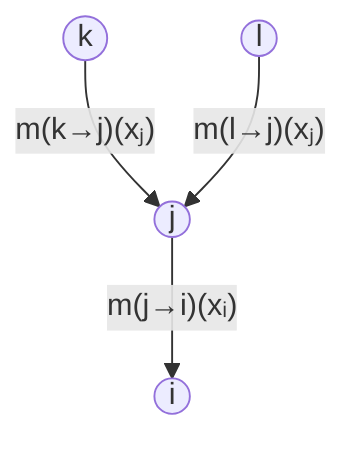
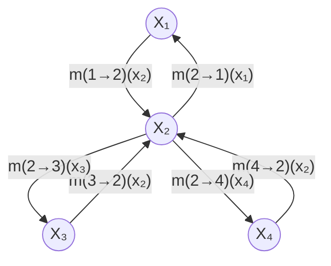

# Algorithme

Le principe de passage de messages illustré sur une chaîne se généralise directement aux arbres, c'est-à-dire aux graphes où chaque nœud possède un seul parent : c'est l'algorithme *somme-produit* (sum-product). Le [[Passage de messages sur une chaîne]] en est le cas particulier où l'arbre est une chaîne.

L'absence de cycle permet de traiter chaque arête une seule fois dans chaque sens, en quatre étapes :

1. enraciner l'arbre en un nœud racine ;
2. faire remonter les messages des feuilles vers la racine ;
3. faire redescendre les messages de la racine vers les feuilles ;
4. calculer en chaque nœud la marge par produit des messages reçus.

Un message $m_{ji}(x_i)$ est envoyé par le nœud $j$ à un voisin $i$ : il est indexé par la source $j$ puis par le destinataire $i$, et prend pour argument les valeurs de la variable du destinataire. Son calcul agrège le facteur $f_{ji}$ porté par l'arête entre $j$ et $i$ et tous les messages déjà reçus des autres voisins, la somme portant sur la variable $x_j$ du nœud émetteur :

$$m_{ji}(x_i) = \sum_{x_j} f_{ji}(x_j, x_i) \prod_{k \in \mathcal{N}(j) \setminus \{i\}} m_{kj}(x_j)$$

Une feuille $k$ n'a pas d'autre voisin que son parent $j$ : le produit est vide et son message se réduit à la somme du facteur de l'arête sur sa propre variable.

$$m_{kj}(x_j) = \sum_{x_k} f_{kj}(x_k, x_j)$$

La remontée terminée, la racine dispose d'un message de chacun de ses voisins. La descente répète la même récurrence en parcourant chaque arête dans le sens inverse, si bien qu'à la fin chaque nœud a reçu un message de chacun de ses voisins. La marge de $x_i$ est alors proportionnelle au produit de ces messages :

$$\mathbb{P}[x_i] \propto \prod_{k \in \mathcal{N}(i)} m_{ki}(x_i)$$

Les marges de toutes les variables s'obtiennent ainsi avec deux parcours de l'arbre, là où l'[[Élimination de variables]] doit être reprise pour chaque variable dont on veut la marge.

# Exemple

Un arbre orienté vers la racine $i$ : les feuilles $k$ et $l$ envoient leur message à leur parent $j$, qui envoie à son tour le sien à $i$.

Le message de $j$ vers $i$ vaut alors :

$$m_{ji}(x_i) = \sum_{x_j} f_{ji}(x_j, x_i) \, m_{kj}(x_j) \, m_{lj}(x_j)$$

Sur un arbre en étoile autour de $X_2$, les deux passes parcourent chaque branche dans les deux sens.

En prenant $X_1$ pour racine, la remontée fait circuler $m_{32}(x_2)$ et $m_{42}(x_2)$ vers $X_2$, puis $m_{21}(x_1)$ vers $X_1$ ; la descente renvoie $m_{12}(x_2)$ vers $X_2$, puis $m_{23}(x_3)$ vers $X_3$ et $m_{24}(x_4)$ vers $X_4$. La marge du nœud central s'écrit avec les trois messages qu'il a reçus :

$$\mathbb{P}[x_2] \propto m_{12}(x_2) \, m_{32}(x_2) \, m_{42}(x_2)$$

# Remarque

Un message se note $m_{ji}(x_i)$ : le premier indice $j$ désigne le nœud émetteur, le second $i$ le nœud destinataire, et l'argument est la variable du destinataire. Noter $m_{12}(x_1)$ un message remontant de $X_2$ vers $X_1$ inverse ces deux rôles et le rend indistinguable du message descendant $m_{12}(x_2)$ allant de $X_1$ vers $X_2$ ; la convention retenue ici est donc émetteur puis destinataire, seul moyen de distinguer les deux sens de parcours d'une même arête.

Le principe somme-produit admet plusieurs variantes.

Remplacer la somme par un maximum dans chaque message donne la variante *max-produit*, qui ne calcule plus une marge mais la configuration la plus probable de l'ensemble des variables :

$$m_{ji}^{\max}(x_i) = \max_{x_j} f_{ji}(x_j, x_i) \prod_{k \in \mathcal{N}(j) \setminus \{i\}} m_{kj}^{\max}(x_j)$$

Une autre variante consiste à exploiter le graphe de facteurs biparti décrit dans le [[Graphe de facteurs]] plutôt qu'un arbre de variables : les messages circulent alors entre sommets variables et sommets facteurs, chaque facteur n'échangeant de message qu'avec les variables dont il dépend.

Pour un graphe qui n'est pas un arbre, le passage se fait sur un [[Arbre de jonction]] de ce graphe, comme le détaille l'[[Inférence par arbre de jonction]].

L'algorithme est une méthode d'[[Inférence dans un modèle graphique|inférence]] exacte : il fournit les marges de toutes les variables, et non une approximation.
