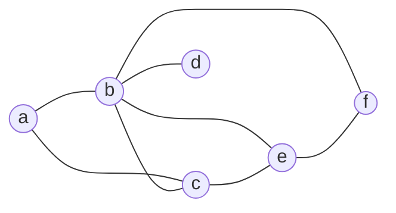
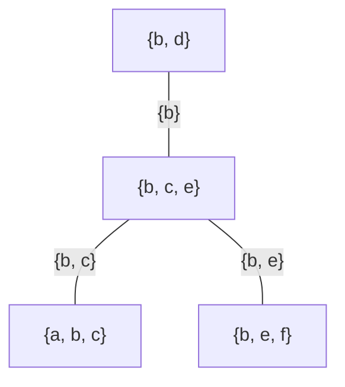

# Définition

Un **arbre de jonction** $\mathcal{T}$ d'un graphe $\mathcal{G}$ est un arbre dont les nœuds sont des clusters de nœuds de $\mathcal{G}$, associés aux cliques de $\mathcal{G}$, et qui vérifie les propriétés suivantes :

- il n'existe qu'un seul chemin entre chaque paire de clusters (c'est un arbre) ;
- chaque clique de $\mathcal{G}$ est incluse dans un cluster ;
- pour chaque paire de clusters $A$ et $B$ contenant un nœud $i$, chaque cluster du chemin (unique) entre $A$ et $B$ contient $i$.

# Exemple

Le graphe $\mathcal{G}$ a pour cliques maximales $\{a,b,c\}$, $\{b,c,e\}$, $\{b,e,f\}$ et $\{b,d\}$.

L'arbre de jonction $\mathcal{T}$ associe un cluster à chacune de ces cliques. Le rectangle porté par chaque arête est l'intersection des deux clusters qu'elle relie, leur séparateur.

Le nœud $b$ appartient aux quatre clusters : il figure donc dans chaque cluster du chemin entre deux clusters quelconques, ce qui satisfait la troisième condition. Le nœud $c$ n'apparaît que dans $\{a,b,c\}$ et $\{b,c,e\}$, séparés par $\{b,c\}$ ; le nœud $e$ que dans $\{b,c,e\}$ et $\{b,e,f\}$, séparés par $\{b,e\}$.

# Remarque

Un cluster peut être plus grand qu'une clique : la condition est l'inclusion de chaque clique dans un cluster, pas l'égalité. Les cliques d'un graphe non dirigé sont définies avec les [[Graphes dirigés et graphes non dirigés|graphes non dirigés]].

Sur un graphe orienté, il faut d'abord le transformer en graphe non dirigé, par [[Moralisation d'un graphe orienté]].

La construction effective d'un arbre de jonction est décrite dans [[Construction d'un arbre de jonction]] ; l'arbre sert ensuite de support à l'inférence, développée dans [[Inférence par arbre de jonction]] par passage de messages de type [[Algorithme somme-produit|somme-produit]].
