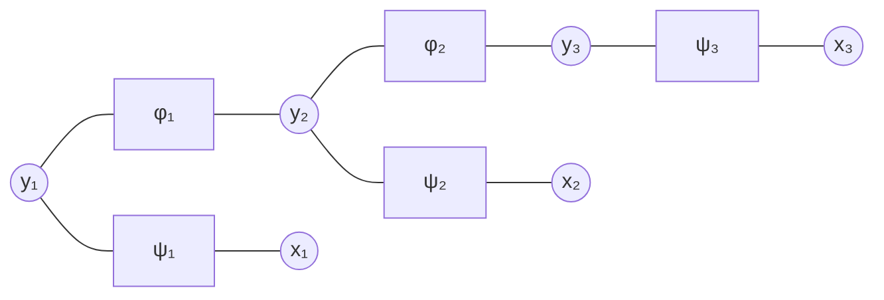
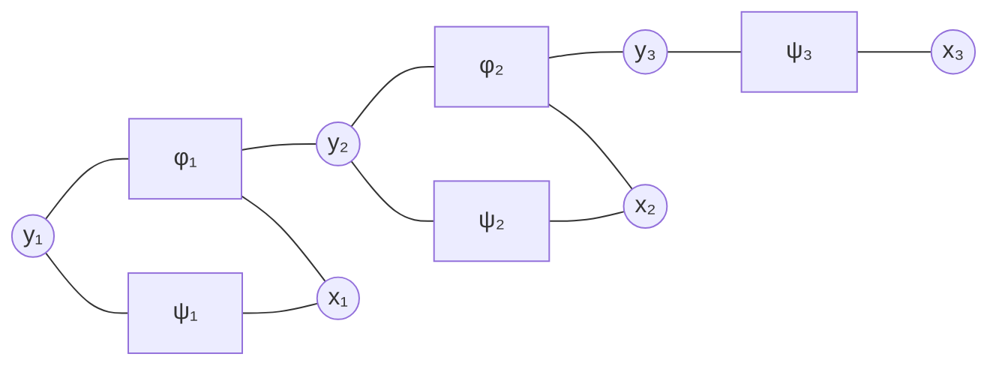

# Modèle

Un **champ aléatoire conditionnel à chaîne linéaire** modélise directement la loi conditionnelle d'une suite d'étiquettes sachant une suite d'observations :

- $X = (x_1, \dots, x_n)$ est une suite de $n$ observations multivariées, chaque $x_s$ regroupant les variables observées à la position $s$ ;
- $Y = (y_1, \dots, y_n)$ est la suite des $n$ étiquettes correspondantes, chaque $y_s$ prenant ses valeurs dans un ensemble fini d'étiquettes.

La probabilité a posteriori du modèle est la [[Distribution de Gibbs|distribution de Gibbs]] donnée par

$$
\mathbb{P}[Y \mid X] = \frac{1}{Z(x, \Lambda)} \exp\left( \sum_{i=1}^{m} \lambda_i f_i(x, y) \right)
$$

où $x$ et $y$ désignent des réalisations des suites $X$ et $Y$. Pour tout $i \in \{1, \dots, m\}$, la fonction de traits $f_i$ se décompose sur les positions :

$$
f_i(x, y) = \sum_{s=1}^{n} f_i(y_{s-1}, y_s, x, s)
$$

Chaque terme de cette somme ne voit que l'étiquette courante $y_s$, l'étiquette précédente $y_{s-1}$ et les observations : la contribution d'une position est locale. Le premier terme fait intervenir une étiquette de bord $y_0$ fixée avant la séquence.

La fonction de partition est donnée par

$$
Z(x, \Lambda) = \sum_{y} \exp\left( \sum_{i=1}^{m} \lambda_i f_i(x, y) \right)
$$

Les paramètres du modèle sont $\Lambda = \{\lambda_1, \dots, \lambda_m\}$.

# Interprétation

Le membre de droite est une distribution de Gibbs sur les suites d'étiquettes, à observations fixées : l'énergie est remplacée par le score $\sum_{i=1}^{m} \lambda_i f_i(x, y)$, que le modèle favorise en le portant à l'exponentielle, chaque [[Fonctions de traits pour les séquences|fonction de traits]] étant pondérée par son paramètre $\lambda_i$.

Les observations $x$ étant données, elles ne sont jamais modélisées : le modèle ne décrit que la répartition des étiquettes, à la différence d'un modèle génératif de la paire $(X, Y)$ comme le [[Modèle de Markov caché]]. C'est la forme conditionnelle de ce dernier sur une chaîne d'étiquettes : mêmes dépendances entre positions successives, mais une loi conditionnelle au lieu d'une loi jointe.

La [[Décomposition positionnelle des fonctions de traits|décomposition positionnelle]] des $f_i$ restreint chaque facteur à deux étiquettes voisines au plus, $y_{s-1}$ et $y_s$ : c'est l'analogue, pour la loi conditionnelle, de la [[Propriété de Markov|dépendance markovienne]] entre états successifs d'une chaîne.

# Exemple

Le modèle graphique d'un champ aléatoire conditionnel à chaîne linéaire de type [[Modèle de Markov caché|HMM]] fait apparaître deux familles de facteurs, représentés par des carrés :

- un facteur de transition entre deux étiquettes voisines, qui porte le score du couple $(y_{s-1}, y_s)$ ;
- un facteur d'observation par position, qui relie une étiquette aux variables observées à cette position.

Chaque observation étant multivariée, plusieurs variables observées se rattachent à la même position ; une seule est dessinée ici.

Une variante courante fait dépendre le score de transition de l'observation courante : le facteur de transition ne relie plus seulement les deux étiquettes voisines, il relie aussi les variables observées de la position de départ.

# Remarque

Il s'agit du cas séquentiel du [[Modèle log-linéaire conditionnel]] : la même loi conditionnelle normalisée par une fonction de partition, appliquée à des suites d'étiquettes.

La fonction de partition $Z(x, \Lambda)$ ne dépend pas de $y$ : elle ne change pas le classement des suites d'étiquettes, si bien que décoder revient à maximiser le seul score $\sum_{i=1}^{m} \lambda_i f_i(x, y)$ (voir [[Décodage d'un champ aléatoire conditionnel à chaîne linéaire]]).

La somme sur $y$ porte sur toutes les suites d'étiquettes possibles : leur nombre croît exponentiellement avec la longueur $n$. La structure de chaîne rend néanmoins le calcul tractable, par [[Programmation dynamique pour un champ aléatoire conditionnel|programmation dynamique]].

Les paramètres $\Lambda$ s'estiment en maximisant la vraisemblance conditionnelle des étiquettes observées, et non la vraisemblance jointe (voir [[Vraisemblance conditionnelle d'un champ aléatoire conditionnel]]).
