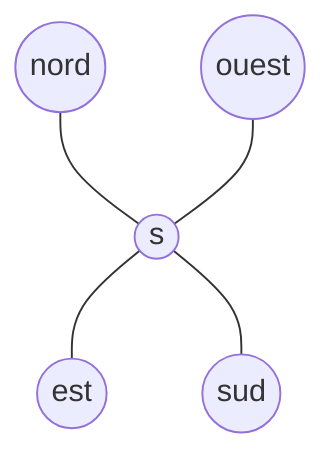

# Définition

Un **champ aléatoire de Markov** est un [[Processus stochastique|champ aléatoire]], c'est-à-dire une famille de variables aléatoires $(X_s)_{s \in S}$ indexée par un ensemble de sites $S$, chaque $X_s$ prenant ses valeurs dans un ensemble fini $E$ d'états, dont la loi vérifie la propriété de Markov spatiale : la loi conditionnelle de la variable d'un site sachant toutes les autres ne dépend que des variables des sites voisins. Pour tout site $s \in S$ et toute valeur $x_s \in E$,

$$\mathbb{P}[X_s = x_s \mid X_{S \setminus s} = x_{S \setminus s}] = \mathbb{P}[X_s = x_s \mid X_{V_s} = x_{V_s}]$$

où $V_s$ désigne l'ensemble des voisins de $s$.

Le champ est décrit par :

- l'ensemble des sites $S$ et l'ensemble fini d'états $E$ commun à tous les sites ;
- l'état $x_s \in E$ du site $s$, et $x_{S \setminus s}$ les états de tous les sites autres que $s$ ;
- l'espace d'échantillonnage $\Omega = E^{|S|}$, ensemble des configurations $x = (x_s)_{s \in S}$ du champ entier ;
- un système de voisinage $V$, qui associe à chaque site $s$ son voisinage $V_s$ ;
- l'ensemble $\mathcal{C}$ des cliques, une clique étant une partie de sites dont tous les éléments sont deux à deux voisins.

# Interprétation

La propriété est **locale** : sachant les états de ses voisins, l'état d'un site ne dépend plus du reste du réseau. Connaître en plus les états des sites éloignés n'apporte aucune information supplémentaire sur $X_s$, toute la dépendance passe par le voisinage $V_s$.

L'indice d'un champ est une position dans l'espace, le plus souvent une case d'une grille, et non un instant : la propriété de Markov y joue le même rôle de localité que pour un processus indexé par le temps, mais le voisinage $V_s$ remplace le passé immédiat. La loi du champ entier se construit ainsi à partir de contraintes locales, portées par les voisinages et par les cliques.

Le voisinage dépend du réseau considéré. Sur une grille, le voisinage usuel d'un site est formé de ses quatre plus proches voisins, ceux qui le touchent par un côté : les sites placés en diagonale, plus éloignés, n'en font pas partie.

Les cliques d'une telle grille sont alors les paires de sites adjacents et les cliques réduites à un seul site : aucune clique ne regroupe trois sites, puisque deux sites diagonaux ne sont pas voisins. La propriété de Markov locale ne suppose aucune direction dans le réseau, et une clique peut regrouper plus de deux sites sur un autre graphe : la dépendance n'est pas limitée à des paires de voisins.

# Exemple

Un exemple de champ aléatoire de Markov sur un réseau à deux états prend pour loi conditionnelle de chaque site une régression logistique sur les états de ses voisins :

$$
\mathbb{P}[X_s = x_s \mid X_{S \setminus s} = x_{S \setminus s}] = \frac{\exp\left(\alpha x_s + \beta x_s \sum_{r \in V_s} x_r\right)}{1 + \exp\left(\alpha + \beta \sum_{r \in V_s} x_r\right)}
$$

Le score $\alpha x_s + \sum_{r \in V_s} \beta x_s x_r$ combine un terme propre au site, $\alpha x_s$, et un terme d'interaction avec chacun de ses voisins, $\beta x_s x_r$. Plus le coefficient $\beta$ est grand en valeur absolue, plus l'état d'un site est déterminé par les états de ses voisins, et non par son seul terme propre.

La simulation d'un tel champ sur une grille montre une mosaïque dont les cases prennent deux couleurs selon leur état, et le régime observé dépend des paramètres : tantôt les deux couleurs alternent en désordre, sans former d'amas, tantôt les sites d'une même couleur se regroupent en amas contigus. L'aimantation, moyenne des états des sites lorsque ceux-ci sont codés par $+1$ et $-1$, soit la différence des proportions des deux états, est une grandeur signée à valeurs dans $[-1, 1]$ ; elle est suivie graphiquement au fil des itérations, avec un curseur de température, et fluctue autour d'une valeur de régime.

# Remarque

La propriété de Markov ne suffit pas à fixer la loi du champ : celle-ci s'écrit comme une [[Distribution de Gibbs|distribution de Gibbs]] sur les cliques, dont l'énergie est une somme de potentiels locaux, un potentiel par clique, et dont le facteur de normalisation assure que la probabilité totale sur $\Omega$ vaut $1$.

La forme logistique de l'exemple est normalisée sur les deux valeurs possibles de $x_s$, et non sur la seule valeur figurant au numérateur : le score $\alpha x_s + \beta x_s \sum_{r \in V_s} x_r$ dépend de $x_s$, si bien que le dénominateur réunit les exponentielles des deux scores, celui de l'état $0$ qui vaut $1$ et celui de l'état $1$ qui vaut $\exp\left(\alpha + \beta \sum_{r \in V_s} x_r\right)$. La somme sur $x_s \in \{0, 1\}$ vaut alors

$$
\frac{1 + \exp\left(\alpha + \beta \sum_{r \in V_s} x_r\right)}{1 + \exp\left(\alpha + \beta \sum_{r \in V_s} x_r\right)} = 1
$$

Un dénominateur évalué en la même valeur $x_s$ que le numérateur, soit $1 + \exp\left(\alpha x_s + \beta x_s \sum_{r \in V_s} x_r\right)$, donne $1/2$ lorsque $x_s = 0$ quels que soient les voisins ; la somme des deux issues ne vaut alors $1$ que dans le cas dégénéré $\alpha + \beta \sum_{r \in V_s} x_r = 0$, où les deux écritures coïncident. Hors de ce cas, ce n'est pas une loi conditionnelle.

# Liens avec d'autres lois

Le champ aléatoire de Markov est la version spatiale de la [[Propriété de Markov]] : la loi conditionnelle en un site n'y dépend que d'un voisinage, là où celle d'un processus de Markov ne dépend que de son état présent. Contrairement à une [[Chaîne de Markov à temps discret]], dont l'indice est un instant, l'indice est ici un site du réseau, et le voisinage d'un indice se limite à ses voisins immédiats dans le temps.

Un champ aléatoire de Markov observé à travers une version bruitée de ses états donne un [[Champ de Markov caché]] : le champ latent y suit la loi d'un champ aléatoire de Markov, et les observations sont conditionnellement indépendantes sachant ce champ.
