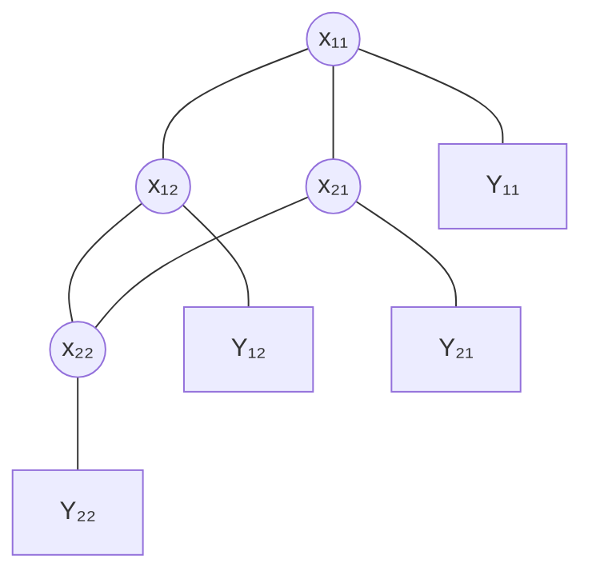

#adm-7 #adm-8

# Définition

Un **champ de Markov caché** (HMRF) est un couple de champs aléatoires $(X, Y)$ indexés par le même ensemble de sites $S$, dont seul le second est observé. Le modèle est donc une application $X \longmapsto Y$, où $X$ est le champ d'intérêt, inconnu, et $Y$ le champ mesuré.

- Le champ caché $X = (X_s)_{s \in S}$ prend ses valeurs dans un ensemble $E$ et suit un [[Champ aléatoire de Markov]] sur $S$ : il est muni d'un système de voisinage $V$, d'un ensemble de cliques $\mathcal{C}$ et d'une énergie $U(x) = \sum_{c \in \mathcal{C}} U_c(x)$, l'espace des configurations étant $\Omega = E^{|S|}$.
- Le champ observé $Y = (Y_s)_{s \in S}$ est une version bruitée de $X$ : chaque observation $Y_s$ ne dépend que de la valeur cachée $X_s$ du même site.

# Modèle

Notations :

- $S$ : ensemble des sites ;
- $E$ : ensemble des états possibles d'un site ;
- $x_s \in E$ : état caché du site $s$ ;
- $b_{x_s}(y_s) = \mathbb{P}[Y_s = y_s \mid X_s = x_s]$ : loi d'émission du site $s$, probabilité ou densité de l'observation $y_s$ sachant que le site porte la valeur cachée $x_s$.

Les nœuds cachés sont reliés selon le graphe non dirigé du champ de Markov, et chaque nœud caché est relié à son observation.

Les arêtes pleines relient entre eux les sites du [[Champ aléatoire de Markov]] caché ; les liens vers les nœuds $Y_s$ portent l'indépendance conditionnelle des données sachant $X$.

# Propriétés

### Indépendance conditionnelle des observations

Les observations sont supposées conditionnellement indépendantes sachant le champ caché, d'où, pour toutes configurations $x$ et $y$,

$$
\mathbb{P}[Y = y \mid X = x] = \prod_{s \in S} b_{x_s}(y_s)
$$

### Écriture en énergie

Cette vraisemblance se met sous forme exponentielle, avec l'énergie conditionnelle

$$
U(y \mid x) = -\sum_{s \in S} \ln b_{x_s}(y_s)
$$

soit

$$
\mathbb{P}[Y = y \mid X = x] = \exp\left(-U(y \mid x)\right)
$$

Le terme $U(y \mid x)$ est la somme, site par site, des coûts $-\ln b_{x_s}(y_s)$ : il agrège l'écart entre la configuration cachée $x$ et l'observation $y$.

### Loi a posteriori

Sachant les observations, la loi du champ caché est une [[Distribution de Gibbs]] d'énergie $U(x) + U(y \mid x)$ :

$$
\mathbb{P}[X = x \mid Y = y] = \frac{1}{Z(y)} \exp\left(-U(x) - U(y \mid x)\right)
$$

La constante de normalisation $Z(y)$ ne dépend que de l'observation $y$.

# Interprétation

Un champ de Markov caché décrit l'observation bruitée d'un phénomène structuré dans l'espace : le champ $X$ porte les grandeurs d'intérêt, jamais accessibles, et le champ $Y$ ce qui est effectivement mesuré, site par site.

La loi a posteriori additionne deux termes d'énergie :

- $U(x)$ : l'énergie du champ a priori, qui favorise les configurations localement régulières, cohérentes avec le voisinage défini par $V$, conformément au [[Champ aléatoire de Markov]] sous-jacent ;
- $U(y \mid x)$ : l'énergie des observations, qui favorise les configurations cachées rendant l'observation probable, site par site.

Reconstituer $X$ à partir de $Y$ revient donc à chercher la configuration cachée la plus probable a posteriori, c'est-à-dire celle qui réalise ce compromis entre régularité spatiale et fidélité aux données.

# Remarque

Le [[Modèle de Markov caché]] est le cas particulier du champ de Markov caché où le graphe du champ caché est une chaîne : les sites sont alors des instants successifs, chaque état caché ne dépendant que du précédent, la [[Propriété de Markov]] s'y réduisant à la dépendance entre deux instants consécutifs, et les observations y sont conditionnellement indépendantes de la même façon. Un champ de Markov caché autorise n'importe quel graphe non dirigé, par exemple la grille des sites d'une image, et généralise donc ce modèle.

Les quantités $b_{x_s}(y_s)$ y jouent le rôle des probabilités d'émission du modèle de Markov caché, et l'énergie $U(x)$ celui de la loi a priori de la chaîne des états.

La loi jointe du couple se factorise site par site, par les potentiels de cliques de $X$ et par les émissions $b_{x_s}(y_s)$ ; elle se représente donc comme un [[Graphe de facteurs]] sur le graphe du champ, augmenté des nœuds d'observation. Les marginales et le mode a posteriori s'y calculent par [[Inférence dans un modèle graphique|inférence dans le modèle graphique]].
