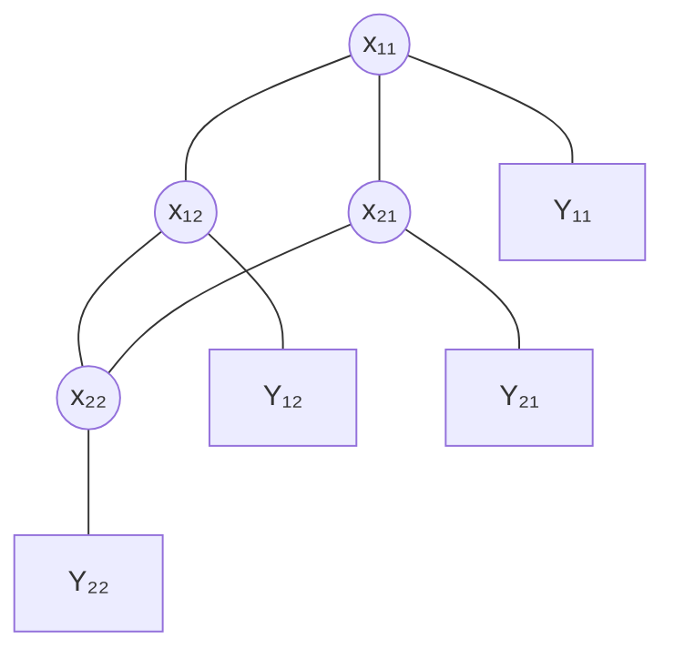

# Définition

Un **champ de Markov caché** (HMRF) est formé de deux champs définis sur le même ensemble de sites $S$ :

- un champ caché $X = (X_s)_{s \in S}$, qui est un [[Champ aléatoire de Markov]] sur un graphe non dirigé : chaque $X_s$ prend ses valeurs dans un ensemble $E$ et ne dépend du reste du champ qu'à travers son voisinage $V_s$ ;
- un champ observé $Y = (Y_s)_{s \in S}$, version bruitée de $X$ : l'observation au site $s$ ne dépend que de l'état caché du même site.

Le modèle est donc une application $X \longmapsto Y$, où $X$ est le champ d'intérêt, inconnu, et $Y$ le champ mesuré.

# Modèle

Notations :

- $S$ : ensemble des sites ;
- $x_s \in E$ : état caché du site $s$ ;
- $b_{x_s}(y_s) = \mathbb{P}[Y_s = y_s \mid X_s = x_s]$ : loi d'émission du site $s$.

Les nœuds cachés sont reliés selon le graphe non dirigé du champ de Markov, et chaque nœud caché est relié à son observation.

# Propriétés

### Indépendance conditionnelle des observations

Les observations sont supposées conditionnellement indépendantes sachant le champ caché, d'où

$$
\mathbb{P}[Y = y \mid X = x] = \prod_{s \in S} b_{x_s}(y_s)
$$

### Écriture en énergie

Cette vraisemblance se met sous forme exponentielle, avec l'énergie conditionnelle

$$
U(y \mid x) = -\sum_{s \in S} \ln b_{x_s}(y_s)
$$

soit

$$
\mathbb{P}[Y = y \mid X = x] = \exp\left(-U(y \mid x)\right)
$$

### Loi a posteriori

Sachant les observations, la loi du champ caché est une [[Distribution de Gibbs]] d'énergie $U(x) + U(y \mid x)$ :

$$
\mathbb{P}[X = x \mid Y = y] \propto \exp\left(-\left(U(x) + U(y \mid x)\right)\right)
$$

la constante de normalisation ne dépendant que de $y$.

# Interprétation

L'énergie a posteriori additionne deux termes :

- $U(x)$ : l'énergie du champ a priori, qui favorise les configurations localement régulières, conformément au [[Champ aléatoire de Markov]] sous-jacent ;
- $U(y \mid x)$ : l'énergie des observations, qui favorise les configurations cachées expliquant bien les mesures.

Reconstituer $X$ à partir de $Y$ revient donc à chercher une configuration cachée à la fois régulière et compatible avec les observations.

# Remarque

Le [[Modèle de Markov caché]] est le cas particulier du champ de Markov caché où le graphe du champ caché est une chaîne : les sites sont alors des instants successifs, chaque état caché ne dépendant que du précédent, et les observations y sont conditionnellement indépendantes de la même façon.

La loi jointe du couple se factorise site par site, par les potentiels de cliques de $X$ et par les émissions $b_{x_s}(y_s)$ ; elle se représente donc comme un [[Graphe de facteurs]] sur le graphe du champ, augmenté des nœuds d'observation.
