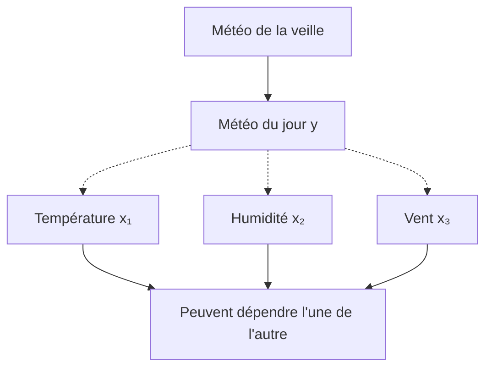

# Définition

La **classification par maximum a posteriori** prédit une étiquette discrète $y$ à partir de données observées $x$. La décision bayésienne, optimale au sens où elle choisit l'étiquette la plus probable sachant l'observation, associe à $x$ l'étiquette

$$\hat{y} = \arg\max_y \mathbb{P}[Y = y \mid X = x] = \arg\max_y \mathbb{P}[X = x, Y = y] = \arg\max_y \mathbb{P}[X = x \mid Y = y] \, \mathbb{P}[Y = y] .$$

Les trois écritures désignent la même étiquette. Le passage de la première à la deuxième utilise la [[Formule de Bayes]] : la probabilité marginale $\mathbb{P}[X = x]$ ne dépend pas de $y$, donc elle ne change pas l'argument du maximum. Le passage de la deuxième à la troisième utilise la définition d'une probabilité conditionnelle, $\mathbb{P}[X = x, Y = y] = \mathbb{P}[X = x \mid Y = y] \, \mathbb{P}[Y = y]$.

# Interprétation

La règle se lit en deux temps : le modèle fournit, pour chaque étiquette candidate $y$, une vraisemblance des observations $\mathbb{P}[X = x \mid Y = y]$ et une probabilité a priori $\mathbb{P}[Y = y]$ ; la décision retient l'étiquette dont le produit est le plus grand.

Les modèles dits génératifs passent par cette loi jointe, puisqu'ils modélisent aussi la loi des observations $x$ ; la voie discriminante s'en dispense et modélise directement $\mathbb{P}[Y = y \mid X = x]$, comme le décrit [[Modèles génératifs et modèles conditionnels]]. Aucune hypothèse d'indépendance sur les composantes de $x$ n'intervient à ce stade : la règle est valable pour toute loi jointe.

L'observation $x$ est en pratique un vecteur d'attributs $x = (x_1, \dots, x_n)$ (température, humidité, vent, etc.). La règle reste inchangée, mais la classification à plusieurs attributs fait souvent l'hypothèse d'indépendance des attributs.

# Exemple

On veut prévoir la météo du jour. L'étiquette $y$ est la météo du jour (ensoleillé, pluvieux, nuageux) ; les observations $x$ sont la température, l'humidité, la force du vent, etc. À partir du relevé du jour, la règle du maximum a posteriori retient la météo la plus probable.

Les dépendances entre ces variables ne sont pas fixées par la règle de décision : elles relèvent du choix du modèle. Trois dépendances sont envisageables.

- La météo du jour peut dépendre de la météo de la veille (structure séquentielle).
- Chaque observation dépend de la météo du jour.
- Les observations peuvent dépendre l'une de l'autre.

Il reste à choisir une loi pour $\mathbb{P}[Y = y]$ et pour $\mathbb{P}[X = x \mid Y = y]$, ce qui conduit à un modèle particulier du type [[Modèles génératifs et modèles conditionnels|modèle génératif]].

# Remarque

La règle du maximum a posteriori est une règle de décision, pas un modèle : elle ne dit rien sur la façon de représenter $\mathbb{P}[X = x, Y = y]$. Deux voies s'ouvrent.

- Restreindre la loi jointe en supposant les attributs conditionnellement indépendants sachant l'étiquette, ce qui donne la forme factorisée décrite dans [[Hypothèse d'indépendance conditionnelle des attributs]] et le classifieur naïf de Bayes.
- Modéliser directement la loi conditionnelle $\mathbb{P}[Y = y \mid X = x]$, par exemple avec une [[Régression logistique binaire]], sans passer par la loi des observations.

Un lien étroit existe aussi avec les modèles séquentiels : la même règle de décision s'applique au décodage d'une séquence d'états, voir [[Probabilités d'un modèle de Markov caché]].
