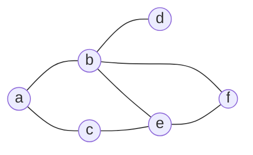
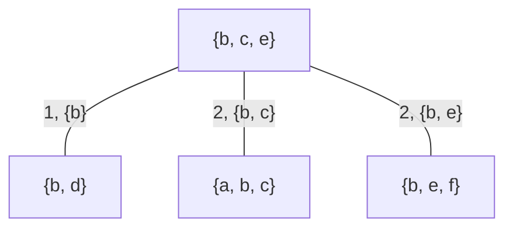

#adm-7

# Algorithme

Un [[Arbre de jonction]] se construit à partir d'un graphe $\mathcal{G}$ en cinq étapes : un ordre d'élimination fixe les cliques, un graphe complet pondéré relie ces cliques, et un arbre couvrant de poids maximum en extrait l'arbre de jonction.

1. Choisir un ordre d'élimination des nœuds.
2. Dérouler l'élimination pour obtenir l'ensemble des cliques d'élimination.
3. Construire un graphe complet sur les cliques maximales d'élimination.
4. Pondérer l'arête entre deux cliques $A$ et $B$ par $|A \cap B|$, le nombre de variables que ces cliques partagent.
5. Construire un arbre couvrant de poids maximum de ce graphe complet.

Les deux premières étapes sont celles de l'[[Élimination de variables]]. Éliminer un nœud $i$ revient à sommer les facteurs qui le contiennent : le facteur obtenu dépend de $i$ et de tous ses voisins à cet instant, lesquels forment avec $i$ une clique d'élimination. Quand ces voisins ne sont pas déjà deux à deux reliés, l'élimination ajoute les arêtes manquantes, dites arêtes de remplissage, pour que le voisinage de $i$ soit bien une clique. Les cliques d'élimination recueillies le long de l'ordre sont donc les cliques maximales du graphe augmenté des arêtes de remplissage ; une clique incluse dans une autre n'apporte rien de plus, et seules les cliques maximales deviennent des clusters.

Les étapes 3 à 5 relient ces clusters entre eux. Le graphe complet a pour sommets les cliques maximales et pour arêtes toutes les paires de cliques ; chaque arête reçoit pour poids le nombre de variables communes aux deux cliques, c'est-à-dire la taille du séparateur qu'elle deviendra. Un arbre couvrant de poids maximum retient $k-1$ arêtes pour $k$ cliques en maximisant la somme des poids, donc en privilégiant les couples de cliques qui échangent le plus de variables. Les arêtes retenues portent alors les séparateurs de l'arbre, chaque clique du graphe de départ étant incluse dans une clique maximale : l'arbre obtenu est un arbre de jonction.

# Exemple

Le graphe $\mathcal{G}$ ci-dessous a pour nœuds $a$, $b$, $c$, $d$, $e$ et $f$ ; ses cliques maximales sont $\{a, b\}$, $\{a, c\}$, $\{b, d\}$, $\{b, e, f\}$ et $\{c, e\}$, le nœud $c$ n'étant pas relié à $b$.

L'ordre d'élimination retenu traite $f$, puis $d$, puis $e$, puis $c$, puis $b$. Chaque élimination fournit une clique :

- élimination de $f$, voisin de $b$ et de $e$ : clique $\{b, e, f\}$ ;
- élimination de $d$, voisin de $b$ : clique $\{b, d\}$ ;
- élimination de $e$, voisin de $b$ et de $c$ : clique $\{b, c, e\}$, avec l'arête de remplissage entre $b$ et $c$ ;
- élimination de $c$, voisin de $a$ et de $b$ : clique $\{a, b, c\}$ ;
- élimination de $b$, voisin de $a$ : clique $\{a, b\}$, incluse dans $\{a, b, c\}$ et donc non maximale.

Les cliques maximales d'élimination sont donc $\{b, d\}$, $\{b, e, f\}$, $\{b, c, e\}$ et $\{a, b, c\}$. Le graphe complet construit sur ces quatre cliques porte les poids suivants.

| Cliques reliées | Variables communes | Poids |
| --- | --- | --- |
| $\{b, d\}$ et $\{b, c, e\}$ | $b$ | 1 |
| $\{b, d\}$ et $\{b, e, f\}$ | $b$ | 1 |
| $\{b, d\}$ et $\{a, b, c\}$ | $b$ | 1 |
| $\{b, c, e\}$ et $\{b, e, f\}$ | $b$, $e$ | 2 |
| $\{b, c, e\}$ et $\{a, b, c\}$ | $b$, $c$ | 2 |
| $\{b, e, f\}$ et $\{a, b, c\}$ | $b$ | 1 |

Les deux arêtes de poids 2 relient $\{b, c, e\}$ à $\{b, e, f\}$ et $\{b, c, e\}$ à $\{a, b, c\}$ : elles ne forment pas de cycle et sont retenues. Le cluster $\{b, d\}$ n'a que des arêtes de poids 1, dont une seule est nécessaire pour le raccorder, par exemple celle qui le relie à $\{b, c, e\}$. Un arbre couvrant de poids maximum est l'étoile de centre $\{b, c, e\}$, de poids total $2 + 2 + 1 = 5$ ; les trois raccordements possibles de $\{b, d\}$ donnent le même total.

Les séparateurs sont $\{b\}$ entre $\{b, c, e\}$ et $\{b, d\}$, $\{b, c\}$ entre $\{b, c, e\}$ et $\{a, b, c\}$, et $\{b, e\}$ entre $\{b, c, e\}$ et $\{b, e, f\}$. Le nœud $b$ appartient aux quatre cliques : il figure donc dans chaque cluster du chemin entre deux clusters quelconques. Le nœud $e$ n'apparaît que dans $\{b, c, e\}$ et $\{b, e, f\}$, clusters voisins dans l'arbre, et le nœud $c$ que dans $\{b, c, e\}$ et $\{a, b, c\}$, clusters voisins également. Chaque paire de clusters est donc reliée par un chemin unique, chaque clique de $\mathcal{G}$ est incluse dans un cluster, et tout nœud présent dans deux clusters figure dans chacun des clusters du chemin qui les sépare : l'arbre obtenu est bien un arbre de jonction de $\mathcal{G}$.

# Remarque

Le poids d'une arête mesure la taille du séparateur, donc le nombre de variables communes aux deux cliques. L'écriture avec la réunion, $|A \cup B|$, est une erreur fréquente : elle compte aussi les variables propres à chaque clique et ne mesure plus ce qui circule entre elles. Sur l'exemple, toutes les arêtes auraient un poids de 4 ou de 5, et l'arbre de poids maximum ne serait plus celui des plus grands séparateurs.

Le choix de l'ordre d'élimination commande la taille des cliques, donc le coût de l'inférence menée ensuite sur l'arbre (voir [[Inférence par arbre de jonction]]). C'est le point délicat de l'[[Élimination de variables]] : un ordre mal choisi produit des cliques bien plus grosses que nécessaire.

La construction suppose un graphe non dirigé. Sur un graphe orienté, il faut d'abord le transformer par [[Moralisation d'un graphe orienté]], puis appliquer les cinq étapes au graphe moralisé. La définition de l'arbre de jonction et la vérification de ses trois conditions sont données dans [[Arbre de jonction]].
