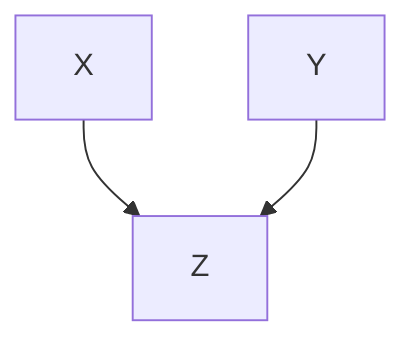

#adm-7

# Définition

Un **graphe en $v$** (ou *v-shape*) est un graphe orienté à trois sommets formé de deux causes $X$ et $Y$ qui pointent toutes deux vers un même effet $Z$, sans arête entre $X$ et $Y$.

L'effet $Z$ est la seule conséquence commune des deux causes. Comme dans tout [[Réseau bayésien]], la loi jointe se factorise en

$$\mathbb{P}[X, Y, Z] = \mathbb{P}[X]\,\mathbb{P}[Y]\,\mathbb{P}[Z \mid X, Y]$$

Chaque cause possède sa propre loi marginale, et l'effet est décrit par sa loi conditionnelle aux deux causes.

# Propriétés

Les deux causes sont marginalement indépendantes :

$$X \perp Y$$

$$\mathbb{P}[X, Y] = \mathbb{P}[X]\,\mathbb{P}[Y]$$

En revanche, l'indépendance conditionnelle sachant l'effet ne tient pas : la relation $X \perp Y \mid Z$ est fausse dans un graphe en $v$.

### Démonstration

Par définition de la probabilité conditionnelle, puis par la factorisation du graphe,

$$\mathbb{P}[X, Y \mid Z] = \frac{\mathbb{P}[X]\,\mathbb{P}[Y]\,\mathbb{P}[Z \mid X, Y]}{\mathbb{P}[Z]}$$

Le membre de droite n'est pas le produit d'une fonction de $X$ seul et d'une fonction de $Y$ seul dès que $\mathbb{P}[Z \mid X, Y]$ dépend conjointement de $X$ et de $Y$ : il ne se réduit donc pas à $\mathbb{P}[X \mid Z]\,\mathbb{P}[Y \mid Z]$.

# Interprétation

Un graphe en $v$ modélise deux **causes concurrentes** d'un même effet observé. Tant que l'effet n'est pas observé, les deux causes s'ignorent : elles sont indépendantes. Dès que l'effet est observé, elles deviennent dépendantes, car elles se partagent l'explication de ce qui est constaté.

Savoir qu'une cause est présente retire à l'autre une partie de son pouvoir explicatif : sa probabilité diminue. Ce phénomène porte le nom d'***explaining away*** : une cause suffit à expliquer l'effet observé, l'autre n'a plus besoin d'être invoquée et sa probabilité diminue.

# Exemple

Le [[Réseau bayésien du système d'arrosage|système d'arrosage]] en donne l'illustration canonique. L'herbe est mouillée, $W = 1$, et deux causes concurrentes peuvent l'expliquer : l'arroseur $S$ et la pluie $R$. Remonter de l'effet observé vers ses causes relève du [[Raisonnement causal et raisonnement diagnostique|raisonnement diagnostique]].

Probabilité que l'arroseur soit en marche :

$$\mathbb{P}[S = 1 \mid W = 1] = \frac{\sum_{c,r} \mathbb{P}[S = 1, W = 1, C = c, R = r]}{\mathbb{P}[W = 1]} = \frac{0{,}2781}{0{,}6471} \approx 0{,}4297$$

Probabilité qu'il pleuve :

$$\mathbb{P}[R = 1 \mid W = 1] = \frac{\sum_{c,s} \mathbb{P}[R = 1, W = 1, C = c, S = s]}{\mathbb{P}[W = 1]} = \frac{0{,}4581}{0{,}6471} \approx 0{,}7079$$

La pluie explique donc plus probablement l'herbe mouillée que l'arroseur.

Si l'on apprend en plus qu'il pleut, la probabilité que l'arroseur explique l'herbe mouillée devient

$$\mathbb{P}[S = 1 \mid W = 1, R = 1] = \frac{\sum_{c} \mathbb{P}[S = 1, W = 1, C = c, R = 1]}{\mathbb{P}[W = 1, R = 1]} = 0{,}1945$$

Elle chute de $0{,}4297$ à $0{,}1945$ : la pluie prenant en charge l'explication de l'herbe mouillée, l'arroseur devient une explication beaucoup moins plausible.

# Remarque

- Sans observation de $Z$, les deux causes restent indépendantes ; c'est l'observation de l'effet qui les rend dépendantes, et non une dépendance inscrite dans le graphe.
- Le graphe en $v$ échange les rôles de l'indépendance marginale et de l'indépendance conditionnelle par rapport au graphe en cause commune : dans [[Indépendance conditionnelle sachant une cause commune]], les deux effets d'une cause commune sont dépendants marginalement et indépendants sachant cette cause, alors qu'ici les deux causes sont indépendantes marginalement et dépendantes sachant l'effet.
- Le contraste vaut aussi avec [[Indépendance conditionnelle le long d'une chaîne]], où deux variables extrêmes deviennent indépendantes dès que la variable intermédiaire est observée.
- Dans le [[Réseau bayésien du système d'arrosage|système d'arrosage]], les deux causes partagent en outre la cause commune $C$, le temps nuageux : l'explication concurrente se lit sur la partie en $v$ du graphe, $S \to W \leftarrow R$, une fois $W$ observé.
