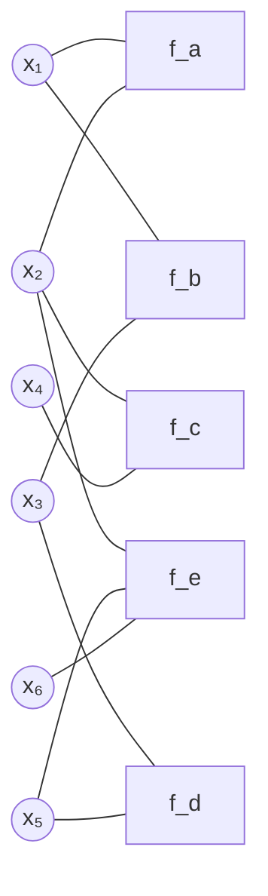

# Définition

Un graphe de facteurs représente une loi jointe comme le produit normalisé de fonctions dont chacune ne dépend que d'un sous-ensemble de variables :

$$p(\mathbf{x}) = \frac{1}{Z} \prod_{i \in \mathcal{I}} f_i(x_{C_i})$$

Les $f_i$ sont les facteurs, indexés par $i \in \mathcal{I}$ ; $x_{C_i}$ désigne l'ensemble des variables du sous-ensemble $C_i$, et $Z$ la constante de normalisation qui ramène le produit à une loi.

Sa représentation est un graphe biparti : deux familles de sommets, les variables $x_j$ d'un côté et les facteurs $f_i$ de l'autre, et une arête entre un facteur et chacune des variables dont il dépend.

# Propriétés

Les deux factorisations usuelles d'un [[Modèle graphique|modèle graphique]] se ramènent à cette forme unique.

Sur un graphe dirigé, la loi jointe s'écrit comme un produit de lois conditionnelles, une par sommet sachant ses parents :

$$p(\mathbf{x}) = \prod_{v \in \mathcal{V}} p(x_v \mid x_{\pi_v})$$

Sur un graphe non dirigé, elle s'écrit comme un produit de potentiels, un par clique :

$$p(\mathbf{x}) = \frac{1}{Z} \prod_{c \in \mathcal{C}} \psi_c(x_c)$$

Chacune de ces deux écritures est un cas particulier de la factorisation en facteurs : le graphe de facteurs rend explicites les groupes de variables sur lesquels porte chaque terme du produit.

# Exemple

Six variables $x_1, \dots, x_6$ et cinq facteurs $f_a$ à $f_e$.

Chaque facteur relie les variables dont il dépend : $f_a$ porte sur $x_1$ et $x_2$, $f_b$ sur $x_1$ et $x_3$, $f_c$ sur $x_2$ et $x_4$, $f_d$ sur $x_3$ et $x_5$, $f_e$ sur $x_2$, $x_5$ et $x_6$.

La loi jointe s'écrit alors :

$$\mathbb{P}[\mathbf{x}] = \frac{1}{Z} f_a(x_1, x_2) f_b(x_1, x_3) f_c(x_2, x_4) f_d(x_3, x_5) f_e(x_2, x_5, x_6)$$

Le même exemple sert de support à l'[[Élimination de variables|élimination de variables]], où les variables sont sommées une à une.

# Remarque

Le potentiel d'une clique d'un graphe non dirigé s'écrit comme l'exponentielle d'une énergie :

$$\psi_c(x_c) = \exp\big(-U_c(x_c)\big)$$

Les notations $\psi_c$, $\exp(-U_c)$ et $f_i$ désignent donc un seul et même objet, le facteur, dont seule change l'écriture.

Un graphe de facteurs généralise ainsi la factorisation du [[Réseau bayésien]] et celle de la [[Distribution de Gibbs]], qui n'en sont que deux écritures particulières.

La ligne conditionnelle du bestiaire des modèles, celle des champs aléatoires conditionnels, se décrit aussi par des graphes de facteurs ; la comparaison avec les modèles génératifs est l'objet de [[Modèles génératifs et modèles conditionnels]].

Le passage d'un graphe dirigé à un graphe non dirigé ne se réduit pas à effacer les flèches : il faut d'abord marier les parents de chaque nœud, ce qui ajoute des arêtes entre eux. C'est l'objet de la [[Moralisation d'un graphe orienté]].

Sur une chaîne, un tel graphe porte les scores de traits locaux d'un [[Champ aléatoire conditionnel à chaîne linéaire]], et ses facteurs y sont évalués position par position.
