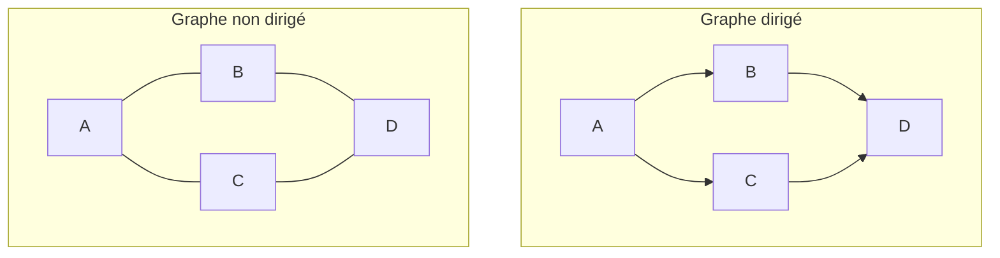

# Définition

Deux familles de graphes structurent les [[Modèle graphique|modèles graphiques]] :

- les graphes dirigés, qui encodent des relations causales et doivent être acycliques (DAG) ;
- les graphes non dirigés, qui encodent des relations spatiales et sont appelés champs aléatoires.

| | Graphes dirigés | Graphes non dirigés |
| --- | --- | --- |
| Relations encodées | causales | spatiales |
| Structure | graphe acyclique (DAG) | graphe non orienté |
| Nom | réseau bayésien | champ aléatoire |

Notations : $x_A$ désigne l'ensemble $\{x_i \mid i \in A\}$, $\pi_v$ l'ensemble des sommets parents de $v$, $\mathcal{V}$ l'ensemble des sommets du graphe et $\mathcal{C}$ l'ensemble de ses cliques.

# Propriétés

Sur un graphe dirigé, la loi jointe se factorise en un produit de lois conditionnelles, une par sommet, sachant ses parents :

$$p(\mathbf{x}) = \prod_{v \in \mathcal{V}} p(x_v \mid x_{\pi_v})$$

Sur un graphe non dirigé, elle se factorise en un produit de potentiels, un par clique, ramené à une loi par la constante de normalisation $Z$ :

$$p(\mathbf{x}) = \frac{1}{Z} \prod_{c \in \mathcal{C}} \psi_c(x_c)$$

# Interprétation

L'orientation d'une arête porte une signification causale : le sommet de départ explique le sommet d'arrivée, et l'acyclicité interdit les boucles de causalité.

Le graphe non dirigé, lui, ne décrit que des voisinages : des sites reliés entre eux, sans direction privilégiée, comme sur une grille où chaque site est relié à ses voisins.

La différence de forme des deux factorisations en découle : dans le cas dirigé, chaque terme est une loi conditionnelle, directement normalisée ; dans le cas non dirigé, les potentiels $\psi_c$ ne sont pas des probabilités, et c'est $Z$ qui normalise le produit.

# Exemple

Un même squelette de quatre sommets se lit de deux façons.

Dans la lecture non dirigée, les cliques maximales de ce cycle sont ses quatre arêtes : la loi jointe s'écrit avec un potentiel par arête.

# Remarque

Le cas dirigé est celui des [[Réseau bayésien|réseaux bayésiens]], le cas non dirigé celui des [[Champ aléatoire de Markov|champs aléatoires de Markov]] ; la factorisation non dirigée est la forme utilisée par les [[Distribution de Gibbs|distributions de Gibbs]].

Dans la factorisation non dirigée, les potentiels ne sont pas des probabilités : seule la constante $Z$ normalise le produit. Un potentiel s'écrit indifféremment $\psi_c(x_c)$ ou $\exp\left(-U_c(x_c)\right)$, où $U_c$ est l'énergie de la clique ; c'est la même fonction, vue comme facteur ou comme exponentielle d'une énergie.

Passer d'une factorisation dirigée à une factorisation non dirigée est l'objet de la [[Moralisation d'un graphe orienté]].
