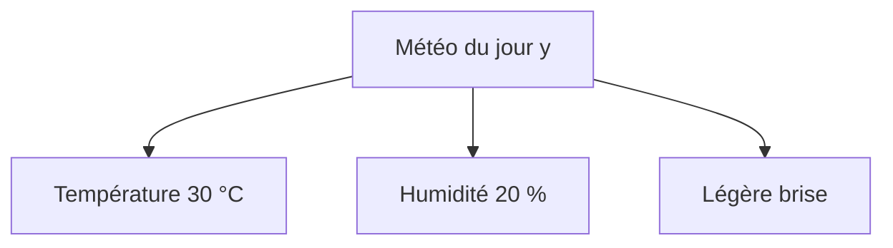

# Définition

Soit $y$ une étiquette discrète et $x_1, \dots, x_n$ les attributs observés, regroupés en un vecteur $\mathbf{x}$. L'**hypothèse d'indépendance conditionnelle des attributs** suppose que, sachant $y$, les attributs sont mutuellement indépendants, au sens de l'[[Indépendance de variables aléatoires|indépendance de variables aléatoires]]. La loi jointe de l'étiquette et des attributs se factorise alors en

$$p(\mathbf{x}, y) = p(y) \prod_{i=1}^{n} p(x_i \mid y)$$

et la loi des attributs sachant l'étiquette est le produit de leurs lois marginales conditionnelles, $p(\mathbf{x} \mid y) = \prod_{i=1}^{n} p(x_i \mid y)$.

# Interprétation

Classifier à partir de plusieurs attributs demande la loi jointe de tous ces attributs, dont l'estimation devient coûteuse quand leur nombre grandit. L'hypothèse remplace cette loi jointe par un petit nombre de lois de dimension un : une loi pour l'étiquette, puis une loi conditionnelle par couple formé de l'étiquette et d'un attribut.

Chaque attribut n'est plus relié qu'à l'étiquette, et à rien d'autre : la structure de dépendance est une étoile centrée sur $y$, dont l'absence de liens entre attributs est exactement le contenu de l'hypothèse.

L'hypothèse porte sur l'indépendance sachant $y$, et non sur l'indépendance des attributs entre eux. Deux attributs peuvent rester dépendants marginalement, par exemple une température élevée et une humidité faible, et vérifier néanmoins l'hypothèse : seules les lois conditionnelles sont contraintes.

# Propriétés

Sous cette hypothèse, la règle de décision de la [[Classification par maximum a posteriori]] se réécrit en remplaçant $p(\mathbf{x} \mid y)$ par son produit :

$$\hat{y} = \arg\max_y p(y) \prod_{i=1}^{n} p(x_i \mid y)$$

Le classement d'une observation ne demande donc que les probabilités a priori des étiquettes et les lois conditionnelles de chaque attribut sachant l'étiquette, jamais la loi jointe des attributs.

# Exemple

On prévoit la météo du jour à partir de trois relevés. L'étiquette $y$ est la météo du jour (ensoleillé, pluvieux, nuageux) ; les attributs sont la température, l'humidité et la force du vent, ici $30$ °C, $20$ % et une légère brise. Sous l'hypothèse, la loi jointe de ces quatre variables s'écrit

$$p(30\ \text{°C}, 20\ \%, \text{légère brise}, y) = p(y)\, p(30\ \text{°C} \mid y)\, p(20\ \% \mid y)\, p(\text{légère brise} \mid y)$$

Un seul facteur par attribut suffit, et les dépendances entre température, humidité et vent ne sont pas modélisées.

# Remarque

- La factorisation $p(y, \mathbf{x}) = p(y) \prod_{i=1}^{n} p(x_i \mid y)$ est parfois désignée sous le nom de « MAP ». C'est un raccourci d'étiquetage : cette écriture exprime l'hypothèse d'indépendance conditionnelle des attributs, et non la règle de décision du maximum a posteriori. La règle compare $p(y \mid \mathbf{x})$ entre étiquettes candidates et ne factorise rien ; la factorisation n'entre dans la règle que par substitution de $p(\mathbf{x} \mid y)$, ce qui donne la forme de la section Propriétés. Les deux objets restent distincts : la factorisation est un choix de modèle pour la loi jointe, la règle du maximum a posteriori une règle de décision valable pour toute loi jointe.
- La même hypothèse structure les modèles séquentiels : dans un [[Probabilités d'un modèle de Markov caché|modèle de Markov caché]], chaque observation n'est conditionnée que par l'état courant, ce qui donne une factorisation analogue en produits de termes de transition et d'émission.
- L'hypothèse est propre aux modèles qui décrivent la loi jointe. L'alternative consiste à modéliser directement la loi conditionnelle $p(y \mid \mathbf{x})$, sans rien supposer sur la dépendance des attributs : c'est la voie des [[Modèles génératifs et modèles conditionnels|modèles conditionnels]], dont le [[Modèle log-linéaire conditionnel]] est l'exemple canonique.
