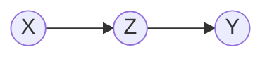

# Propriétés

Dans un graphe en chaîne à trois sommets $X \to Z \to Y$, conditionner sur le sommet intermédiaire $Z$ rend les deux sommets extrêmes indépendants :

$$X \perp Y \mid Z$$

Cette indépendance conditionnelle s'écrit, sur la loi de $Y$, de la façon suivante.

$$\mathbb{P}[Y \mid Z, X] = \mathbb{P}[Y \mid Z]$$

# Interprétation

Sachant $Z$, l'observation de $X$ n'apporte plus aucune information sur $Y$ : tout ce que $X$ transmet sur $Y$ passe par le sommet intermédiaire $Z$, et une fois $Z$ connu le message de $X$ est épuisé.

Sur un graphe orienté, cette propriété est la forme graphique de la [[Propriété de Markov]] : sachant le sommet présent $Z$, la variable amont $X$ n'apporte plus d'information sur la variable aval $Y$.

# Exemple

Les trois graphes élémentaires à trois sommets se distinguent par l'orientation de leurs deux arêtes.

- La **chaîne** $X \to Z \to Y$ : les deux flèches pointent dans le même sens et le sommet intermédiaire $Z$ sépare $X$ de $Y$.
- La **cause latente** $Z \to X$, $Z \to Y$ : les deux flèches partent d'un même sommet, cas traité dans [[Indépendance conditionnelle sachant une cause commune]].
- Le **v-shape** $X \to Z \leftarrow Y$ : les deux flèches convergent vers un même sommet, cas traité dans [[Explication par une cause concurrente]].

# Remarque

Le terme de graphe en chaîne désigne ici un graphe à trois sommets $X \to Z \to Y$ ; il désigne ailleurs une chaîne séquentielle de $n$ variables reliées par des facteurs successifs, traitée dans [[Passage de messages sur une chaîne]].

Un graphe en chaîne est le [[Réseau bayésien]] le plus simple où un unique sommet intermédiaire résume l'information échangée entre les deux extrémités.
