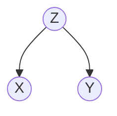

# Définition

Dans une structure de **cause commune**, une même variable $Z$ est la cause de deux variables $X$ et $Y$, et aucune arête ne relie directement ces deux effets :

La cause $Z$ est dite latente : elle n'est pas nécessairement observée, et c'est elle qui explique la dépendance apparente entre $X$ et $Y$.

# Propriétés

Conditionner sur la cause commune $Z$ rend les deux effets indépendants :

$$X \perp Y \mid Z$$

Cette indépendance conditionnelle s'écrit, sur la loi jointe de $X$ et $Y$, de la façon suivante.

$$\mathbb{P}[X, Y \mid Z] = \mathbb{P}[X \mid Z] \mathbb{P}[Y \mid Z]$$

# Interprétation

Toute l'information que $X$ apporte sur $Y$ passe par $Z$. Sachant $Z$, l'observation de $X$ n'apprend plus rien sur $Y$, et réciproquement : les deux effets ne sont plus liés que par leur cause, et une fois celle-ci connue ils varient indépendamment. Sans conditionner sur $Z$, ils varient ensemble parce qu'ils subissent la même influence.

# Exemple

Les trois graphes élémentaires à trois sommets se distinguent par l'orientation de leurs deux arêtes.

- La **chaîne** $X \to Z \to Y$ : le conditionnement sur le sommet intermédiaire rend les deux extrêmes indépendants, voir [[Indépendance conditionnelle le long d'une chaîne]].
- La **cause commune** $Z \to X$, $Z \to Y$ : les deux flèches partent d'un même sommet, placé en amont des deux autres.
- Le **v-shape** $X \to Z \leftarrow Y$ : les deux flèches convergent vers un même sommet, et l'indépendance conditionnelle sachant $Z$ n'y tient pas, voir [[Explication par une cause concurrente]].

# Remarque

La cause commune est l'un des motifs élémentaires dont se compose un [[Réseau bayésien]] : l'indépendance conditionnelle entre deux variables s'y lit directement sur la forme du graphe, sans calcul.
