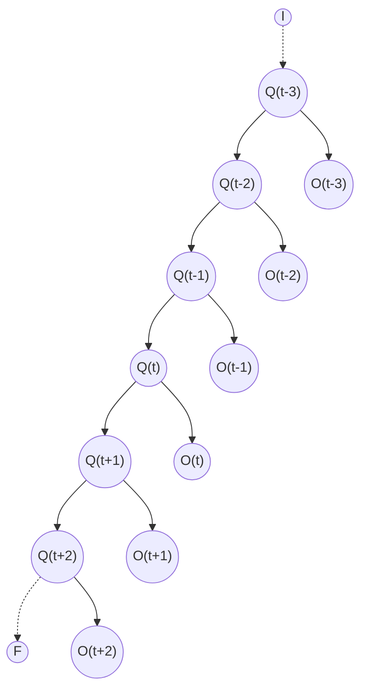
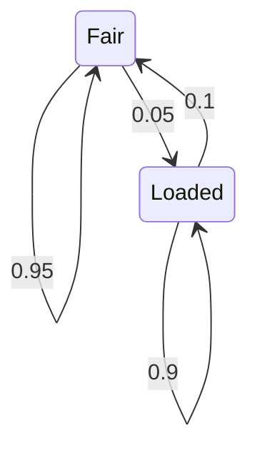
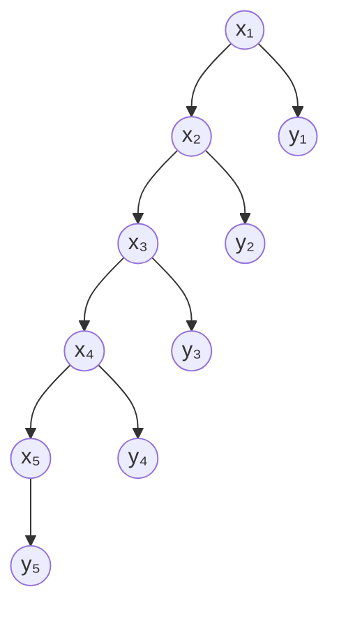

# Modèle

Un **modèle de Markov caché** représente deux processus aléatoires indexés par le même temps $t = 1, \dots, T$ :

- le **processus caché** $S = s_1, \dots, s_T$, suite des états d'une [[Chaîne de Markov à temps discret|chaîne de Markov]], chaque $s_t$ prenant ses valeurs dans $\{1, \dots, N\}$ ;
- le **processus d'observation** $O = o_1, \dots, o_T$, seule séquence mesurée.

Le processus de Markov lui-même n'est pas observable : l'observation est une fonction stochastique dépendant de l'état caché du processus de Markov sous-jacent. L'observation peut être **discrète ou continue**, et les observations sont supposées **indépendantes** conditionnellement à la suite des états cachés.

Le modèle repose ainsi sur deux dépendances seulement :

- un état ne dépend que de l'état qui le précède immédiatement : la suite des états est une chaîne de Markov d'ordre 1, et la probabilité de $s_t$ sachant tout le passé se réduit à $\mathbb{P}[s_t \mid s_{t-1}]$ ;
- une observation ne dépend que de l'état caché de la même date : $\mathbb{P}[o_t \mid s_t]$ ne fait intervenir que $s_t$, si bien que, conditionnellement aux états, les observations ne dépendent plus les unes des autres.

Sur le schéma, l'état de l'instant $t$ se note $Q(t)$ et l'observation qui lui est attachée $O(t)$ : chaque état reçoit une flèche de l'état précédent et une flèche part vers son observation, tandis que les états particuliers $I$ et $F$ bornent la chaîne à gauche et à droite, reliés en pointillés.

# Interprétation

L'état du système n'est jamais connu directement : on n'a accès qu'à des observations qui en dépendent. Pour relier les états non observés aux observations, le modèle ajoute à chaque état une fonction probabiliste.

Ainsi, dans l'exemple météo, le temps qu'il fait n'est pas observé directement ; on ne dispose que de relevés qui en dépendent, comme la température, l'humidité et le vent.

# Exemple

**Les deux dés.** On jette un dé sans savoir lequel : à chaque lancer, c'est l'un des deux, un dé équilibré (*Fair*) et un dé pipé (*Loaded*), qui est utilisé. L'état caché est le dé utilisé, et l'observation est le résultat affiché.

Le dé utilisé évolue d'un lancer au suivant selon les probabilités de transition suivantes :

Les probabilités d'émission, c'est-à-dire la probabilité d'obtenir chaque résultat sachant le dé utilisé, sont :

| Dé utilisé | 1 | 2 | 3 | 4 | 5 | 6 |
|---|---|---|---|---|---|---|
| Fair (équilibré) | $1/6$ | $1/6$ | $1/6$ | $1/6$ | $1/6$ | $1/6$ |
| Loaded (pipé) | $1/10$ | $1/10$ | $1/10$ | $1/10$ | $1/10$ | $1/2$ |

Une réalisation possible enchaîne par exemple les états cachés « F F F F L L L L L F F… » avec les observations « 1 6 4 3 6 3 6 6 2 4 2… ».

Le modèle de Markov caché est aussi une instance de [[Réseau bayésien]] : son graphe est un graphe acyclique dirigé en chaîne, chaque observation n'ayant qu'un seul parent, l'état de sa date.

Sur cinq pas de temps, la chaîne $x_1 \to x_2 \to x_3 \to x_4 \to x_5$ porte les états cachés, et chaque $y_t$ est attaché à son $x_t$. Les deux hypothèses du modèle se lisent directement sur les parents de chaque nœud :

- chaque état $x_t$ n'a qu'un parent, l'état précédent : la chaîne est d'ordre 1 ;
- chaque observation $y_t$ n'a qu'un parent, l'état $x_t$ de la même date : elle ne dépend que de l'état courant.

Dans la notation du modèle, $x_t$ joue le rôle de $s_t$ et $y_t$ celui de $o_t$ : les flèches entre états consécutifs portent la dépendance temporelle, les flèches vers un $y_t$ la dépendance instantanée entre un état et son observation.

# Propriétés

Dans le cas discret, un modèle de Markov caché est en fait une [[Chaîne de Markov à temps discret|chaîne de Markov]] : la suite des couples $(x_k, y_k)$ formés d'un état et de l'observation associée est markovienne, puisque

$$\mathbb{P}[x_k \mid x_{k-1}]\,\mathbb{P}[y_k \mid x_k] = \underbrace{\mathbb{P}[y_k, x_k \mid x_{k-1}]}_{a((x_{k-1}, y_{k-1}), (x_k, y_k))}$$

# Remarque

Les paramètres du modèle, loi de l'état initial, probabilités de transition entre états et probabilités conditionnelles des observations, sont décrits dans [[Paramètres d'un modèle de Markov caché]] ; ce sont eux qui fixent les deux mécanismes ci-dessus.

La probabilité jointe d'une séquence d'observations et d'une séquence d'états, et sa factorisation à partir des deux hypothèses, sont du ressort de [[Probabilités d'un modèle de Markov caché]].

- La [[Génération d'un modèle de Markov caché]] en décrit le point de vue génératif.
- Un modèle de Markov caché est un cas particulier de [[Modèle à espace d'état]] : l'état y est discret et évolue selon une chaîne de Markov, l'observation y est tirée d'une loi qui ne dépend que de l'état courant.
- Comme le [[Variables cachées d'un modèle de mélange|modèle de mélange]], il fait intervenir une variable non observée qui gouverne la loi des observations ; ici, cette variable est une suite d'états régie par une chaîne de Markov.
- La même construction à deux niveaux, un niveau caché et un niveau observé attaché nœud par nœud, décrit aussi les champs sur une grille : c'est le [[Champ de Markov caché]], dont le modèle de Markov caché est la version le long d'un axe de temps.
- La loi jointe des deux séquences est écrite en détail dans [[Probabilités d'un modèle de Markov caché]] ; la version conditionnelle du même problème sur une chaîne est le [[Champ aléatoire conditionnel à chaîne linéaire]], et ce couple illustre les deux lignes, générative et conditionnelle, des [[Modèles génératifs et modèles conditionnels]].
