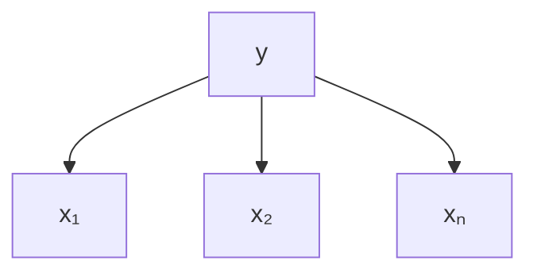

# Définition

Un **modèle graphique** est une famille de lois de probabilité définies à partir d'un [[Graphes dirigés et graphes non dirigés|graphe, dirigé ou non]]. Les nœuds du graphe sont identifiés à des variables aléatoires, et la loi jointe s'obtient en prenant le produit de fonctions définies sur des sous-ensembles connexes de nœuds.

# Interprétation

L'idée directrice est de représenter la dépendance entre variables, donc aussi l'indépendance, par un graphe. La structure du graphe rend lisible quelles variables sont liées, et elle apporte deux bénéfices immédiats.

- La loi jointe se factorise en un produit de fonctions locales, chacune portant sur un sous-ensemble connexe de nœuds.
- Les algorithmes d'inférence génériques de la théorie des graphes s'appliquent, sans réécrire un calcul propre à chaque modèle.

En pratique, les données ne sont pas des observations indépendantes sans structure : une mesure indexée par le temps présente une structure temporelle, et une mesure indexée par une position présente une structure spatiale. Un modèle doit prendre en compte cette information structurelle, et le graphe en est le support.

# Exemple

Un cas élémentaire : une variable $y$ dont dépendent $n$ variables $x_1, \dots, x_n$, regroupées en un vecteur $\mathbf{x}$. La loi jointe se factorise suivant le graphe dirigé en étoile centré sur $y$,

$$p(\mathbf{x}, y) = p(y) \prod_{i=1}^{n} p(x_i \mid y)$$

Chaque facteur du produit est porté par un sous-ensemble connexe du graphe : le nœud $y$ seul pour $p(y)$, puis la paire $\{y, x_i\}$ pour chaque $p(x_i \mid y)$. L'absence d'arête entre deux variables $x_i$ et $x_j$ traduit leur indépendance conditionnelle sachant $y$.

# Remarque

La forme du graphe distingue les deux grandes familles : un graphe dirigé donne un [[Réseau bayésien]], un graphe non dirigé un [[Champ aléatoire de Markov]].

La factorisation en produit de fonctions sur des sous-ensembles de nœuds se lit explicitement sur un [[Graphe de facteurs]], qui rend chaque facteur visible comme un nœud du graphe.
