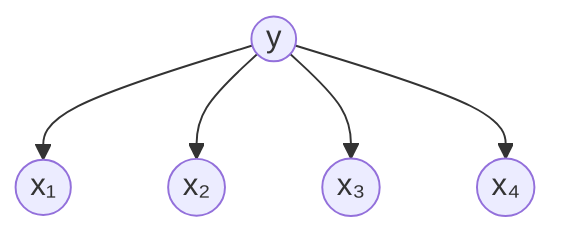
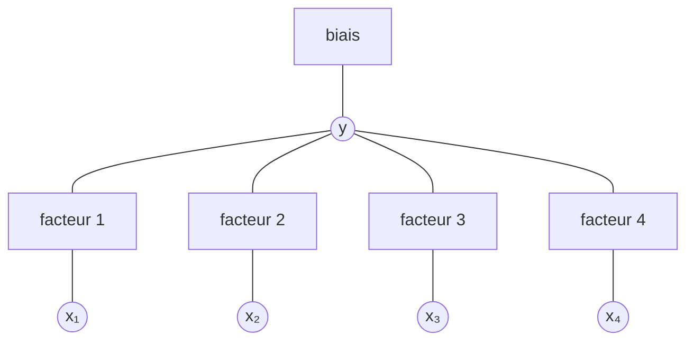

# Modèle

Un problème de prédiction met en regard des observations $X$ et une sortie $Y$ à prédire. Deux familles de modèles graphiques s'en chargent :

- un **modèle génératif** décrit la loi jointe $\mathbb{P}[X, Y]$ : les observations et la sortie y sont des variables aléatoires, engendrées par le modèle ;
- un **modèle conditionnel**, dit aussi **discriminatif**, décrit directement la loi conditionnelle $\mathbb{P}[Y \mid X]$ : les observations $X$ y sont toujours données et seule la sortie $Y$ est modélisée.

Pour un modèle génératif, la loi conditionnelle se déduit de la loi jointe par la [[Formule de Bayes]] :

$$p(y \mid \mathbf{x}) = \frac{p(y, \mathbf{x})}{p(\mathbf{x})}$$

Les deux familles portent donc sur les mêmes objets, une observation $\mathbf{x}$ et une étiquette $y$ à prédire, mais posent le problème différemment : l'une passe par la loi jointe, l'autre par la loi conditionnelle.

# Interprétation

Le bestiaire des modèles range les deux familles sur deux lignes, chacune parcourant les mêmes trois degrés de complexité.

| Famille | Modèle simple | Modèle séquentiel | Modèle général |
| --- | --- | --- | --- |
| Génératif | [[Classifieur naïf de Bayes]] | [[Modèle de Markov caché]] | modèles dirigés génératifs |
| Conditionnel | régression logistique | CRF à chaîne linéaire | CRF généraux |

Les CRF sont les champs aléatoires conditionnels.

De gauche à droite, la structure s'enrichit :

- premier degré : une sortie unique reliée à quelques observations, sans dépendance entre celles-ci ;
- deuxième degré : les observations forment une séquence et chaque observation est attachée à un état d'une chaîne (flèche SEQUENCE) ;
- troisième degré : observations et sorties sont reliées par un graphe quelconque (flèche GENERAL GRAPHS).

D'une ligne à l'autre, la structure du graphe se conserve et seule la loi décrite change :

- la ligne générative est faite de graphes dirigés, où les observations sont engendrées par les variables du modèle ; au troisième degré, une observation peut à son tour en engendrer une autre ;
- la ligne conditionnelle est faite de graphes de facteurs, sans direction, où les observations sont toujours présentes ; l'étiquette CONDITIONAL marque que seul le conditionnement sur ces observations est modélisé.

Le bestiaire se lit ainsi en correspondance terme à terme : le classifieur naïf de Bayes a pour homologue conditionnel la régression logistique, le modèle de Markov caché le CRF à chaîne linéaire, et les modèles dirigés génératifs les CRF généraux.

Le principe discriminatif consiste à modéliser directement la distribution de $p(y \mid \mathbf{x})$ afin de :

- ne pas dépenser d'effort à modéliser la distribution de $\mathbf{x}$ ;
- prendre en compte des traits en interaction et des dépendances à long terme ;
- entraîner directement pour la tâche visée.

La modélisation discriminative est liée aux [[Distribution de maximum d'entropie d'une traduction|distributions de maximum d'entropie]] : la loi conditionnelle y prend la forme normalisée d'une exponentielle de combinaison linéaire de [[Fonctions de traits d'un exemple de traduction|fonctions de traits]], ce qui correspond au [[Principe du maximum d'entropie|principe du maximum d'entropie]] appliqué sous contraintes d'espérance.

# Exemple

Sur une tâche de classification, les deux familles donnent deux écritures du même problème.

Côté génératif, la loi jointe se factorise selon le modèle de [[Classifieur naïf de Bayes|Naive Bayes]], l'étiquette engendrant les observations :

$$p(y, \mathbf{x}) = p(y) \prod_{i=1}^{n} p(x_i \mid y)$$

Le graphe associé est un [[Réseau bayésien]] : il est dirigé, avec une racine $y$ et une flèche de $y$ vers chaque $x_i$.

Côté conditionnel, la loi conditionnelle s'écrit directement sous forme normalisée, avec un jeu de coefficients par classe $k$ :

$$p(y \mid \mathbf{x}) = \frac{1}{Z} \exp\left(b^{(k)} + \mathbf{w}^{(k)} \mathbf{x}\right)$$

où $Z$ est la constante de normalisation sur les étiquettes possibles, $b^{(k)}$ un biais et $\mathbf{w}^{(k)}$ un vecteur de poids propres à la classe $k$, conformément à la [[Régression logistique multinomiale]]. Le graphe associé n'est plus dirigé : l'étiquette et chaque observation sont reliées par un facteur, ce qui donne un [[Graphe de facteurs|graphe de facteurs]] en étoile, avec un facteur supplémentaire pour le biais.

La différence de structure traduit la différence de modélisation : le graphe génératif oriente les flèches de l'étiquette vers les observations qu'elle engendre, le graphe conditionnel se contente d'attacher l'étiquette aux observations par des facteurs, sans rien dire de la loi de $\mathbf{x}$.

# Remarque

La ligne générative est constituée de [[Réseau bayésien|réseaux bayésiens]] et la ligne conditionnelle de [[Graphe de facteurs|graphes de facteurs]] : la première porte des flèches, la seconde des facteurs.

Le choix entre les deux familles est un compromis :

- le génératif décrit aussi la loi des observations $\mathbb{P}[X]$, ce qui est coûteux lorsque les observations sont de grande dimension, mais permet d'engendrer des données ;
- le conditionnel n'en décrit pas la loi et concentre l'effort sur $\mathbb{P}[Y \mid X]$.

L'écriture conditionnelle s'étend telle quelle aux suites. Pour une séquence d'observations $X$ et une suite d'étiquettes $Y$ de même longueur $n$, la loi conditionnelle s'écrit

$$\mathbb{P}[Y \mid X] = \frac{1}{Z(x, \Lambda)} \exp\left( \sum_{j=1}^{m} \lambda_j f_j(x, y) \right)$$

où les $f_j$ sont des fonctions de traits portant sur la séquence entière et $\Lambda$ l'ensemble des poids. Reste à savoir si cette forme suffit à décrire les dépendances entre étiquettes voisines : la réponse est le [[Champ aléatoire conditionnel à chaîne linéaire]], degré séquentiel de la ligne conditionnelle, dont le [[Modèle de Markov caché]] est le pendant génératif et le [[Champ de Markov caché]] la version latente.

Sur le plan de l'estimation, maximiser la log-vraisemblance conditionnelle conduit à égaliser deux quantités pour chaque fonction de trait : l'[[Espérance empirique d'une fonction de trait|espérance empirique]] calculée sur les données et l'espérance théorique sous le modèle courant. Cette égalité vaut pour l'ensemble des données d'entraînement et non pour un seul point, et c'est elle qui relie la famille conditionnelle au [[Principe du maximum d'entropie]]. Dès que l'on passe aux graphes généraux, la tractabilité devient rapidement un problème : le calcul de ces espérances et l'inférence associée exigent des algorithmes dédiés, du [[Graphe de facteurs|graphe de facteurs]] à l'[[Élimination de variables]].

Le [[Champ de Markov caché]] diffère des CRF de la ligne conditionnelle : il modélise la loi jointe d'un champ caché et de ses observations, alors qu'un CRF conditionne sur les observations.
