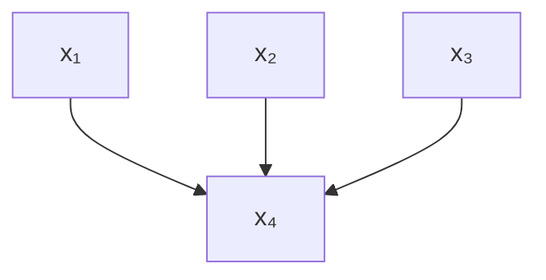
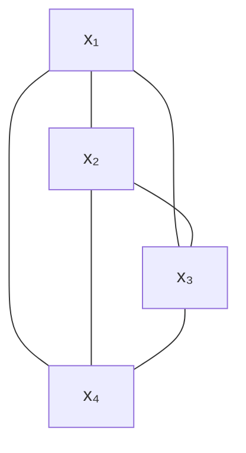

#adm-7

# Définition

La moralisation associe à un graphe orienté un graphe non dirigé, son graphe moralisé, en deux étapes :

- marier les parents de chaque nœud, c'est-à-dire relier entre eux deux à deux tous les parents d'un même nœud ;
- retirer l'orientation de toutes les arêtes.

Le graphe obtenu a les mêmes sommets que le graphe orienté ; seules ses arêtes changent.

Notation : $x_1, \dots, x_n$ désignent les nœuds du graphe, $\pi_v$ l'ensemble des parents d'un nœud $v$, et $f_a$ un facteur.

# Algorithme

```
pour chaque nœud v du graphe orienté :
    relier deux à deux tous les parents de v      (arêtes de mariage)
pour chaque arc (u -> v) :
    remplacer l'arc par une arête non dirigée entre u et v
```

# Exemple

Sur le graphe orienté à quatre nœuds où $x_1$, $x_2$ et $x_3$ sont les parents de $x_4$, le mariage relie $x_1$, $x_2$ et $x_3$ deux à deux ; les trois arcs deviennent ensuite des arêtes non dirigées.

Avant la moralisation :



Après la moralisation, les quatre sommets forment un graphe complet :



La loi jointe se lit alors directement comme un produit de facteurs, les trois lois marginales et la loi conditionnelle de $x_4$ sachant ses parents se regroupant en un seul facteur sur l'ensemble des quatre variables :

$$\mathbb{P}[\mathbf{x}] = \mathbb{P}[x_4 \mid x_1, x_2, x_3] \mathbb{P}[x_1] \mathbb{P}[x_2] \mathbb{P}[x_3] = \frac{1}{Z} f_a(x_1, x_2, x_3, x_4)$$

Pour un graphe en chaîne, la moralisation se réduit à « enlever » l'orientation des arêtes. La loi jointe s'écrit d'abord avec une loi conditionnelle par nœud :

$$\mathbb{P}[\mathbf{x}] = \mathbb{P}[x_1] \mathbb{P}[x_2 \mid x_1] \mathbb{P}[x_3 \mid x_2] \dots \mathbb{P}[x_n \mid x_{n-1}]$$

soit, après conversion en facteurs :

$$\mathbb{P}[\mathbf{x}] = f_1(x_1) f_2(x_1, x_2) f_3(x_2, x_3) \dots f_n(x_{n-1}, x_n)$$

Chaque nœud n'y a qu'un seul parent : il n'y a aucun couple de parents à marier, et la seule opération est de supprimer le sens des flèches.

# Interprétation

Moraliser revient à traduire une factorisation dirigée, une loi conditionnelle par nœud sachant ses parents, en une factorisation non dirigée, un facteur par famille. Le mariage rend la portée de chaque facteur complète : le nœud et tous ses parents forment une clique du graphe moralisé, et le facteur peut y être posé sans dépendance manquante.

L'opération modifie la topologie du graphe : des arêtes absentes du graphe orienté apparaissent entre les parents d'un même nœud. Le graphe moralisé étant non dirigé, il relève de la lecture non dirigée décrite dans [[Graphes dirigés et graphes non dirigés]].

# Remarque

La forme obtenue est celle d'un [[Graphe de facteurs|graphe de facteurs]], avec un facteur par famille du graphe orienté de départ.

Le point de départ est un [[Réseau bayésien|réseau bayésien]] ; le point d'arrivée un graphe non dirigé, dont la factorisation se fait en potentiels de clique.

Comme le graphe en chaîne le montre, le mariage est l'opération réellement nouvelle : sans parents multiples, la moralisation n'est qu'un effacement des orientations.

Le graphe moralisé sert d'entrée aux méthodes d'inférence écrites pour les graphes non dirigés, notamment la construction d'un [[Arbre de jonction|arbre de jonction]].
