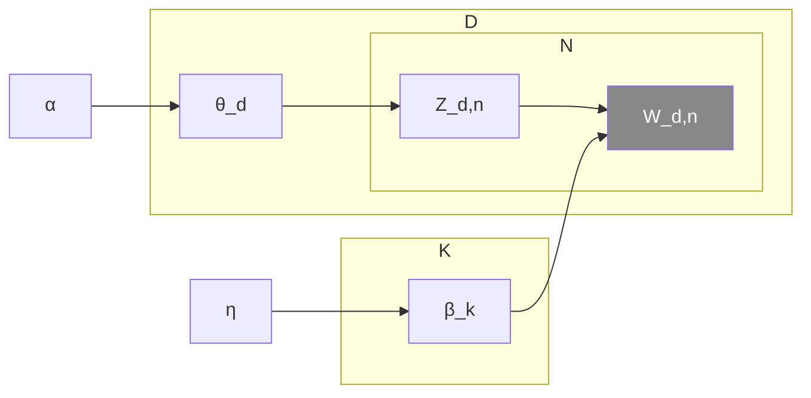

# Définition

La **notation en plaques** est une convention de dessin des [[Réseau bayésien|réseaux bayésiens]] qui résume un motif répété : on encadre d'un rectangle, appelé *plaque*, le groupe de nœuds qui se répète, et l'étiquette de la plaque donne le nombre de répétitions.

Une plaque se lit donc à deux niveaux :

- les nœuds qu'elle contient décrivent un motif unique, écrit une seule fois ;
- son étiquette, son *compteur*, indique combien de copies indépendantes de ce motif coexistent dans le modèle.

Un nœud ombré désigne une variable observée, un nœud blanc une variable latente. Les paramètres partagés par toutes les répétitions restent à l'extérieur des plaques.

# Interprétation

Une plaque de taille $N$ contenant un nœud $X$ abrège $N$ variables $X_1, \dots, X_N$, avec la même famille de dépendances pour chacune. Le gain est surtout de lisibilité : un modèle qui répète le même motif sur des milliers d'indices se dessine avec un seul nœud et un compteur, au lieu d'une chaîne de nœuds juxtaposés.

Les plaques peuvent s'imbriquer : une plaque intérieure décrit une répétition à l'intérieur de chaque copie de la plaque extérieure, si bien que le nombre total de copies du motif intérieur est le produit des deux compteurs.

Une flèche qui traverse la frontière d'une plaque vaut pour toutes les copies du motif qu'elle encadre.

# Exemple

Le modèle d'[[Allocation de Dirichlet latente]] s'écrit avec trois plaques, de tailles $N$, $D$ et $K$. Ses nœuds portent les noms suivants :

- $\alpha$ : paramètre des proportions ;
- $\theta_d$ : proportions de topics du document $d$ ;
- $Z_{d,n}$ : affectation de topic du $n$-ième mot du document $d$ ;
- $W_{d,n}$ : mot observé, le $n$-ième du document $d$ ;
- $\beta_k$ : topic $k$ ;
- $\eta$ : paramètre des topics.

Les plaques se lisent ainsi :

- la plaque intérieure des mots, de taille $N$, contient $Z_{d,n}$ et $W_{d,n}$, avec $Z_{d,n} \to W_{d,n}$ ;
- la plaque extérieure des documents, de taille $D$, contient $\theta_d$ et la plaque intérieure, avec $\theta_d \to Z_{d,n}$ ;
- la plaque des topics, de taille $K$, contient $\beta_k$, avec $\beta_k \to W_{d,n}$.

Le chemin génératif complet est

$$\alpha \to \theta_d \to Z_{d,n} \to W_{d,n} \leftarrow \beta_k \leftarrow \eta$$

Le nœud $W_{d,n}$ est ombré : les mots sont les seules variables observées du modèle. Le paramètre $\eta$, extérieur à toute plaque, est partagé par les $K$ topics.

# Remarque

La notation en plaques est un raccourci d'écriture d'un [[Réseau bayésien]] : le graphe déplié serait un réseau bayésien dont chaque nœud porte ses indices. Elle sert de point de départ à la construction d'un [[Graphe de facteurs]], où chaque facteur de la loi jointe devient un nœud relié aux variables qu'il concerne.

Un modèle en plaques plus riche que le modèle de topics est décrit dans [[Régression logistique à covariables mesurées avec erreur]] : une régression, un mélange et un modèle de mesure y partagent une même plaque d'individus, les paramètres restant à l'extérieur.
