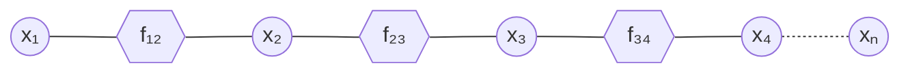
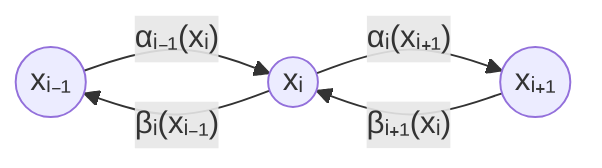

#adm-7

# Modèle

Une chaîne de $n$ variables $x_1, \dots, x_n$ est décrite par un facteur par paire de variables voisines : la loi jointe du vecteur $\mathbf{x} = (x_1, \dots, x_n)$ est proportionnelle au produit de ces facteurs,

$$\mathbb{P}[\mathbf{x}] \propto f_{1,2}(x_1, x_2) f_{2,3}(x_2, x_3) f_{3,4}(x_3, x_4) \dots f_{n-1,n}(x_{n-1}, x_n)$$

# Algorithme

La marginale d'une variable s'obtient en sommant la loi jointe sur toutes les autres variables :

$$\mathbb{P}[x_i] = \sum_{x_1} \dots \sum_{x_{i-1}} \sum_{x_{i+1}} \dots \sum_{x_n} \mathbb{P}[\mathbf{x}]$$

L'[[Élimination de variables]] conduit à effectuer ces sommes de proche en proche : chaque somme partielle forme un facteur qui ne dépend plus que d'une variable. Sur une chaîne, le mécanisme se lit aux deux extrémités.

En partant de l'extrémité droite, la somme sur $x_n$ ne dépend que du dernier facteur,

$$\beta_n(x_{n-1}) = \sum_{x_n} f_{n-1,n}(x_{n-1}, x_n)$$

puis la somme sur $x_{n-1}$ ne dépend que du facteur précédent et de $\beta_n(x_{n-1})$,

$$\beta_{n-1}(x_{n-2}) = \sum_{x_{n-1}} f_{n-2,n-1}(x_{n-2}, x_{n-1}) \beta_n(x_{n-1})$$

En partant de l'extrémité gauche, la somme sur $x_1$ ne dépend que du premier facteur,

$$\alpha_1(x_2) = \sum_{x_1} f_{1,2}(x_1, x_2)$$

puis la somme sur $x_2$ ne dépend que du facteur suivant et de $\alpha_1(x_2)$,

$$\alpha_2(x_3) = \sum_{x_2} f_{2,3}(x_2, x_3) \alpha_1(x_2)$$

Chaque étape définit ainsi un message, envoyé d'une variable à sa voisine et portant l'information accumulée depuis l'extrémité de départ.

# Propriétés

Le message envoyé vers la droite, de $x_{i-1}$ vers $x_i$, résume les facteurs situés à gauche de $x_i$ ; il obéit à la récurrence

$$\alpha_{i-1}(x_i) = \sum_{x_{i-1}} f_{i-1,i}(x_{i-1}, x_i) \alpha_{i-2}(x_{i-1})$$

Le message envoyé vers la gauche, de $x_i$ vers $x_{i-1}$, résume les facteurs situés à droite de $x_{i-1}$ ; il obéit à la récurrence

$$\beta_i(x_{i-1}) = \sum_{x_i} f_{i-1,i}(x_{i-1}, x_i) \beta_{i+1}(x_i)$$

La marginale de $x_i$ est alors, à normalisation près, le produit des deux messages qui arrivent en $x_i$ :

$$\mathbb{P}[x_i] \propto \alpha_{i-1}(x_i) \beta_{i+1}(x_i)$$

# Remarque

- Tous les messages se calculent en deux balayages : un balayage de $x_1$ vers $x_n$ pour les $\alpha$, un balayage de $x_n$ vers $x_1$ pour les $\beta$ ; chaque message ne réutilise que le message précédent et le facteur qui le relie à la variable voisine.
- Le passage de messages sur une chaîne est le cas particulier, pour un arbre réduit à une chaîne, de l'[[Algorithme somme-produit]].
- La même famille de messages se rencontre avec l'indice portant sur la valeur de l'état et l'argument sur l'instant : $\alpha_i(t)$ désigne alors le message calculé pour l'état $i$ à l'instant $t$. Ici, l'indice repère la position de la variable dont part le message et l'argument la valeur de la variable destinataire. Les deux écritures désignent les mêmes quantités, seul le choix de ce que désignent l'indice et l'argument change.
- Ce sont ces mêmes messages que l'on retrouve dans les [[Probabilités forward et backward]], calculées par l'[[Algorithme forward|algorithme forward]] et l'[[Algorithme backward|algorithme backward]].
