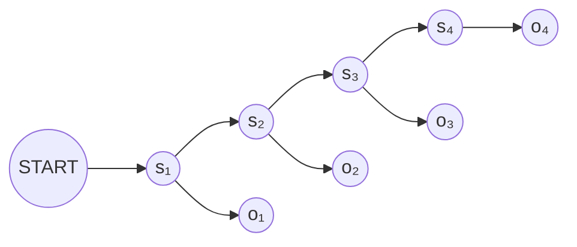

#adm-6 #adm-7 #adm-8

# Loi

Un [[Modèle de Markov caché|modèle de Markov caché]] fait vivre deux séquences sur les mêmes instants $t = 1, \dots, T$ : les états cachés $S = s_1, \dots, s_T$ et les observations $O = o_1, \dots, o_T$. La loi qui régit l'ensemble du modèle est la loi jointe du couple, et elle se factorise en la loi des états et en la loi des observations sachant les états :

$$\mathbb{P}[O = o_1, \dots, o_T, S = s_1, \dots, s_T] = \mathbb{P}[O \mid S] \, \mathbb{P}[S]$$

Le facteur $\mathbb{P}[S]$ est la probabilité de la suite d'états, le facteur $\mathbb{P}[O \mid S]$ la probabilité des observations une fois cette suite connue. Chacun se calcule à partir d'une seule hypothèse du modèle, ce qui rend la loi jointe entièrement calculable.

# Propriétés

La suite des états est une [[Chaîne de Markov à temps discret|chaîne de Markov]] d'ordre 1 : chaque état ne dépend que de l'état précédent, et le premier état est régi par le seul terme $\pi_{s_1}$. La probabilité d'une suite d'états vaut donc

$$\mathbb{P}[S = s_1, \dots, s_T] = \pi_{s_1} \prod_{t=2}^{T} \mathbb{P}[s_t \mid s_{t-1}]$$

Le terme $\pi_{s_1}$ donne la probabilité de commencer en $s_1$, chaque facteur suivant une probabilité de transition de $s_{t-1}$ vers $s_t$.

Les observations sont conditionnellement [[Indépendance de variables aléatoires|indépendantes]] sachant les états : chacune ne dépend que de l'état de sa propre date, si bien que la probabilité conditionnelle de la séquence d'observations est le produit de ces dépendances locales :

$$\mathbb{P}[O = o_1, \dots, o_T \mid S = s_1, \dots, s_T] = \prod_{t=1}^{T} \mathbb{P}[o_t \mid s_t]$$

En reportant ces deux expressions dans la loi jointe, on obtient la probabilité d'une histoire complète, états et observations :

$$\mathbb{P}[O = o_1, \dots, o_T, S = s_1, \dots, s_T] = \pi_{s_1} \prod_{t=2}^{T} \mathbb{P}[s_t \mid s_{t-1}] \prod_{t=1}^{T} \mathbb{P}[o_t \mid s_t]$$

En notant $a_{s_{t-1}s_t} = \mathbb{P}[s_t \mid s_{t-1}]$ les probabilités de transition et $b_{s_t}(o_t) = \mathbb{P}[o_t \mid s_t]$ les probabilités d'émission, la même jointure se lit comme le produit des transitions et le produit des émissions :

$$\mathbb{P}[O, S] = \prod_{t=1}^{T} \mathbb{P}[s_t \mid s_{t-1}] \prod_{t=1}^{T} \mathbb{P}[o_t \mid s_t]$$

avec la convention $s_0 = \text{START}$ pour le premier facteur de transition, auquel aucune observation n'est associée. La loi des observations s'obtient en sommant la jointure sur toutes les séquences d'états possibles :

$$\mathbb{P}[O = o_1, \dots, o_T] = \sum_{s_1, \dots, s_T} \mathbb{P}[O = o_1, \dots, o_T, S = s_1, \dots, s_T]$$

# Interprétation

La factorisation reflète les deux niveaux du modèle. La loi jointe se lit comme un enchaînement génératif : un état initial de probabilité $\pi_{s_1}$, $T - 1$ transitions pour dérouler la suite des états, puis un tirage d'observation par état atteint. Sa valeur est la vraisemblance d'une trajectoire complète, celle d'un couple (états, observations) donné, et non celle des seules observations.

Chacune des deux hypothèses fournit un seul des deux facteurs : la suite des états cachés évolue selon une chaîne de Markov, dont la probabilité est celle de son état initial multipliée par les probabilités de transition successives, tandis que chaque observation $o_t$ ne dépend que de l'état $s_t$ au même instant. Un terme du produit a une lecture concrète : $\mathbb{P}[s_t \mid s_{t-1}] \, \mathbb{P}[o_t \mid s_t]$ est la probabilité du pas qui mène de l'état $s_{t-1}$ à l'état $s_t$ et y émet l'observation $o_t$.

# Exemple

Sur quatre jours, un modèle du temps prend pour états cachés l'état du ciel et pour observations le triplet température, humidité et vent, relevé chaque jour :

| Jour | État caché | Observation |
|---|---|---|
| lundi | ensoleillé | $30$ °C, $20$ %, vent faible |
| mardi | ensoleillé | $28$ °C, $30$ %, vent faible |
| mercredi | nuageux | $25$ °C, $40$ %, vent modéré |
| jeudi | pluvieux | $22$ °C, $60$ %, vent modéré |

La probabilité de cette trajectoire complète se développe terme à terme sur les quatre pas :

$$\mathbb{P}[O, S] = \pi_{s_1}\, \mathbb{P}[o_1 \mid s_1]\, \mathbb{P}[s_2 \mid s_1]\, \mathbb{P}[o_2 \mid s_2]\, \mathbb{P}[s_3 \mid s_2]\, \mathbb{P}[o_3 \mid s_3]\, \mathbb{P}[s_4 \mid s_3]\, \mathbb{P}[o_4 \mid s_4]$$

Chaque couple $\mathbb{P}[s_{t+1} \mid s_t]\, \mathbb{P}[o_{t+1} \mid s_{t+1}]$ se lit comme la probabilité de passer de l'état du jour $t$ à celui du jour $t+1$ et d'y observer le relevé correspondant.

# Remarque

La notation $O = o_1, \dots, o_T$ désigne la séquence entière, la lettre nue $O$ renvoyant à la suite et chaque $o_t$ à la valeur prise à l'instant $t$ ; de même pour $S$ et $s_t$. L'écriture $O = o_1, \dots, T$, où la virgule est suivie directement de $T$, omet l'indice final de $o$ : la séquence s'arrête à $o_T$, d'où la forme $O = o_1, \dots, o_T$ employée dans les formules ci-dessus.

Les deux indices d'une probabilité conditionnelle se lisent à la date qu'ils portent : $\mathbb{P}[o_t \mid s_t]$ compare l'observation et l'état du même instant $t$, tandis que $\mathbb{P}[s_t \mid s_{t-1}]$ relie deux instants consécutifs.

Le produit sur les états part de $t = 2$ parce que le cas $t = 1$ est déjà couvert par $\pi_{s_1}$ ; le produit sur les observations part de $t = 1$ parce que chaque instant émet une observation, y compris le premier.

L'écriture de la jointure dépend de la convention d'indices retenue : avec des états indexés à partir de $0$, soit $s_0, \dots, s_{T-1}$, le produit des transitions démarre à l'indice $1$, puisque le premier pas porte la transition vers $s_1$ et l'émission $o_1$. Une erreur fréquente consiste à faire démarrer ce produit au deuxième pas : le facteur du pas de $s_0$ vers $s_1$ manque alors, et l'écriture ne décrit plus la même loi. Avec la convention $s_0 = \text{START}$ adoptée ici, la séquence commence à $s_1$, aucune observation n'est émise à l'instant $0$, et le premier pas fournit à la fois $\pi_{s_1}$ et $\mathbb{P}[o_1 \mid s_1]$.

Aucune constante de normalisation n'apparaît : le produit $\mathbb{P}[O \mid S] \, \mathbb{P}[S]$ est déjà une loi sur le couple des deux séquences.

Les facteurs $\pi_{s_1}$, $\mathbb{P}[s_t \mid s_{t-1}]$ et $\mathbb{P}[o_t \mid s_t]$ sont exactement les [[Paramètres d'un modèle de Markov caché|paramètres du modèle]]. La loi marginale des observations s'obtient en sommant la loi jointe sur toutes les suites d'états possibles, somme qui définit le problème d'évaluation parmi les [[Trois problèmes d'un modèle de Markov caché|trois problèmes d'un modèle de Markov caché]]. La jointure est la quantité de base de ces trois problèmes : le [[Décodage d'une séquence d'états|décodage]] la maximise sur les séquences d'états, et l'évaluation de sa somme demande un calcul efficace, celui de l'[[Algorithme forward|algorithme forward]].
