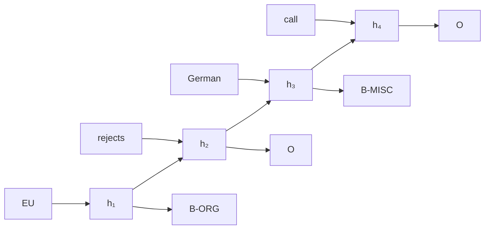

#adm-8

# Modèle

Un [[Réseau de neurones récurrent|réseau de neurones récurrent]] déroulé de gauche à droite sur les entrées $x_1, \dots, x_n$ produit à chaque position un état caché $h_k$ qui résume le préfixe $x_1, \dots, x_k$. Dans le mode de prédiction directe, l'étiquette $y_k$ de la position $k$ est lue sur cet état, sans étape intermédiaire.

Les scores $f(x_k, h_k)$ calculés par le réseau à partir de l'entrée $x_k$ et de l'état caché $h_k$ sont normalisés en une distribution sur l'ensemble des étiquettes $\mathcal{Y}$ par le softmax, dont la composante $y$ vaut

$$\operatorname{softmax}(z)[y] = \frac{e^{z_y}}{\sum_{y' \in \mathcal{Y}} e^{z_{y'}}}$$

Le score attribué à une séquence d'étiquettes est la somme, sur les positions, des probabilités que le softmax donne aux étiquettes choisies :

$$L(y_1, \dots, y_n) \propto \sum_{k=1}^{n} \underbrace{\operatorname{softmax}(f(x_k, h_k))[y_k]}_{\mathbb{P}(k, x, y_k) \text{, probabilité de l'étiquette } y_k \text{ en position } k}$$

# Interprétation

Le réseau étiquette la séquence position par position : à chaque position, le softmax fournit une distribution sur les étiquettes possibles, et la prédiction retient celle de probabilité maximale. Le score de la séquence agrège ces choix individuels, un terme par position.

Rien ne couple deux étiquettes voisines : la distribution de $y_k$ ne dépend que des entrées $x_1, \dots, x_k$ résumées dans $h_k$, jamais du choix fait en position $k-1$. Le pouvoir prédictif vient donc uniquement de la richesse de l'état caché, qui transporte l'information sur tout le préfixe de la séquence.

# Exemple

Sur la phrase « EU rejects German call », un réseau récurrent en lecture avant associe un état caché à chaque mot, puis prédit l'étiquette de chaque mot à partir du seul état correspondant, selon la convention [[Gabarits de traits et annotation BIO|BIO]] :

La sortie attendue est B-ORG, O, B-MISC, O : chaque état caché alimente une étiquette et une seule, et aucune arête ne relie deux étiquettes entre elles.

# Remarque

Le score $L$ ci-dessus additionne des probabilités par position, sans terme de transition. Un modèle qui ajoute un score $A(y_{k-1}, y_k)$ pour chaque couple d'étiquettes voisines, en plus du terme d'émission $\mathbb{P}(k, x, y_k)$, couple les choix successifs et s'écrit comme un [[Champ aléatoire conditionnel sur un réseau de neurones récurrent]] posé sur le même réseau ; il relève alors de la famille des [[Champ aléatoire conditionnel à chaîne linéaire|champs aléatoires conditionnels à chaîne linéaire]]. La lettre $L$ désigne dans les deux cas une somme sur les positions, mais la nature des termes sommés diffère : probabilités d'étiquettes isolées d'un côté, transition et émission de l'autre.
