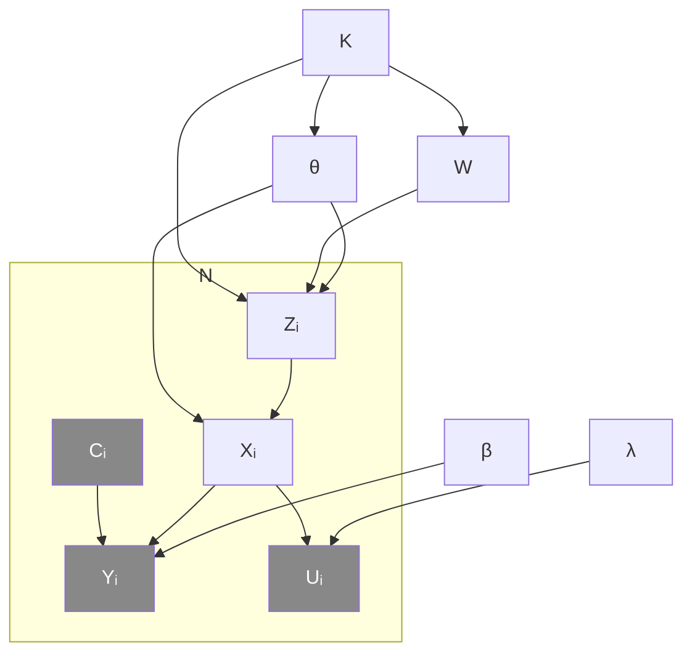

#adm-7

# Modèle

La **régression logistique à covariables mesurées avec erreur** est un [[Réseau bayésien|réseau bayésien]] qui combine trois mécanismes : une régression logistique, un [[Modèles de mélange|modèle de mélange]] pour la covariable et un modèle de mesure bruitée. C'est un exemple de réseau nettement plus complexe que les modèles en étoile ou en chaîne.

Pour chaque individu $i$, quatre variables sont distinguées :

- $Y_i$ : réponse binaire observée ;
- $X_i$ : covariable d'intérêt, non observée en général ;
- $U_i$ : mesures bruitées de $X_i$, observées ;
- $C_i$ : covariables supplémentaires, observées.

Le cœur du modèle est la régression logistique de $Y_i$ sur $X_i$, à laquelle s'ajoutent les covariables observées $C_i$ :

$$\mathbb{P}[Y_i = 1 \mid X_i, C_i] = \frac{\exp(\beta_0 + \beta_1 X_i + \beta_2^\top C_i)}{1 + \exp(\beta_0 + \beta_1 X_i + \beta_2^\top C_i)}$$

La covariable latente $X_i$ reçoit un modèle de mélange à $K$ composantes : $W = (W_1, \dots, W_K)$ sont les proportions du mélange, $Z_i$ est l'allocation de l'individu $i$ à une composante, et $\theta$ paramètre les composantes. L'allocation se tire selon

$$\mathbb{P}[Z_i = k] = W_k$$

et, sachant son allocation, la covariable suit la composante correspondante :

$$X_i \mid Z_i = k \sim f_{\theta_k}$$

La mesure $U_i$ est produite à partir de $X_i$ par une densité de mesure $g_\lambda$, où $\lambda$ paramètre le bruit :

$$U_i \mid X_i \sim g_\lambda(\cdot \mid X_i)$$

La factorisation de la loi jointe d'un individu se lit sur le graphe :

$$\mathbb{P}[Y_i, U_i, C_i, X_i, Z_i] = \mathbb{P}[C_i]\,\mathbb{P}[Z_i]\,\mathbb{P}[X_i \mid Z_i]\,\mathbb{P}[U_i \mid X_i]\,\mathbb{P}[Y_i \mid X_i, C_i]$$

Le modèle s'écrit en [[Notation en plaques]] : seule la plaque de taille $N$ dépend de l'individu, tous les paramètres restent à l'extérieur.

Les nœuds ombrés sont les variables observées du modèle, $C_i$, $Y_i$ et $U_i$. Les nœuds $X_i$ et $Z_i$ sont latents, tandis que $K$, $W$, $\theta$, $\beta$ et $\lambda$ sont des paramètres partagés par les $N$ individus.

# Interprétation

Trois lectures se superposent dans ce réseau :

- la régression logistique décrit l'effet de la vraie covariable $X_i$ et des covariables $C_i$ sur la réponse $Y_i$ ;
- le mélange décrit l'hétérogénéité de la population : l'individu appartient à une composante tirée au hasard, ce qui autorise une loi multimodale pour la covariable ;
- le modèle de mesure décrit l'imprécision de l'observation : $U_i$ n'est qu'une version bruitée de la covariable d'intérêt.

L'intérêt du modèle est de rendre estimable une régression dont la covariable n'est pas observable. Les seules données disponibles sont $Y_i$, $U_i$ et $C_i$, et la covariable $X_i$ est traitée comme une [[Variables cachées d'un modèle de mélange|variable cachée]], dont la loi est décrite par le mélange.

Remplacer $X_i$ par $U_i$ dans la régression reviendrait à ignorer l'erreur de mesure et fausserait l'estimation des coefficients ; séparer la covariable latente de ses mesures est précisément ce que permet ce modèle.

Comme illustration de réseau complexe, le modèle cumule ce que les réseaux plus simples font séparément :

- un [[Classifieur naïf de Bayes|classifieur naïf de Bayes]] a une racine et des feuilles indépendantes sachant la racine ;
- un [[Modèle de Markov caché]] enchaîne ses états, chaque observation restant attachée à un seul état ;
- ici deux couches latentes, l'allocation $Z_i$ puis la covariable $X_i$, alimentent deux observations parallèles, $Y_i$ et $U_i$, et les paramètres sont partagés sur toute la plaque.

# Remarque

Les proportions du mélange sont notées $W$ ; c'est la même notion que le poids d'une composante d'un [[Modèles de mélange|mélange]], l'écriture $W_k$ étant retenue ici parce que $W$ désigne le vecteur complet des $K$ proportions.

Conditionnellement à $X_i$, les observations $U_i$ et $Y_i$ ne dépendent plus de l'allocation $Z_i$ : le mélange n'agit sur elles qu'à travers la covariable latente. C'est la lecture d'[[Indépendance conditionnelle sachant une cause commune|cause commune]] du graphe, $X_i$ séparant ses deux descendants.

Le modèle est entièrement paramétrique : les densités des composantes et celle du bruit de mesure sont fixées à un paramètre près, si bien que, $K$ étant fixé, l'estimation porte sur $W$, $\theta$, $\beta$ et $\lambda$ à partir des seules variables observées.

Le nombre de composantes $K$ est un paramètre structurel, extérieur à la plaque : il est commun à tous les individus, comme dans tout modèle en plaques.

Le cœur logistique du modèle est celui de la [[Régression logistique binaire]], dont cette note décrit un emploi avec covariable latente mesurée avec erreur.
