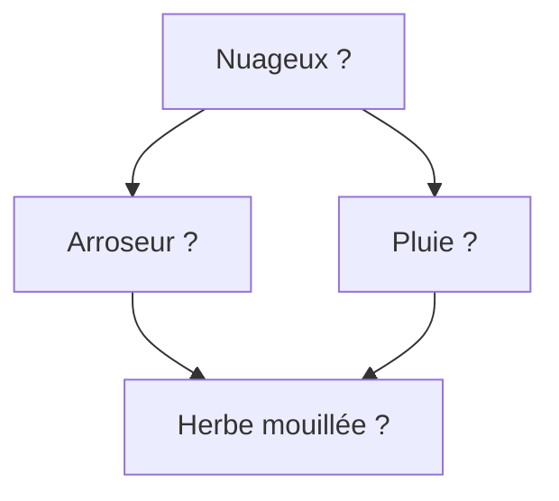

# Modèle

Le **réseau bayésien du système d'arrosage** est l'instance paramétrée d'un [[Réseau bayésien]] : un graphe orienté acyclique à quatre variables binaires.

- $C$ : le temps est nuageux (*cloudy*) ;
- $S$ : l'arroseur est en marche (*sprinkler*) ;
- $R$ : il pleut (*rain*) ;
- $W$ : l'herbe est mouillée (*wet grass*).

Le graphe orienté encode une famille de lois de probabilité dont la loi jointe vérifie

$$\mathbb{P}[C, S, R, W] = \mathbb{P}[C]\,\mathbb{P}[S \mid C]\,\mathbb{P}[R \mid C]\,\mathbb{P}[W \mid S, R]$$

On dit que la loi **se factorise** sur le graphe : chaque facteur ne porte que sur un nœud et sur ses parents.

Une instance de cette famille est entièrement spécifiée par les paramètres suivants, des tables de probabilités conditionnelles.

Loi marginale de $C$ :

| $C$ | F | T |
|---|---|---|
| $\mathbb{P}[C]$ | 0,5 | 0,5 |

Loi de $S$ sachant $C$ :

| $C$ | $\mathbb{P}[S = \text{F} \mid C]$ | $\mathbb{P}[S = \text{T} \mid C]$ |
|---|---|---|
| F | 0,5 | 0,5 |
| T | 0,9 | 0,1 |

Loi de $R$ sachant $C$ :

| $C$ | $\mathbb{P}[R = \text{F} \mid C]$ | $\mathbb{P}[R = \text{T} \mid C]$ |
|---|---|---|
| F | 0,8 | 0,2 |
| T | 0,2 | 0,8 |

Loi de $W$ sachant $R$ et $S$ :

| $R$ | $S$ | $\mathbb{P}[W = \text{F} \mid R, S]$ | $\mathbb{P}[W = \text{T} \mid R, S]$ |
|---|---|---|---|
| F | F | 1 | 0 |
| F | T | 0,1 | 0,9 |
| T | F | 0,1 | 0,9 |
| T | T | 0,01 | 0,99 |

# Exemple

L'herbe est mouillée : on observe $W = 1$. Remonter du bas du graphe vers le haut, des conséquences observées vers les causes, relève du [[Raisonnement causal et raisonnement diagnostique|raisonnement diagnostique]].

Probabilité que l'arroseur soit en marche :

$$\mathbb{P}[S = 1 \mid W = 1] = \frac{\sum_{c,r} \mathbb{P}[S = 1, W = 1, C = c, R = r]}{\mathbb{P}[W = 1]} = \frac{0{,}2781}{0{,}6471} \approx 0{,}4297$$

Probabilité qu'il pleuve :

$$\mathbb{P}[R = 1 \mid W = 1] = \frac{\sum_{c,s} \mathbb{P}[R = 1, W = 1, C = c, S = s]}{\mathbb{P}[W = 1]} = \frac{0{,}4581}{0{,}6471} \approx 0{,}7079$$

Probabilité que l'arroseur soit en marche, sachant en plus qu'il pleut :

$$\mathbb{P}[S = 1 \mid W = 1, R = 1] = \frac{\sum_{c} \mathbb{P}[S = 1, W = 1, C = c, R = 1]}{\mathbb{P}[W = 1, R = 1]} = 0{,}1945$$

L'herbe mouillée s'explique donc plus probablement par la pluie, à $0{,}7079$, que par l'arroseur, à $0{,}4297$.

# Remarque

Le numérateur de chaque rapport s'obtient en sommant la loi jointe sur les variables non observées, et chaque terme de la somme se calcule en multipliant les facteurs lus dans les tables ; le dénominateur, par exemple $\mathbb{P}[W = 1]$, se calcule de la même façon en sommant sur $C$, $S$ et $R$.

Savoir qu'il pleut fait baisser la probabilité que l'arroseur explique l'herbe mouillée, de $0{,}4297$ à $0{,}1945$ : c'est l'[[Explication par une cause concurrente|explication par une cause concurrente]] de deux causes possibles.
