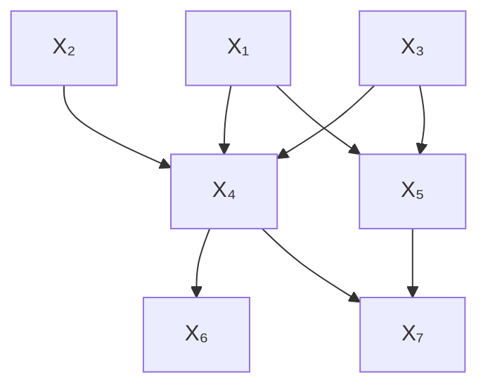
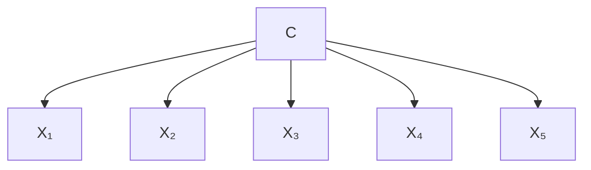
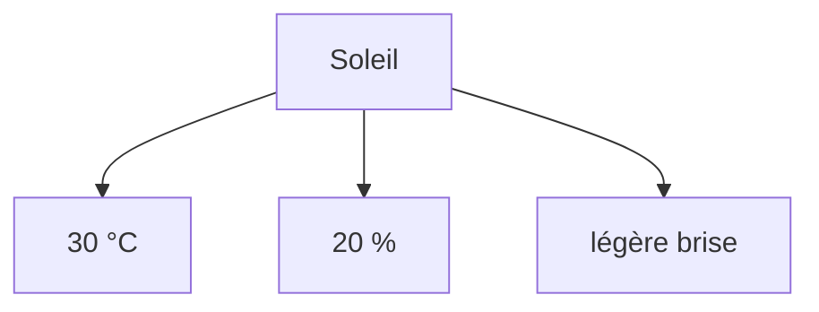

#adm-7

# Définition

Un **réseau bayésien** est un graphe acyclique dirigé (DAG) sur une collection de variables aléatoires (discrètes).

L'intérêt d'une telle structure est double :

- elle permet de factoriser la vraisemblance jointe des variables ;
- elle rend applicables des algorithmes génériques d'inférence.

# Propriétés

La vraisemblance jointe se factorise selon le graphe : chaque variable n'y apparaît conditionnée que par ses parents.

Sur un réseau à sept variables $X_1, \dots, X_7$, la règle de la chaîne développe d'abord la loi jointe en un facteur par variable, chacun conditionné sur toutes les variables qui le précèdent :

- $\mathbb{P}[X_1]$
- $\mathbb{P}[X_2 \mid X_1]$
- $\mathbb{P}[X_3 \mid X_2, X_1]$
- $\mathbb{P}[X_4 \mid X_1, X_2, X_3]$
- $\mathbb{P}[X_5 \mid X_1, \dots, X_4]$
- $\mathbb{P}[X_6 \mid X_1, \dots, X_5]$
- $\mathbb{P}[X_7 \mid X_1, \dots, X_6]$

Le graphe supprime les conditionnements inutiles : seuls subsistent les parents de chaque variable, c'est-à-dire

- $X_4$ conditionnée par $X_1$, $X_2$ et $X_3$ ;
- $X_5$ conditionnée par $X_1$ et $X_3$ ;
- $X_6$ conditionnée par $X_4$ ;
- $X_7$ conditionnée par $X_4$ et $X_5$ ;
- $X_1$, $X_2$ et $X_3$ sans aucun parent.

Les arêtes correspondantes sont $X_1 \to X_4$, $X_1 \to X_5$, $X_2 \to X_4$, $X_3 \to X_4$, $X_3 \to X_5$, $X_4 \to X_6$, $X_4 \to X_7$ et $X_5 \to X_7$ :

La factorisation développée s'écrit donc

$$\mathbb{P}[X_1, \dots, X_7] = \mathbb{P}[X_1]\,\mathbb{P}[X_2]\,\mathbb{P}[X_3]\,\mathbb{P}[X_4 \mid X_1, X_2, X_3]\,\mathbb{P}[X_5 \mid X_1, X_3]\,\mathbb{P}[X_6 \mid X_4]\,\mathbb{P}[X_7 \mid X_4, X_5]$$

Une dépendance que le graphe ne représente pas explicitement disparaît ainsi de la factorisation : c'est la forme graphique de l'[[Indépendance conditionnelle sachant une cause commune|indépendance conditionnelle]].

# Exemple

Le [[Classifieur naïf de Bayes|classifieur naïf de Bayes]] est un réseau bayésien en étoile : le label $C$ est la racine, et chacune des observations $X_1, \dots, X_5$ n'a que $C$ pour parent.

Chaque observation n'étant conditionnée que par le label, la loi jointe d'un label $y$ et de $n$ observations $x_1, \dots, x_n$ se réduit à la factorisation naïve de Bayes :

$$\mathbb{P}[\mathbf{x}, y] = \mathbb{P}[y] \prod_{i=1}^{n} \mathbb{P}[x_i \mid y]$$

Pour cinq observations, elle s'écrit

$$\mathbb{P}[C, X_1, \dots, X_5] = \mathbb{P}[C] \prod_{i=1}^{5} \mathbb{P}[X_i \mid C]$$

La météo du jour en est une lecture immédiate : l'ensoleillement y joue le rôle de la cause $y$ ; la température (30 °C), l'humidité (20 %) et la légère brise jouent celui des observations, chacune conditionnée par le seul ensoleillement.

# Remarque

Dans le dernier facteur de la factorisation, la variable aléatoire se note en majuscule et la minuscule désigne l'une de ses réalisations : le facteur s'écrit $\mathbb{P}[X_6 \mid X_4]$. La forme $\mathbb{P}[x_6 \mid X_4]$, qui mêle les deux conventions dans un même facteur, est une coquille fréquente.

Un réseau bayésien est un cas particulier de [[Modèle graphique]] : c'est la forme dirigée, dont le graphe doit être acyclique. La forme non dirigée correspondante est celle des [[Champ aléatoire de Markov|champs aléatoires de Markov]] ; la comparaison des deux familles est détaillée dans [[Graphes dirigés et graphes non dirigés]].

La factorisation dirigée se lit aussi comme un cas particulier de la factorisation en facteurs : chaque loi conditionnelle devient un facteur, et le [[Graphe de facteurs]] rend visible sur quelles variables porte chacun d'eux.

D'autres réseaux bayésiens structurent des modèles déjà rencontrés :

- le [[Modèle de Markov caché]], dont chaque observation est attachée à un état de la chaîne ;
- l'[[Allocation de Dirichlet latente]], dont les dépendances répétées se résument par la [[Notation en plaques]] ;
- le [[Réseau bayésien du système d'arrosage]], instance paramétrée où les probabilités conditionnelles sont explicitées.
