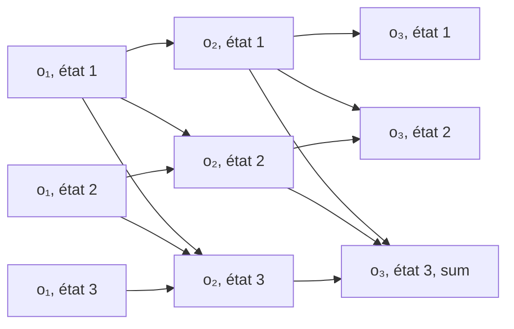

#adm-6 #adm-7

# Définition

Le **treillis** (trellis) d'un [[Modèle de Markov caché|modèle de Markov caché]] est le dépliage de la chaîne dans le temps : chaque état et chaque instant y occupent une position fixe.

- Une **colonne** par instant $t$, étiquetée par l'observation $o_t$ ; le treillis complet porte les observations $o_1$, $o_2$, $o_3$, $o_4$, $o_5$, $o_6$, $o_7$, $o_8$.
- Une **ligne** par état du modèle, numérotés ici de $1$ à $4$.
- Un **nœud** pour chaque couple (état $i$, instant $t$) : l'hypothèse « le modèle est dans l'état $i$ à l'instant $t$ ».
- Un **arc** du nœud $(i, t-1)$ vers le nœud $(j, t)$ pour chaque transition autorisée de $i$ vers $j$ ; un état transite vers lui-même (boucle) ou vers un état d'indice supérieur, adjacent ou non, et chaque arc relie donc deux colonnes consécutives.
- L'observation $o_t$ n'étiquette aucun arc : elle nomme la colonne et s'applique à toutes ses cases.

Le treillis se lit donc aussi comme une matrice (ou un graphe) dont les éléments sont des couples (état, observation) : l'une des dimensions correspond aux observations $o_1, \ldots, o_T$, l'autre aux états de la [[Chaîne de Markov à temps discret|chaîne de Markov]].

Chaque élément du treillis possède un ensemble de **prédécesseurs**, définis par la topologie de la chaîne de Markov : les éléments de l'observation précédente dont l'état admet une transition vers l'état de l'élément considéré. Un **chemin** dans le treillis est une séquence d'états $S_1, \ldots, S_T$, un état par observation, où chaque transition entre états consécutifs est une transition possible de la chaîne.

Le treillis compte donc $N$ lignes et $T$ colonnes pour $N$ états et $T$ observations, et chaque arc y porte un facteur de transition du modèle.

# Algorithme

Le treillis se remplit par deux passes qui parcourent les mêmes nœuds en sens inverse, la passe **Forward** de $o_1$ vers $o_8$, la passe **Backward** de $o_8$ vers $o_1$.

## Passe Forward

Pour chaque nœud, la valeur est la somme des valeurs des nœuds de la colonne précédente qui pointent vers lui, pondérées par la probabilité de transition, le tout multiplié par la probabilité d'émission de l'observation de la colonne. La case en cours d'évaluation porte l'étiquette « sum », et ses flèches entrantes viennent toutes de la gauche, c'est-à-dire de la colonne déjà remplie.

```text
Forward
pour chaque état i :
    case(i, 1) = pi_i * b_i(o_1)
pour t = 2, 3, ..., T :
    pour chaque état j :
        case(j, t) = b_j(o_t) * somme sur i de ( case(i, t-1) * a_ij )
```

Soit, en notation algébrique,

$$\alpha_j(t) = b_j(o_t) \sum_{i=1}^{N} \alpha_i(t-1)\, a_{ij}$$

initialisée par

$$\alpha_i(1) = \pi_i b_i(o_1).$$

## Passe Backward

Chaque case somme les valeurs des cases de la colonne suivante accessibles par une transition, pondérées par la probabilité de transition et par la probabilité d'émission de l'observation de cette colonne suivante ; ses flèches entrantes viennent de la droite, c'est-à-dire de la colonne déjà remplie.

```text
Backward
pour t = T-1, T-2, ..., 1 :
    pour chaque état i :
        case(i, t) = somme sur j de ( a_ij * b_j(o_{t+1}) * case(j, t+1) )
```

Soit, en notation algébrique,

$$\beta_i(t) = \sum_{j=1}^{N} a_{ij}\, b_j(o_{t+1})\, \beta_j(t+1)$$

initialisée par

$$\beta_i(T) = 1.$$

# Exemple

Extrait de treillis pour trois états et trois instants (le treillis complet compte quatre états et huit observations) ; la case en cours d'évaluation porte l'étiquette « sum » :



Chaque nœud reçoit une flèche de chacun des nœuds de la colonne précédente dont l'état peut transiter vers le sien, y compris depuis un état non adjacent : l'état 3 de la colonne $o_2$ reçoit ainsi les flèches des états 1, 2 et 3 de la colonne $o_1$. La case marquée « sum » contient la somme des valeurs de tous les chemins partiels qui aboutissent à ce nœud : chaque case n'est évaluée qu'une fois, alors que le nombre de chemins partiels croît très vite avec le nombre d'instants.

Deux chemins dans le treillis complet, à quatre états et huit observations $o_1, \ldots, o_8$ :

- $S_1 = 1$, $S_2 = 1$, $S_3 = 2$, $S_4 = 3$, $S_5 = 3$, $S_6 = 4$, $S_7 = 4$, $S_8 = 4$ ;
- $S_1 = 2$, $S_2 = 2$, $S_3 = 2$, $S_4 = 2$, $S_5 = 2$, $S_6 = 3$, $S_7 = 3$, $S_8 = 4$.

Sur le treillis, chaque chemin traverse un élément (état, observation) par observation ; les séquences ci-dessus se lisent donc comme des trajectoires colonne par colonne, où A désigne le premier chemin et B le second :

| État | $o_1$ | $o_2$ | $o_3$ | $o_4$ | $o_5$ | $o_6$ | $o_7$ | $o_8$ |
|---|---|---|---|---|---|---|---|---|
| 4 | | | | | | A | A | A B |
| 3 | | | | A | A | B | B | |
| 2 | B | B | A B | B | B | | | |
| 1 | A | A | | | | | | |

# Remarque

La passe Forward et la passe Backward parcourent le même treillis. Le produit des deux valeurs d'une case, $\alpha_i(t)\beta_i(t)$, est proportionnel à la probabilité a posteriori de l'état $i$ en $t$ : il vaut $\mathbb{P}[\mathbf{o}]\,\gamma_i(t)$, soit la probabilité jointe $\mathbb{P}[o_1, \ldots, o_T, S_t = i]$, et ne devient cette probabilité a posteriori qu'après normalisation :

$$\gamma_i(t) = \frac{\alpha_i(t)\beta_i(t)}{\sum_{j=1}^{N}\alpha_j(t)\beta_j(t)}$$

où $\mathbb{P}[\mathbf{o}] = \sum_{j=1}^{N}\alpha_j(t)\beta_j(t)$ est la probabilité de la séquence d'observations, voir [[Probabilités forward et backward|probabilités forward et backward]].

- La case forward est une probabilité jointe, la probabilité d'observer $o_1, \ldots, o_t$ et d'être dans l'état $i$ en $t$ ; la case backward est une vraisemblance conditionnelle, celle d'observer $o_{t+1}, \ldots, o_T$ sachant l'état $i$ en $t$.
- Le treillis est la structure d'implémentation de l'[[Algorithme de Viterbi]], qui y cherche le meilleur chemin au lieu de sommer sur tous les chemins ; les deux passes ci-dessus sont celles de l'[[Algorithme forward]] et de l'[[Algorithme backward]], qui s'appuient sur la même structure.
