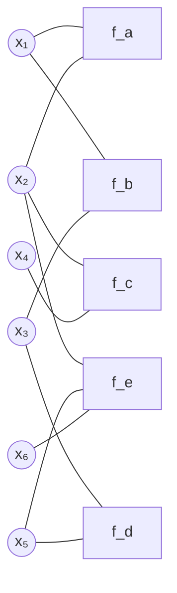
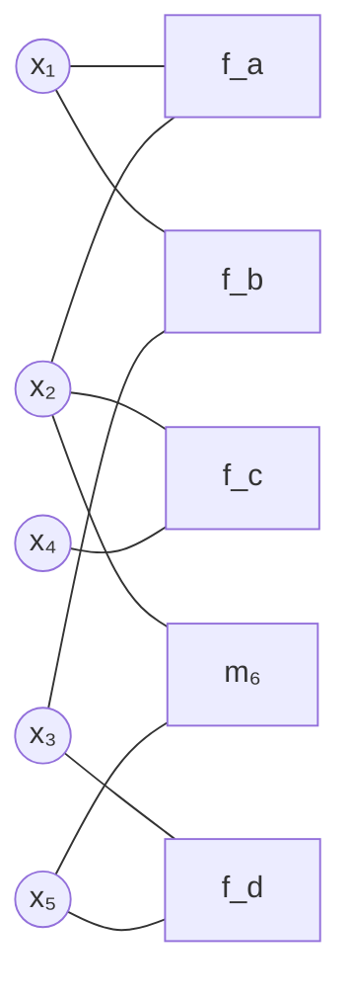

# Définition

L'élimination de variables calcule la loi marginale d'une variable d'un [[Graphe de facteurs]] sans jamais former le produit complet de tous les facteurs : les variables sont sommées une par une, par sommes partielles successives.

Dans un produit de facteurs, une variable $x_j$ ne peut être sommée qu'avec les facteurs qui la contiennent. Les facteurs qui n'en dépendent pas sont constants par rapport à cette somme et en sortent ; la somme partielle des autres forme un nouveau facteur, appelé message et noté $m_j$, qui ne dépend plus que des variables restantes de ces facteurs et qui les remplace dans le produit.

Éliminer revient donc à factoriser le calcul selon la structure du graphe : chaque étape ne fait intervenir que les facteurs voisins de la variable traitée, et le résultat est un facteur dont la portée est réduite d'une variable.

# Exemple

Six variables $x_1, \dots, x_6$, cinq facteurs $f_a$ à $f_e$, et la loi jointe

$$\mathbb{P}[\mathbf{x}] = \frac{1}{Z} f_a(x_1, x_2) f_b(x_1, x_3) f_c(x_2, x_4) f_d(x_3, x_5) f_e(x_2, x_5, x_6)$$

Le [[Graphe de facteurs|graphe de facteurs]] associé relie chaque facteur aux variables dont il dépend.

On cherche la loi marginale de $x_1$, c'est-à-dire le produit sommé sur les cinq autres variables :

$$\mathbb{P}[x_1] \propto \sum_{x_2} \dots \sum_{x_6} f_a(x_1, x_2) f_b(x_1, x_3) f_c(x_2, x_4) f_d(x_3, x_5) f_e(x_2, x_5, x_6)$$

## Élimination de $x_6$

Seul $f_e$ dépend de $x_6$ : la somme sur $x_6$ isole ce facteur et le transforme en un message sur ses deux variables restantes,

$$m_6(x_2, x_5) = \sum_{x_6} f_e(x_2, x_5, x_6)$$

que l'on substitue dans le produit :

$$\mathbb{P}[x_1] \propto \sum_{x_2} f_a(x_1, x_2) \sum_{x_3} f_b(x_1, x_3) \sum_{x_4} f_c(x_2, x_4) \sum_{x_5} f_d(x_3, x_5) m_6(x_2, x_5)$$

Dans le graphe de facteurs, le sommet $x_6$ disparaît et $f_e$ est remplacé par $m_6$, qui ne relie plus que $x_2$ et $x_5$.

## Élimination de $x_5$

La somme sur $x_5$ porte à présent sur $f_d$ et sur le message $m_6$ ; elle définit

$$m_5(x_2, x_3) = \sum_{x_5} f_d(x_3, x_5) m_6(x_2, x_5)$$

Le message obtenu dépend de $x_3$, par $f_d$, et de $x_2$, apportée par $m_6$. Le produit devient

$$\mathbb{P}[x_1] \propto \sum_{x_2} f_a(x_1, x_2) \sum_{x_3} f_b(x_1, x_3) \sum_{x_4} f_c(x_2, x_4) m_5(x_2, x_3)$$

## Élimination de $x_4$

L'ordre retenu traite $x_4$ avant $x_3$, ce qui est loisible puisque ces deux variables n'apparaissent dans aucun facteur commun. Le facteur $f_c$ ne dépend que de $x_2$ et de $x_4$, d'où

$$m_4(x_2) = \sum_{x_4} f_c(x_2, x_4)$$

et

$$\mathbb{P}[x_1] \propto \sum_{x_2} f_a(x_1, x_2) m_4(x_2) \sum_{x_3} f_b(x_1, x_3) m_5(x_2, x_3)$$

## Élimination de $x_3$

Les deux facteurs restants en $x_3$ sont $f_b$ et $m_5$ :

$$m_3(x_1, x_2) = \sum_{x_3} f_b(x_1, x_3) m_5(x_2, x_3)$$

d'où

$$\mathbb{P}[x_1] \propto \sum_{x_2} f_a(x_1, x_2) m_4(x_2) m_3(x_1, x_2)$$

## Élimination de $x_2$ et résultat

Il ne reste qu'une variable à sommer, avec les trois facteurs qui en dépendent :

$$m_2(x_1) = \sum_{x_2} f_a(x_1, x_2) m_4(x_2) m_3(x_1, x_2)$$

Si bien que la loi marginale cherchée est, à normalisation près,

$$\mathbb{P}[x_1] \propto m_2(x_1)$$

À chaque étape, le calcul ne manipule que les facteurs où figure la variable traitée : chaque message ne dépend que des variables restantes des facteurs sommés, et la dernière étape fournit directement la loi de $x_1$.

# Remarque

L'idée est donc d'éliminer les variables de proche en proche, en enchaînant des sommes partielles : le processus itératif décompose la complexité du calcul.

Deux difficultés subsistent.

- Choisir un ordre d'élimination adéquat est loin d'être trivial en général : sur un graphe quelconque, ce choix est un problème NP-difficile.
- Il faut une procédure d'élimination spécifique pour chaque variable, sans réutilisation directe du travail d'une variable à l'autre.

Si certaines variables sont observées, l'algorithme reste valable : la somme portant sur une telle variable est remplacée par une valeur unique, celle qu'elle prend dans les données.

L'élimination de variables est le principe de base de l'inférence exacte dans un [[Inférence dans un modèle graphique|modèle graphique]] ; l'[[Algorithme somme-produit]] en est la forme organisée sur les arbres, dont le [[Passage de messages sur une chaîne]] est le cas d'une chaîne et l'[[Inférence par arbre de jonction]] l'application à un [[Arbre de jonction]].
