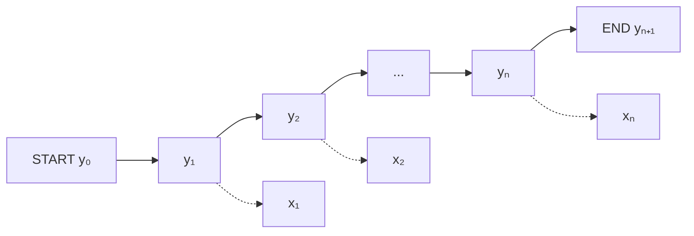

# Exemple

En étiquetage morphosyntaxique, chaque mot $x_s$ d'une séquence $x = (x_1, \dots, x_n)$ reçoit une étiquette $y_s$ indiquant sa catégorie grammaticale : nom (NOUN), nom propre (PROPER_NOUN), salutation (SALUTATION), et ainsi de suite. Une fonction de traits d'une telle séquence évalue une position $s$ à partir de l'étiquette courante $y_s$, de l'étiquette précédente $y_{s-1}$ et de l'observation $x$ entière, sous la forme $f(y_{s-1}, y_s, x, s)$.

Trois traits binaires, évalués à la position $s$ :

- $y_s$ vaut NOUN et $x_s$ commence par une majuscule ;
- $x_{s-1}$ vaut « Mr » et $y_s$ vaut PROPER_NOUN ;
- $y_{s-1}$ vaut SALUTATION et $y_s$ vaut PROPER_NOUN.

Le premier s'écrit comme produit de deux indicatrices, l'une portant sur l'étiquette, l'autre sur l'orthographe du mot :

$$f(y_{s-1}, y_s, x, s) = \mathbb{1}[y_s = \text{NOUN}] \cdot \mathbb{1}[\text{capitalisé}(x_s)]$$

Les deux autres suivent la même construction : un test sur l'étiquette courante, combiné à un test sur le mot précédent pour le deuxième, à un test sur l'étiquette précédente pour le troisième.

# Interprétation

Les trois traits lisent des informations de nature différente :

- le premier combine l'étiquette courante et l'orthographe du mot courant, sans contexte : un mot capitalisé est candidat à l'étiquette de nom ;
- le deuxième combine l'étiquette courante et le mot de gauche : un titre de civilité annonce un nom propre à sa droite ;
- le troisième ne regarde que les deux étiquettes voisines : une salutation impose un nom propre ensuite, quels que soient les mots eux-mêmes.

Un trait peut donc mêler observation locale et étiquettes, et dépendre à la fois de $y_{s-1}$ et de $y_s$. La dépendance aux étiquettes reste locale, portant sur deux étiquettes voisines au plus et jamais sur l'étiquetage $y$ tout entier : c'est l'analogue de la [[Propriété de Markov]] des modèles de Markov cachés, et c'est ce qui rend le décodage tractable dans un [[Champ aléatoire conditionnel à chaîne linéaire]].

# Remarque

Les extrémités de la séquence n'ont pas de voisin naturel. On pose deux étiquettes de bord, jamais prédites, qui rendent le voisinage de chaque position complet :

- $y_0 = \text{START}$, étiquette à gauche de la première position ;
- $y_{n+1} = \text{END}$, étiquette à droite de la dernière position.

Ainsi un trait dépendant de $y_{s-1}$ est défini dès $s = 1$, et un trait dépendant de $y_{s+1}$ l'est jusqu'à $s = n$.

Un trait peut également lire toute l'observation $x$ et pas seulement le voisinage de la position $s$ : la restriction à deux étiquettes voisines porte sur les étiquettes, pas sur les mots. Chaque trait est ensuite évalué à chaque position et sommé sur la séquence, comme le décrit la [[Décomposition positionnelle des fonctions de traits]] ; le cadre général de ces traits pour des séquences est présenté dans [[Fonctions de traits pour les séquences]].

Dans les boîtes à outils usuelles, ces traits ne sont pas écrits un par un mais engendrés à partir de gabarits, ce qui les rend systématiques et adaptés à l'annotation BIO ; voir [[Gabarits de traits et annotation BIO]].
